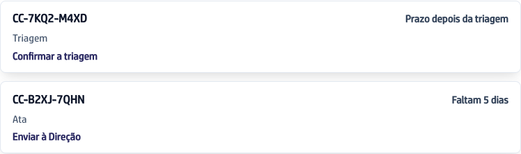
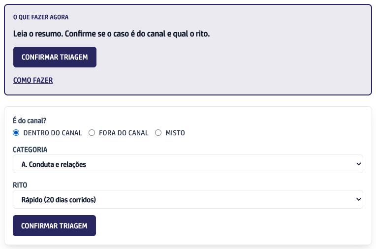
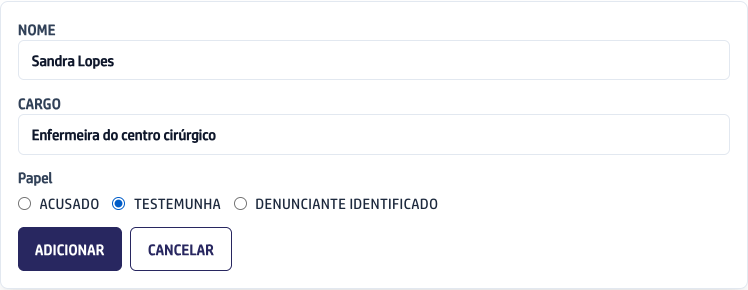
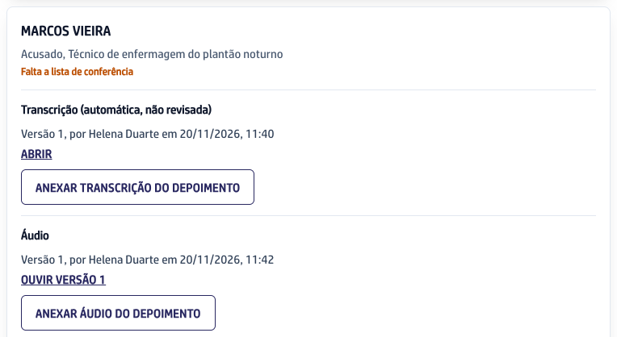
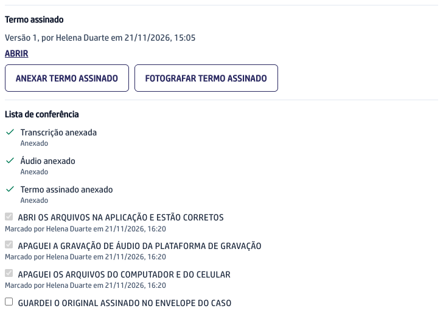
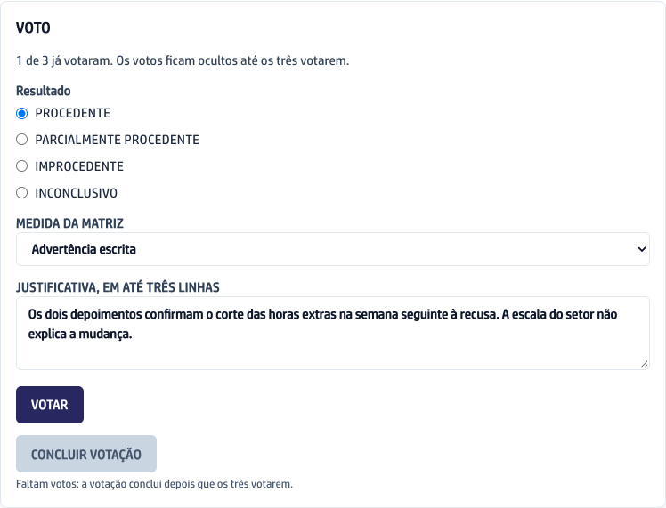
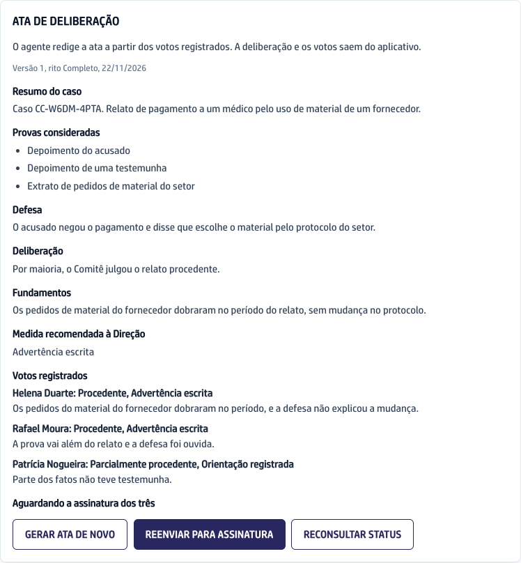
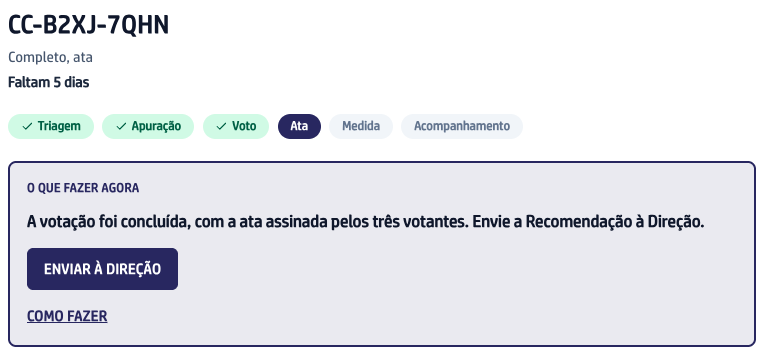

No Canal de Conduta, quem trabalha no hospital relata conduta grave, como assédio, fraude ou desvio, quase sempre sem se identificar. O Comitê de Conduta lê cada relato, apura o caso e recomenda a medida à Direção.

Esta página é para quem trata os casos: a coordenação, o membro e o segundo leitor do Comitê. Você só abre os casos em que está designado, depois de assinar o Termo de Confidencialidade e Posse. Quem é citado num caso nunca o vê, e o super admin não abre caso nenhum. A página pública, onde a pessoa relata e acompanha pelo protocolo, se explica sozinha.

Quando um caso precisa de você, chega um e-mail com a frase **Há uma tarefa no Canal de Conduta.** O link leva à tela **Minha vez**, que mostra só o que depende de você, do prazo que vence antes ao que vence depois. Em toda tela do Comitê, o botão **Guia do rito** explica cada rito.

## O caminho de um relato

Passe o mouse num passo para ver o detalhe, ou clique em **Percorrer** para andar um passo por vez. O prazo de todo rito conta do dia em que o relato foi enviado, nunca da triagem.

```fluxograma
inicio relato 1,1: O relato chega | Pela página pública do Canal, sem login, ou pela Ouvidoria, quando o ouvidor sinaliza o caso. O caso ganha um protocolo sorteado.
decisao direcao 2,1: Envolve a Direção ou a família? | A pergunta é o passo 3 do relato. Quem responde Sim vai direto à Rota Especial, e nem a coordenação vê o caso.
passo triagem 3,1: Triagem | A coordenação diz se o caso é do canal, a categoria e o rito. O segundo leitor confere ou contesta.
decisao rito 4,1: Qual rito?
passo encaminhamento 5,1: Encaminhamento | Assunto de fora do canal, como salário ou escala. Prazo: 5 dias úteis.
passo rapido 5,2: Rito Rápido | A regra geral, sem risco de demissão. A coordenação e um membro apuram. Prazo: 20 dias corridos.
passo completo 5,3: Rito Completo | Assédio sexual, violência, fraude ou risco de justa causa. Dois apuradores convidados conduzem. Prazo: 30 dias corridos, prorrogável uma vez por mais 30.
passo especial 3,4: Rota Especial | Um grupo sem nenhum diretor apura e escolhe a autoridade que recebe o parecer. Prazo: 60 dias corridos.
fim parecer 4,4: Parecer entregue | O grupo registra na tela a quem entregou e em que data.
fim encaminhado 6,1: Encaminhado | A coordenação envia a resposta padrão, que diz para onde levar o assunto.
passo apuracao 6,2: Apuração | Os depoimentos, sempre em dupla, e o relatório de uma página.
passo voto 7,2: Voto e ata | Os três votantes votam, com o voto oculto até todos votarem, e assinam a ata.
decisao procedente 8,2: Procedente?
passo medida 9,2: A Direção decide | O Presidente lê a Recomendação e a diretoria executiva registra a decisão sobre a medida.
fim retorno 10,3: Retorno a quem relatou | A coordenação aprova a resposta, que aparece na página de acompanhamento.

relato -> direcao
direcao -> especial: sim
direcao -> triagem: não
triagem -> rito
rito -> encaminhamento: fora
rito -> rapido
rito -> completo
encaminhamento -> encaminhado
rapido -> apuracao
completo -> apuracao
especial -> parecer
apuracao -> voto
voto -> procedente
procedente -> medida: sim
procedente -> retorno: não
medida -> retorno
```

## Confirmar a triagem

A triagem é da coordenação. Ela diz se o caso é do canal, a categoria e o rito, e o segundo leitor confere depois.

1. Abra o link do e-mail. Na tela **Minha vez**, clique no caso que diz **Confirmar a triagem**.



2. Leia o **Relato original**, no pé da tela do caso. Se o agente de triagem estiver ligado, confira também a sugestão dele.
3. Na caixa **O QUE FAZER AGORA**, clique em **CONFIRMAR TRIAGEM**.
4. Em **É do canal?**, escolha **Dentro do canal**, **Fora do canal** ou **Misto**. Na dúvida, se houver qualquer sinal de assédio, fraude ou retaliação, mantenha no canal.
5. Escolha a **Categoria** e o **Rito**. Caso fora do canal vai sempre ao Encaminhamento. Se parte do assunto é de fora, diga para onde ela vai.
6. Clique em **CONFIRMAR TRIAGEM**, no pé do formulário. O segundo leitor recebe a tarefa de conferir.



Se o segundo leitor discordar, ele contesta com o motivo em uma linha, e os três votantes decidem qual triagem vale. Se faltar informação, a coordenação pergunta a quem relatou pelas **Mensagens** do caso.

## Registrar um depoimento

Na Apuração, cada pessoa ouvida ganha um cartão. A conversa é sempre em dupla, gravada na plataforma de gravação do hospital, e os arquivos entram no cartão depois.

1. Abra o caso. Na caixa **O QUE FAZER AGORA**, clique em **ADICIONAR PESSOA A OUVIR**.
2. Escreva o **Nome** e o **Cargo** da pessoa e escolha o **Papel**: acusado, testemunha ou denunciante identificado.
3. Clique em **ADICIONAR**. O cartão da pessoa aparece em **Depoimentos**.



4. Se quiser, clique em **SUGERIR ROTEIRO DE PERGUNTAS** antes da conversa. O roteiro é só uma sugestão.
5. Depois da conversa, clique em **ANEXAR TRANSCRIÇÃO DO DEPOIMENTO** e em **ANEXAR ÁUDIO DO DEPOIMENTO**. Cada arquivo tem o seu botão.
6. Clique em **REDIGIR TERMO**, preencha a data, a hora, o local e as duas pessoas que conduziram, e revise o termo que o agente redigiu.



Se a pessoa não aceitar gravação, clique em **A PESSOA NÃO ACEITOU GRAVAÇÃO**, escreva o motivo e os pontos da conversa. O termo assinado continua obrigatório. O depoimento só conclui com os sete itens da **Lista de conferência** marcados, e a Apuração só avança com todos os depoimentos concluídos.

## Arquivar o papel

O termo de declaração é assinado à caneta. A cópia entra no cartão, e o original em papel vai para o envelope do caso.

1. No cartão do depoimento, clique em **IMPRIMIR TERMO** e colha a assinatura da pessoa ouvida.
2. Clique em **ANEXAR TERMO ASSINADO** para mandar o PDF ou a foto. No celular, **FOTOGRAFAR TERMO ASSINADO** abre a câmera, uma foto por página.
3. Guarde o original assinado no envelope do caso, no local de guarda que a coordenação definiu nas **Configurações**.
4. Na **Lista de conferência**, marque **Guardei o original assinado no envelope do caso**. A marca guarda quem marcou e quando, e não se desmarca.
5. Com os sete itens marcados, clique em **CONCLUIR DEPOIMENTO**. O depoimento concluído não muda mais.



Se a pessoa se recusar a assinar, clique em **REGISTRAR RECUSA DE ASSINATURA**: a certidão de recusa vai para a assinatura de dois membros.

## Votar

Na etapa Voto, cada um dos três votantes do caso (a coordenação, o membro e o segundo leitor) vota sozinho. O agente não redige voto nem justificativa.

1. Abra o caso e leia o dossiê: o relato, os depoimentos e o relatório da apuração.
2. Na caixa **O QUE FAZER AGORA**, clique em **VOTAR**.
3. Em **Resultado**, escolha procedente, parcialmente procedente, improcedente ou inconclusivo.
4. Se o resultado for procedente ou parcialmente procedente, escolha a **Medida da Matriz**.
5. Escreva a sua **Justificativa, em até três linhas**.
6. Clique em **VOTAR**. O voto não se troca depois.



O seu voto fica oculto até os três votarem. Sem maioria, o aplicativo convoca uma reunião curta e abre uma nova rodada. Procedente e parcialmente procedente só concluem com os sete itens da **Trava de robustez** confirmados.

## Assinar a ata

A ata de deliberação nasce depois que os três votaram e houve maioria. A deliberação e os votos saem do que foi registrado no aplicativo.

1. A coordenação clica em **GERAR ATA**. No rito Completo, antes disso, ela anexa a transcrição da reunião do Comitê.
2. Leia a ata. Os **Pontos a confirmar** são sugestão e não entram nela.
3. A coordenação clica em **ENVIAR PARA ASSINATURA**. Cada um dos três votantes recebe a ata no e-mail profissional, pela ClickSign.
4. Abra o e-mail da ClickSign e assine.
5. A assinatura volta sozinha para o caso. Se demorar, clique em **Reconsultar status**.



Com a ata assinada pelos três, a coordenação clica em **CONCLUIR VOTAÇÃO**. A ata assinada não muda mais e abre pelo botão **Abrir a ata assinada**.

## Enviar à Direção

Só o caso procedente ou parcialmente procedente vai à Direção. Improcedente e inconclusivo não saem do Comitê: a coordenação prepara o retorno direto.

1. Abra o link do e-mail. Na tela **Minha vez**, clique no caso que diz **Enviar à Direção**.
2. Confira a ata assinada pelos três votantes.
3. Na caixa **O QUE FAZER AGORA**, clique em **ENVIAR À DIREÇÃO**.



O Presidente e a diretoria executiva recebem a Recomendação do Comitê, com a página de conclusão e a ata assinada, no item **Recomendações do Comitê** do menu. Eles não abrem o caso. O Presidente só lê, e a diretoria executiva registra a decisão dele sobre a medida. Registrada a decisão, a coordenação clica em **GERAR RETORNO**, revisa a resposta a quem relatou e a comunicação ao acusado e clica em **APROVAR RETORNO**.
