Aqui a conta do MV é conferida antes de ir para a operadora. Quem envia sobe o PDF da conta e o do prontuário. O app compara um com o outro, pelas regras da operadora, e monta o Guia: a lista do que corrigir no MV, dia a dia. A faturista pega a conta na Fila, corrige no MV e marca cada item.

## O caminho de uma conta

Toda conta anda pela **Esteira**, a faixa no alto da tela de contas. Ela tem cinco etapas, cada uma com o número de contas que estão nela. Clique numa etapa para ver a lista dela embaixo.

- **Envios**: as contas enviadas que o app ainda está lendo ou que esperam um arquivo.
- **Fila**: as contas prontas que ninguém pegou, na ordem de envio.
- **Em análise**: as contas que uma faturista pegou e ainda não concluiu.
- **Concluídas**: as contas que a faturista concluiu e ainda não arquivou, separadas por mês.
- **Arquivadas**: as contas que já foram tratadas no MV e saíram da Esteira.

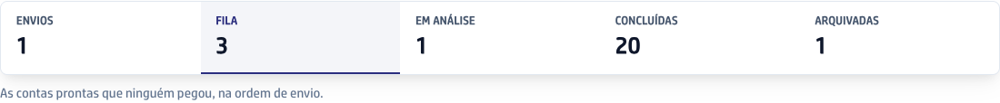

Passe o mouse num passo para ver o detalhe, ou clique em **Percorrer** para andar um passo por vez.

```fluxograma
inicio envio 1,1: Enviar a conta e o prontuário | Quem envia solta os dois PDFs exportados do MV na tela. O app lê o tipo e o atendimento dentro de cada arquivo, e a conta aparece em Envios.
decisao dois 2,1: Chegaram os dois arquivos?
passo falta 2,2: Mandar o arquivo que falta | O cartão fica em Envios com o quadro tracejado do arquivo que falta e o botão para mandar só ele.
passo analise 3,1: O app analisa a conta | Ele lê a conta e o prontuário, confere com as regras da operadora e monta o Guia. Quem enviou acompanha em Envios.
decisao certo 4,1: A análise deu certo?
passo erro 4,2: Enviar de novo | O cartão mostra o erro, o botão Enviar de novo e o Copiar para a TI, que leva o código do erro para quem vai olhar.
passo fila 5,1: A conta entra na Fila | Com o Guia pronto, a conta vai para a Fila, que é a mesma para todas as faturistas, em ordem de envio.
passo pegar 6,1: A faturista pega a conta | O botão Pegar abre a conta e faz dela a dona. A conta passa para Em análise. Se duas pegam juntas, só uma fica com a conta.
passo guia 7,1: Corrigir no MV pelo Guia | Cada item diz o que corrigir. A faturista corrige no MV e marca Feito, Não procede ou Bloqueado. O que o Guia não apontou vai no Faltou isto.
passo concluida 8,1: Análise concluída | Concluir e abrir a próxima. A conta vai para Concluídas e entra na produção da faturista, e o que ficou em validação segue para a gestão.
passo arquivar 9,1: Arquivar a conta | Depois de tratar a conta no MV, a faturista arquiva, uma a uma ou o mês inteiro. A conta sai da Esteira.
decisao retorno 10,1: A Validação mandou um Retorno?
fim arquivada 11,1: A conta fica em Arquivadas | A busca continua achando a conta, e Desarquivar devolve ela para Concluídas.

envio -> dois
dois -> analise: sim
dois -> falta: não
falta -> analise
analise -> certo
certo -> fila: sim
certo -> erro: não
erro -> analise
fila -> pegar
pegar -> guia
guia -> concluida
concluida -> arquivar
arquivar -> retorno
retorno -> arquivada: não
retorno -> guia: sim, Retorno
```

Quando a gestão decide um item em validação e manda o **Retorno**, a conta volta sozinha para a Esteira, mesmo arquivada, e a faturista que a concluiu corrige no MV o que a gestão decidiu.

## Enviar uma conta

1. No menu da esquerda, clique em **Contas médicas**.
2. Exporte do MV o PDF da conta e o PDF do prontuário do atendimento.
3. Clique em **Enviar contas**, no alto da tela. Abre o quadro **Arraste aqui a conta e o prontuário do MV**.
4. Arraste os dois arquivos para o quadro, ou clique em **Selecionar arquivos** e escolha os PDFs. Também dá para soltar os arquivos em qualquer ponto da tela. Pode mandar vários atendimentos de uma vez, sem renomear: até 10 atendimentos e 30 arquivos por envio.

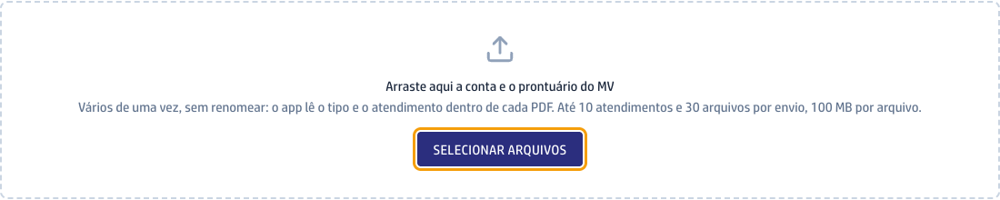

5. Logo abaixo, o quadro **Último envio** diz o que entrou de cada atendimento e o que foi recusado, com o motivo.
6. Acompanhe a conta na etapa **Envios** da Esteira. Cada atendimento vira um cartão com um quadro para a Conta e outro para o Prontuário: verde o que chegou, tracejado o que falta.
7. Se faltou um arquivo, clique no botão do quadro tracejado e mande só ele.

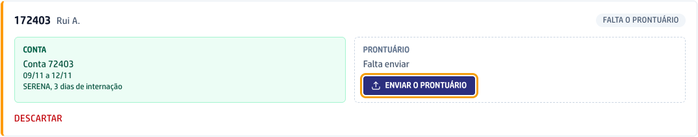

Quando a análise termina, o cartão sai de Envios e aparece o aviso de que o atendimento foi para a Fila. Se a análise deu erro, o cartão fica vermelho, com **Enviar de novo** e **Copiar para a TI**.

## Pegar uma conta da Fila

A Fila é a mesma para todas as faturistas e anda na ordem de envio, nunca pelo valor da conta.

1. Em Contas médicas, clique na etapa **Fila** da Esteira.
2. Na linha da conta, clique em **Pegar**. Comece pela primeira da lista.

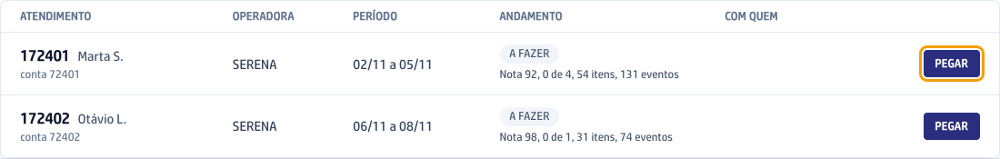

3. A conta abre e, nesse clique, passa a ser sua: sai da Fila e vai para **Em análise**, com o seu nome. No alto ficam o número do atendimento, o paciente, a conta, a operadora e o período, e logo abaixo os três números: **Nota de entrada**, **R$ a ajustar** e **Itens feitos**.

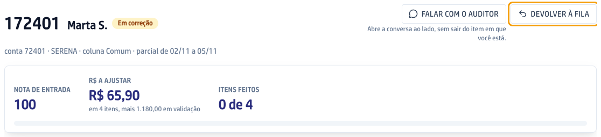

4. Se você não vai terminar a conta, clique em **Devolver à fila**, no alto. Ela volta para a Fila, livre, e as marcações que você já fez ficam.
5. Para voltar a uma conta que você pegou, clique em **Continuar**: ele aparece no quadro **Continue de onde parou**, no alto da Fila, e na linha da conta em Em análise.

## Analisar a conta no Guia

A conta aberta mostra a **Mesa de trabalho**: à esquerda a lista dos itens, agrupados por dia e setor, e à direita o item da vez, o que você está corrigindo agora. Cada item começa pelo que fazer no MV: **Incluir**, **Ajustar quantidade**, **Retirar** ou **Corrigir preço**.

1. Leia o item da vez: o nome, a quantidade, o valor e o motivo. Clique no código para copiar e colar no MV. A **Evidência** mostra a página do prontuário e o trecho que justificam o item.
2. Corrija no MV e marque o item:
   - **Feito**, quando você corrigiu;
   - **Não procede**, quando o item está errado. Escolha o motivo e clique em **Confirmar**;
   - **Bloqueado**, quando o MV não deixou lançar, por falta de cadastro ou de preço.

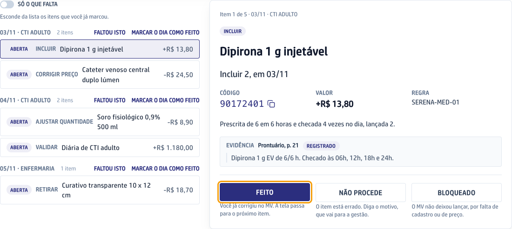

3. Marcado, o app passa sozinho para o próximo item. Para ver outro, clique nele na lista. Se errou, abra o item e clique em **Desfazer**. Quando corrigiu o dia inteiro, **Marcar o dia como feito** marca todos os itens dele de uma vez.
4. Ligue **Só o que falta**, no alto da lista, para esconder os itens que você já marcou.
5. O item **Validar** não tem botão: ele já foi para a validação da gestão.
6. No rodapé, escreva, se quiser, a **Observação para a gestão de contas médicas**.
7. Clique em **Concluir e abrir a próxima**. A conta vai para Concluídas, entra na sua produção, e a próxima da Fila já abre. Dá para concluir com item sem marcação: o app pergunta antes, e os itens em validação e os bloqueados seguem para a gestão.

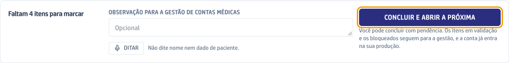

## Pedir o que faltou

Use quando um item foi usado no atendimento, está no prontuário e o Guia não apontou.

1. Na lista da conta, ao lado do dia, clique em **Faltou isto**. A conversa **Falar com o auditor** abre ao lado, já com esse dia escolhido, sem tirar o item da vez da tela.
2. Escreva o **Item que faltou** e a **Página do prontuário** onde ele aparece.
3. Se quiser, escreva a sua pergunta na mensagem para o auditor.
4. Clique em **Perguntar ao auditor**. Ele lê o dia e responde por que o Guia não achou o item e de onde veio a falha.

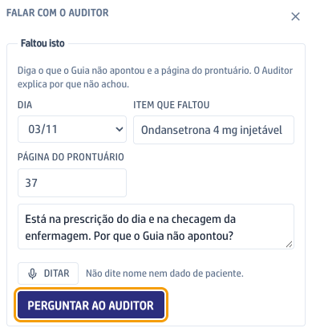

5. Quando a resposta diz que a falha é do sistema ou de uma página que não foi lida, aparece **Abrir o pedido para a Tecnologia**. Clique nele para mandar o caso para correção.

O botão **Falar com o auditor**, no alto da conta, abre a mesma conversa a qualquer momento.

## Achar uma conta

A busca procura em todas as etapas, inclusive nas Arquivadas, e diz onde a conta está e com quem.

1. Na tela de contas, clique no campo **Número do atendimento ou nome do paciente**, no alto.
2. Digite o número do atendimento ou o nome do paciente. A busca começa no segundo caractere, sem precisar de acento nem de maiúscula.
3. As contas achadas aparecem no lugar da Esteira, com o trecho que você digitou marcado em amarelo.
4. Quando só uma conta casa, ela aparece em destaque, com **Onde está** e **Com quem**, e o botão que cabe a você: **Pegar** na conta livre, **Continuar** na sua em análise, **Abrir** na que você pode abrir. A conta que está com outra faturista aparece sem botão, porque só ela pode abrir.

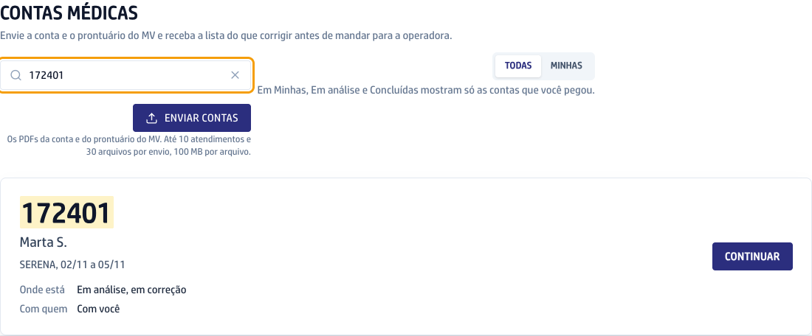

5. Para voltar para a Esteira, clique no **X** do campo ou aperte **Esc**.

## Arquivar as contas do mês

Arquivar tira a conta concluída da Esteira e leva para **Arquivadas**. Arquivar quer dizer que a conta já foi tratada no MV. A conta arquivada continua no Painel e na busca, e nada nela muda.

As contas ficam separadas pela Competência: o mês do fim do período da conta. Você arquiva as contas que concluiu; quem tem o painel completo arquiva as de todas.

Para arquivar uma a uma:

1. Clique na etapa **Concluídas** da Esteira. As contas aparecem por mês, o mais recente em cima.
2. Na linha da conta, clique em **Arquivar**. A conta sai da lista e aparece o aviso de que foi arquivada.

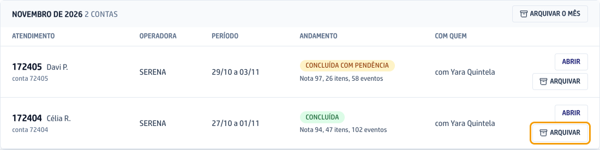

Para arquivar o mês inteiro:

3. No cabeçalho do mês, clique em **Arquivar o mês**.
4. O app pergunta antes, na própria lista: quantas contas vão e quantas têm pendência. O lote leva também as concluídas com pendência.
5. Clique em **Arquivar** com o número de contas para confirmar, ou em **Cancelar**.

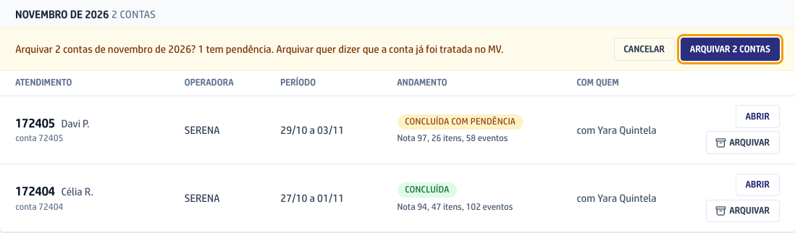

Para desarquivar:

6. Clique na etapa **Arquivadas** da Esteira.
7. Na linha da conta, clique em **Desarquivar**. A conta volta para Concluídas.

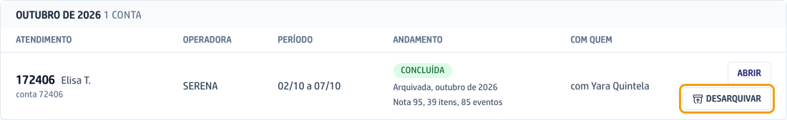

## Ligar e desligar as legendas

As legendas são as frases curtas, em cinza, que explicam a tela e cada botão. Quem já conhece a tela pode desligar, para ela ficar mais limpa.

1. Em Contas médicas, olhe o canto direito, ao lado das abas: lá fica o interruptor **Legendas**.
2. Clique nele para desligar. As legendas somem de todas as telas de Contas médicas.

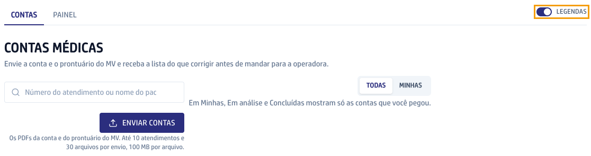

3. Clique de novo para ligar. O app lembra a sua escolha neste navegador, até você mudar.
