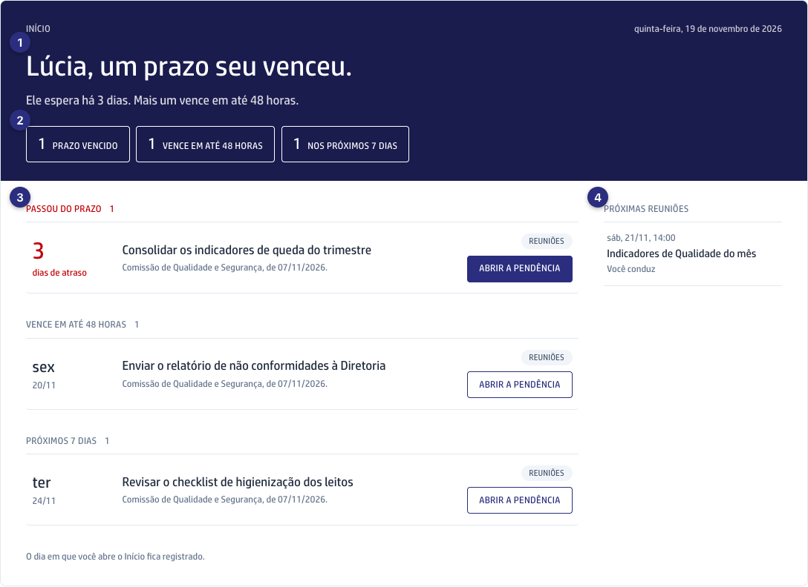
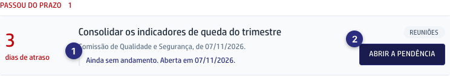
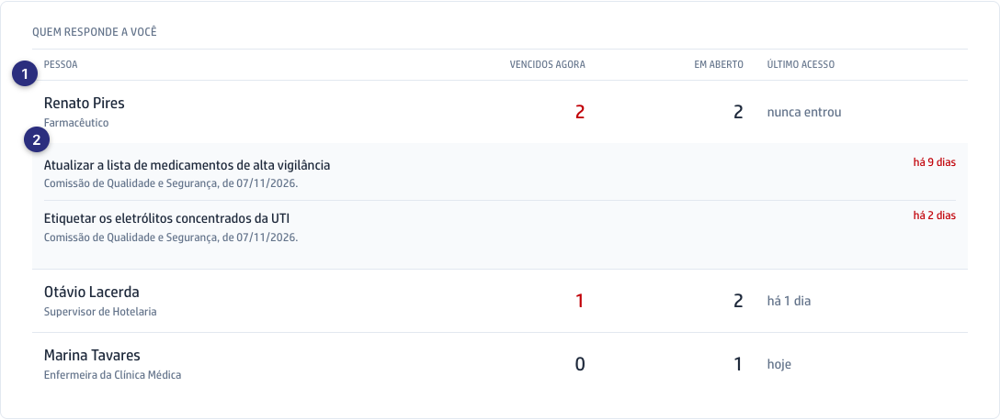
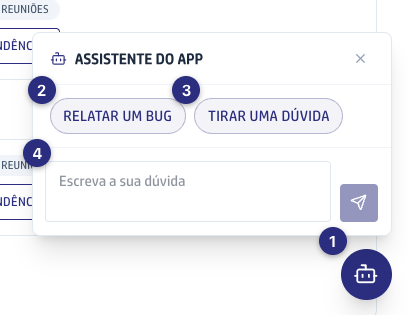

O Início é a primeira tela depois de entrar no app. Ele junta numa lista só o que você tem para entregar em todos os módulos (Pendências, Atas, POPs, casos da Ouvidoria, contas e o que o Núcleo pede), com o que venceu em primeiro lugar. Cada linha leva à tela onde o item se resolve.

Os números nas imagens mostram onde olhar ou clicar em cada passo.

## O caminho no Início

Passe o mouse num passo para ver o detalhe, ou clique em **Percorrer** para andar um passo de cada vez.

```fluxograma
inicio entrar 1,1: Entrar no app | Entre com o seu e-mail e a sua senha. O app abre no Início. De qualquer tela, o item Início, no alto do menu, traz você de volta.
passo frase 2,1: Ler a frase do topo | A frase diz quantos prazos seus venceram e há quanto tempo o mais antigo espera. Com prazo vencido, a faixa do topo fica escura.
decisao tem 3,1: Tem item na Minha Fila?
fim emdia 3,2: Você está em dia | A frase diz que você está em dia e mostra o próximo prazo. Não há nada para abrir agora.
passo item 4,1: Abrir o item | Comece pelo grupo Passou do prazo. O botão da linha diz o que fazer, como Abrir a Pendência ou Assinar a Ata.
decisao clique 5,1: Resolve com um clique?
passo direto 5,2: Confirmar ali mesmo | Alguns itens se resolvem sem sair do Início, como a presença numa capacitação do Núcleo. A linha sai da lista na hora.
passo modulo 6,1: Resolver na tela do módulo | O botão abre a tela do módulo já no item: a Pendência no Kanban, a Ata da Reunião, o POP na etapa, o caso da Ouvidoria.
fim volta 7,1: A linha sai do Início | Quando o item é entregue no módulo, ele sai da sua lista. A frase e os números do topo são refeitos.

entrar -> frase
frase -> tem
tem -> item: sim
tem -> emdia: não
item -> clique
clique -> direto: sim
clique -> modulo: não
modulo -> volta
direto -> volta
```

## Ver o que tenho para entregar

1. Entre com o seu e-mail e a sua senha. O app abre no **Início**. Para voltar a ele de qualquer tela, clique em **Início**, no alto do menu da esquerda.
2. Leia a frase do topo (1). Ela diz quantos prazos seus venceram e há quanto tempo o mais antigo espera. Enquanto houver prazo vencido, a faixa do topo fica escura e o número de vencidos aparece no título da aba do navegador.
3. Logo abaixo, os três números (2) contam os prazos vencidos, os que vencem em até 48 horas e os dos próximos 7 dias. Clique num deles para descer até o grupo.
4. A **Minha Fila** vem em grupos, do mais urgente para o mais distante: **Passou do prazo** (3), **Vence em até 48 horas**, **Próximos 7 dias** e **Sem prazo**. No vencido, a coluna da esquerda mostra os dias de atraso em vermelho; nos outros, o dia do prazo.
5. Cada linha diz o que é, de onde veio (a Reunião, o POP, o caso) e, na etiqueta, o módulo.
6. À direita ficam as **Próximas Reuniões** (4) em que você é Facilitador ou participante, com dia e hora. Clique numa para abrir a Reunião.



Quando nada está vencido, a frase diz que você está em dia e mostra o próximo prazo. Se você cuida de uma fila do seu papel, como a da Ouvidoria, ela aparece num bloco à parte, **Fila do papel**, com o botão **Abrir a fila**.

## Abrir um item da Minha Fila

1. Comece pelo grupo **Passou do prazo** e passe o mouse na linha. Ela ganha fundo, e aparece a linha de contexto (1), com o andamento e o dia em que o item abriu.
2. Clique no botão da linha (2). Ele diz o que fazer: **Abrir a Pendência**, **Assinar a Ata**, **Revisar a Ata**, **Responder**, **Abrir o Guia**.



3. O app abre a tela do módulo já no item: a Pendência destacada no Kanban, a Reunião com a Ata, o POP na sua etapa, o caso da Ouvidoria, a conta no Guia.
4. Resolva o item lá, como você já faz no módulo. Depois clique em **Início**, no menu, para voltar à sua lista.
5. O item entregue sai do Início, e a frase e os números do topo são refeitos.

Alguns itens se resolvem sem sair do Início, como a presença numa capacitação do Núcleo. Nesses, o botão **Confirmar presença** confirma ali mesmo e a linha sai da lista.

## Acompanhar quem responde a você

Este bloco aparece embaixo da Minha Fila para quem acompanha outras pessoas. O Facilitador vê os responsáveis das Pendências das Reuniões que ele conduziu. O Super admin vê todas as pessoas com Pendência aberta.

1. No Início, desça até **Quem responde a você**. Cada linha é uma pessoa, pelo nome e pelo cargo.
2. Leia as colunas. **Vencidos agora** fica em vermelho quando a pessoa tem prazo vencido. **Em aberto** conta tudo o que ela ainda não entregou. **Último acesso** é o dia em que ela abriu o Início pela última vez: "hoje", "há 3 dias" ou "nunca entrou".
3. Clique na linha da pessoa (1). A lista do que venceu e não foi entregue abre ali mesmo (2), com a Reunião de onde cada item veio e há quantos dias venceu.
4. Clique na linha de novo para fechar.



O dia em que você abre o Início fica registrado, uma marca por dia, guardada por 90 dias. Só vê esse dia quem já acompanha os seus itens.

## Tirar uma dúvida ou relatar um bug no Assistente

O robô do Assistente do app fica no canto de baixo, à direita, em toda tela do app, para todo mundo. No celular, ele fica logo acima da barra de baixo.

1. Clique no robô (1). O painel do Assistente abre com duas sugestões: **Relatar um bug** (2) e **Tirar uma dúvida** (3).
2. Para tirar uma dúvida, clique em **Tirar uma dúvida** ou escreva direto no campo de baixo (4). Aperte Enter ou a seta para enviar. A resposta aparece no painel, e você pode perguntar de novo em seguida.



3. Para relatar um bug, clique em **Relatar um bug**. O robô faz uma pergunta por vez: em que tela aconteceu, o que aconteceu, o que você esperava e como fazer o problema acontecer de novo. Responda e clique na seta, ou clique em **Pular** se não souber.
4. Depois das perguntas, o robô pede um print da tela. Clique em **Escolher o print** e escolha a imagem, ou em **Não tenho print**. O print fica guardado só no aplicativo.
5. Confira o resumo. A pergunta que você pulou aparece como "não informado". Se estiver certo, clique em **Enviar à Vitta**.
6. Quando o envio dá certo, o robô diz que o bug foi enviado à Vitta. Clique em **Voltar** para ver as sugestões de novo.

O caminho do bug, da pergunta ao envio:

```fluxograma
inicio robo 1,1: Abrir o robô | Clique no robô, no canto de baixo, à direita. O painel abre com as sugestões Relatar um bug e Tirar uma dúvida.
decisao qual 2,1: Dúvida ou bug?
fim duvida 2,2: Tirar uma dúvida | Escreva no campo e envie. A resposta aparece no painel. A conversa não fica guardada: some quando a página recarrega.
passo perguntas 3,1: Responder as perguntas | Uma por vez: onde aconteceu, o que aconteceu, o que você esperava e como repetir. Pular também vale.
passo print 4,1: Mandar o print | Escolher o print ou Não tenho print. O print fica guardado só no aplicativo.
passo resumo 5,1: Conferir o resumo | A pergunta pulada aparece como "não informado".
passo enviar 6,1: Enviar à Vitta | O clique em Enviar à Vitta manda o relato.
decisao deu 7,1: O envio deu certo?
passo denovo 7,2: Tentar de novo | O painel mostra o motivo da falha. Nada é reenviado sem o seu clique em Tentar de novo.
fim enviado 8,1: Bug enviado | O robô agradece. Voltar mostra as sugestões de novo.

robo -> qual
qual -> perguntas: bug
qual -> duvida: dúvida
perguntas -> print
print -> resumo
resumo -> enviar
enviar -> deu
deu -> enviado: sim
deu -> denovo: não
denovo -> enviar
```

Para desistir no meio do relato, clique em **Cancelar o relato**. Fechar o painel no X também desiste. A conversa da dúvida não fica guardada: ela some quando a página recarrega.
