Aqui o hospital marca as reuniões, guarda a Ata de cada uma e acompanha as Pendências que saem delas. Quem conduz a reunião é o Facilitador: ele marca a data, anexa a transcrição depois, revisa a Ata e a manda para assinatura. Cada linha do quadro da Ata é uma Ação, uma Rotina ou um Processo. A Ação vira uma Pendência, com responsável e prazo; a Rotina se repete toda semana, quinzena ou mês; o Processo fica guardado como regra do setor.

Os números nas imagens mostram onde clicar em cada passo.

## Entrar no app e chegar ao painel de Reuniões

1. Entre com o seu e-mail e a sua senha. O app abre no **Início** (1), a sua tela, com o que você tem para entregar: as Pendências, as Atas para assinar e as próximas reuniões.
2. Para ir ao painel de Reuniões, clique em **Dashboard** (2). Ele fica no grupo **Reuniões e metas** do menu da esquerda, que já aparece aberto.
3. Para voltar ao Início de qualquer tela, clique em **Início**, no alto do menu, ou no logo do hospital.

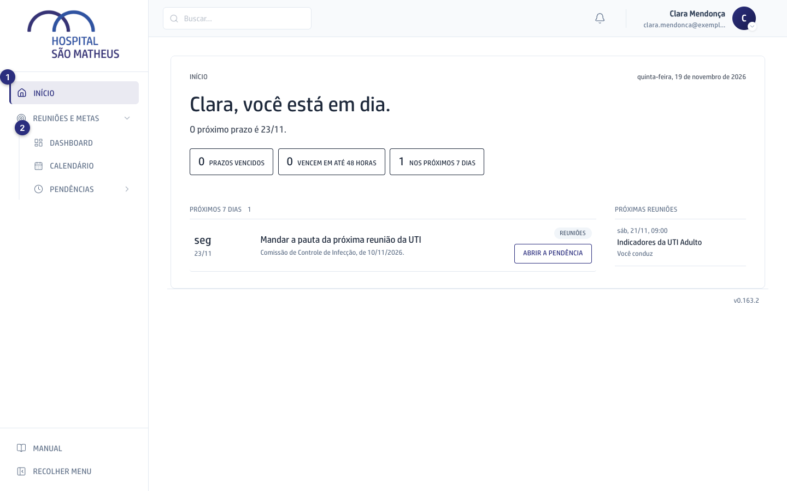

## Ver o que depende de você no Início

1. No alto do Início, uma frase (1) diz quantos prazos seus venceram e há quantos dias o mais antigo espera. Sem nada vencido, ela diz que você está em dia e qual é o seu próximo prazo.
2. Os três números logo abaixo (2) levam direto a cada parte da lista: **Passou do prazo**, **Vence em até 48 horas** e **Próximos 7 dias**.
3. A lista é a sua fila, do prazo mais vencido para o mais distante: as suas Pendências, as Atas que falta você assinar, as Contestações que esperam a sua resposta (3) e as Verificações das suas Rotinas.
4. Cada linha tem um botão que abre a tela onde aquilo se resolve. A Verificação de uma Rotina se marca ali mesmo, com **Realizada**.
5. Ao lado da lista ficam as suas próximas reuniões e as Rotinas do ciclo de agora.

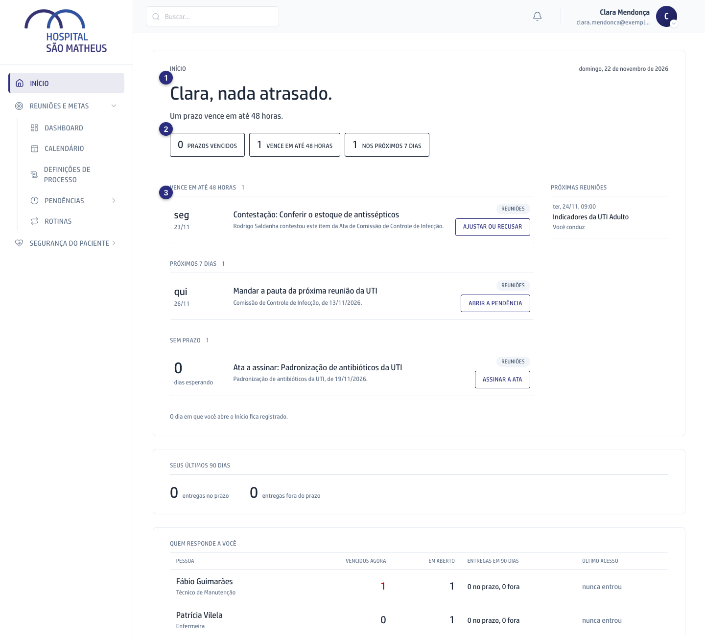

> O painel de Reuniões não tem lista própria do que depende de você: ela mora no Início, e o painel tem um link para lá.

## Ler o painel de Reuniões

O painel mostra os números das Pendências que você vê: as suas e, se você conduz reuniões, as delas.

1. No menu da esquerda, abra **Reuniões e metas** e clique em **Dashboard**.
2. Os cards do alto (1) mostram a conformidade, o que vence em 3 dias, as Atas paradas e as que aguardam assinatura. A seta ao lado do número compara com a segunda-feira anterior: verde é melhora, vermelho é piora.
3. **Status das Pendências** (2) mostra quantas estão pendentes, em progresso, concluídas, atrasadas e repactuadas. Clique numa fatia para abrir a lista só com elas.
4. **Pendências por Setor** (3) mostra a mesma divisão em cada setor. Clique numa barra para abrir a lista daquele setor.
5. **Evolução das atrasadas** (4) mostra as atrasadas das últimas 8 semanas, com o número guardado toda segunda.
6. Se você conduz alguma reunião, **Atrasos por setor** (5) mostra os atrasos dos últimos 90 dias no hospital inteiro e, ao lado, as reaberturas e as Rotinas não cumpridas.

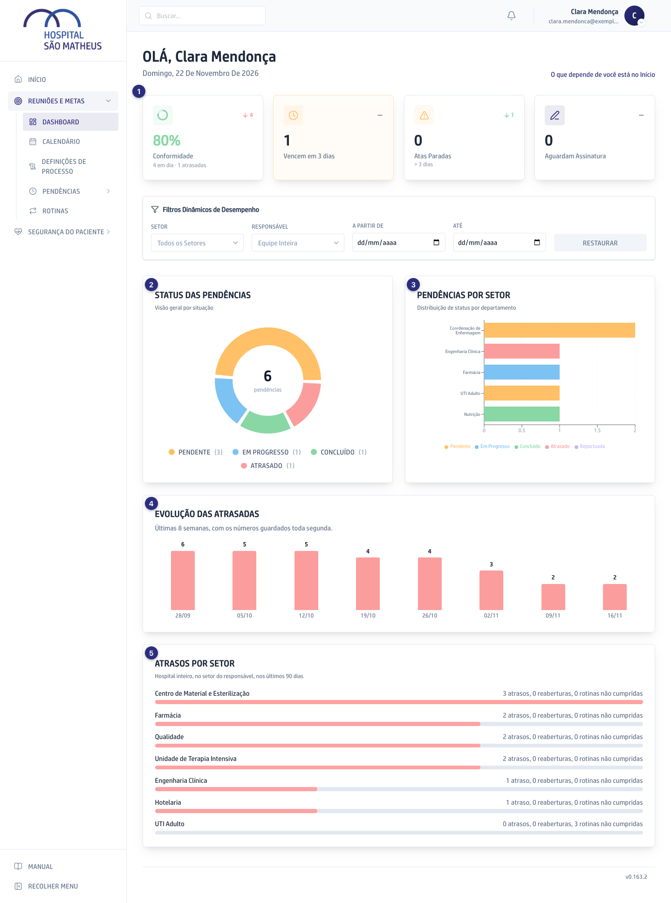

7. Quem administra o aplicativo vê também o **Ranking de atrasos**, com o nome de cada responsável: as vencidas agora (1), as repactuadas depois do prazo, as concluídas com atraso, o total de atrasos (2), as reaberturas e as Rotinas não cumpridas (3). A Rotina não cumprida é o ciclo marcado como Não realizada, marcado depois do prazo ou que terminou sem marcação.

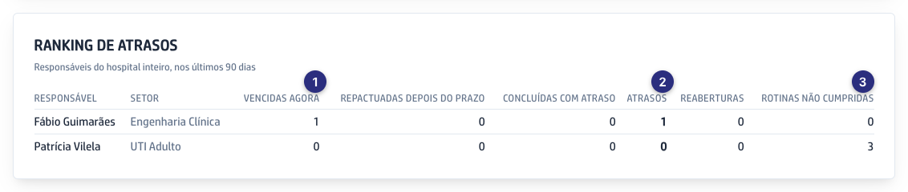

## O caminho de uma reunião

Passe o mouse num passo para ver o detalhe, ou clique em **Percorrer** para andar um passo de cada vez.

```fluxograma
inicio marcar 1,1: Marcar a reunião | No Calendário, com data, horário e participantes.
passo transcricao 2,1: Anexar a transcrição | Depois da reunião, o arquivo com o texto do que foi falado.
passo ata 3,1: A IA escreve a Ata | Os assuntos, as decisões e o quadro, cada linha como Ação, Rotina ou Processo.
decisao certa 4,1: A Ata está certa?
passo corrigir 4,2: Solicitar correção | Você escreve o que mudar e a IA refaz a Ata.
decisao assinar 5,1: Vai com assinatura?
passo enviar 6,1: Enviar para assinatura | Cada participante recebe um e-mail para assinar, e as Pendências já nascem.
passo sem 6,2: Finalizar sem assinatura | A Ata fica aprovada na hora, sem assinatura digital.
passo assinada 7,1: Ata assinada | A assinatura registra que cada um leu a Ata.
fim pendencias 7,2: Pendências | Cada Ação vira uma Pendência, com responsável e prazo, cobrada desde o primeiro segundo.
marcar -> transcricao
transcricao -> ata
ata -> certa
certa -> corrigir: não
corrigir -> ata
certa -> assinar: sim
assinar -> enviar: sim
assinar -> sem: não
enviar -> assinada
enviar -> pendencias
sem -> pendencias
```

## Ver as reuniões do mês

1. No menu da esquerda, abra **Reuniões e metas** e clique em **Calendário** (1).
2. A tela abre no mês de hoje, com as reuniões marcadas em cada dia, na ordem do horário de início: a mais cedo vem primeiro. A cor do quadradinho mostra em que ponto a reunião está, e a legenda fica embaixo do calendário.
3. Para ir a outro mês, use as setas dos lados do nome do mês (2).
4. Para ver uma semana de cada vez, clique em **Semanal**. **Mensal** volta para o mês inteiro.
5. Clique no nome de uma reunião para abrir a página dela (3). Se o título não cabe no quadradinho, passe o mouse para ler inteiro.

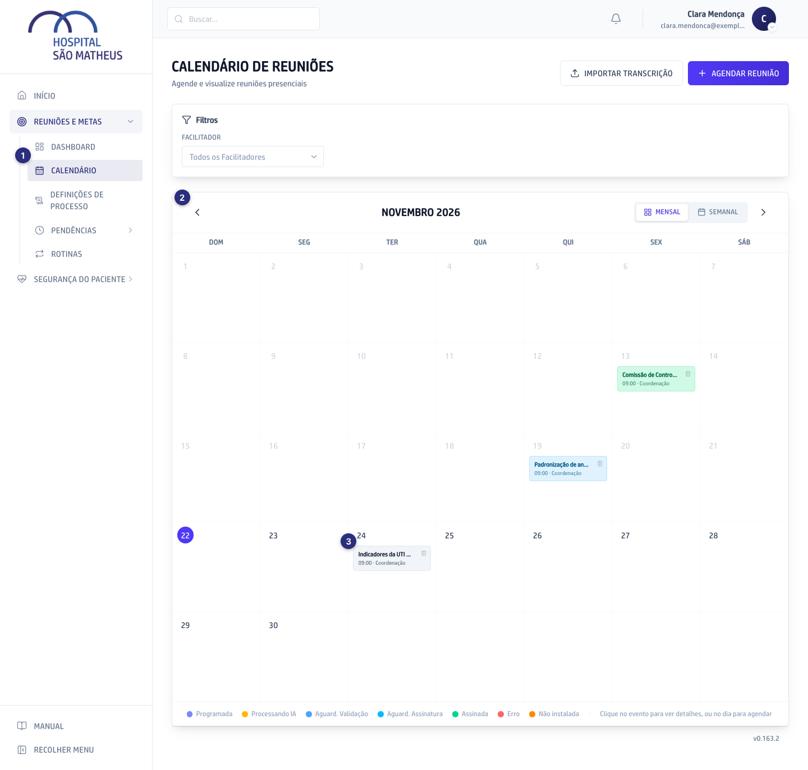

> As reuniões do Núcleo de Segurança do Paciente ficam no módulo **Segurança do Paciente**, em **Reuniões**. No Calendário elas só aparecem para quem tem acesso ao Núcleo.

## Marcar uma reunião

1. No **Calendário**, clique em **Agendar reunião**, no alto à direita. Se preferir, clique direto no dia da reunião: a janela já abre com a data.
2. Escreva o **Título** (1) e confira a **Data**. Escolha o **Tipo** da reunião.
3. Clique no horário de início (2).
4. Se quiser, escreva a **Pauta**, o que vai ser tratado.
5. Em **Participantes**, digite parte do nome de cada pessoa e clique no nome dela na lista (3). Quem você escolher recebe um e-mail assim que a reunião é salva.
6. Clique em **Agendar reunião** (4). A reunião aparece no Calendário no dia marcado.

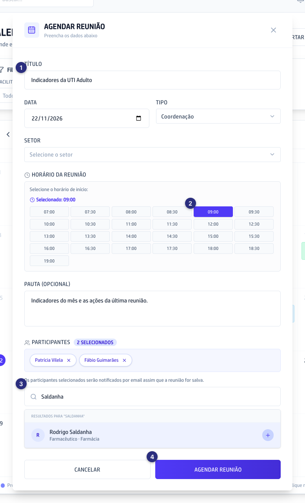

## Anexar a transcrição da reunião

A transcrição é o arquivo com o texto do que foi falado na reunião, tirado da gravação. A IA lê esse texto e escreve a Ata.

1. Depois da reunião, abra a página dela pelo **Calendário**.
2. Desça até o quadro **Transcrição** (1).
3. Clique em **Anexar transcrição e processar com IA** (2) e escolha o arquivo no computador. Pode ser `.txt`, `.md`, `.pdf` ou `.docx`.
4. A reunião passa para **Processando IA**. Em alguns minutos a Ata fica pronta e a reunião passa para **Aguard. Validação**.

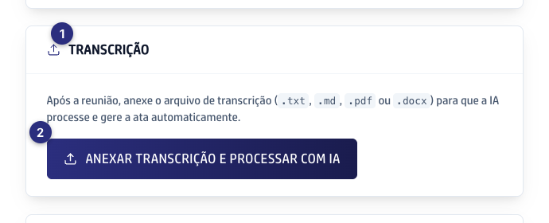

> Reunião rápida, sem gravação? Use **Iniciar Ata Guiada**, logo abaixo: você conta o que foi tratado numa conversa com o assistente e a Ata se monta na hora.

## Revisar a Ata

Antes de seguir, leia a Ata com calma. Ela vale como registro oficial da reunião.

1. Abra a reunião. No alto aparece o quadro **Validação necessária** (1).
2. Clique em **Baixar PDF** (2) para ver a Ata como ela vai ser assinada.
3. Na própria página, confira os **Participantes**, a **Discussão dos pontos** e o **Quadro de atribuições**. Cada linha do quadro tem o tipo, o responsável e o prazo.
4. Achou algo errado? Clique em **Solicitar correção** (3), escreva o que precisa mudar e envie. A IA refaz a Ata, e você confere de novo.

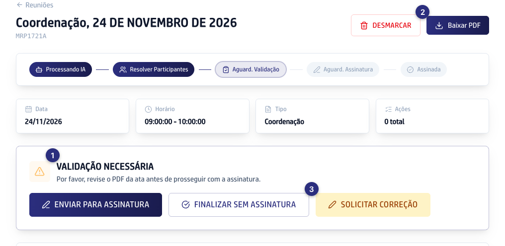

## Classificar as linhas da Ata em Ação, Rotina e Processo

A IA sugere o tipo de cada linha do quadro. Enquanto a Ata espera a sua validação, você confere e troca o que estiver errado.

- **Ação** acontece uma vez e tem entregável: vira uma Pendência, com responsável e prazo.
- **Rotina** se repete toda semana, quinzena ou mês, e tem um responsável que marca cada ciclo.
- **Processo** diz como se faz dali para frente, sem responsável e sem cobrança: vai para as Definições de processo do setor.

1. Abra a reunião em **Aguard. Validação** e desça até o **Quadro de atribuições**.
2. Na coluna **Tipo**, escolha **Ação**, **Rotina** ou **Processo** em cada linha (1). A troca é salva na hora.
3. Se a linha é uma Rotina, escolha logo abaixo a frequência (2): **Semanal**, **Quinzenal** ou **Mensal**.
4. Toda Rotina precisa de responsável e frequência. Se faltar um dos dois, o app não envia a Ata e diz qual linha falta completar.

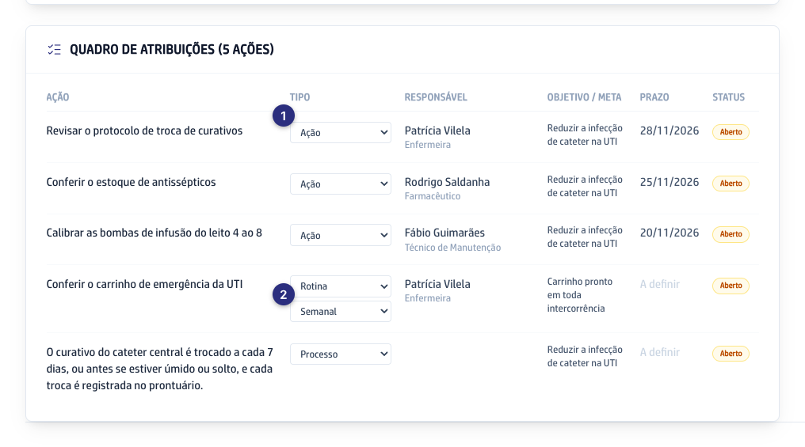

## Mandar a Ata para assinatura

1. Com a Ata revisada, escolha um dos dois caminhos no quadro **Validação necessária**.
2. **Enviar para assinatura** (1): o envio sai na hora, sem outra pergunta. As Pendências nascem no envio, todas de uma vez, e desde esse momento contam no painel e no prazo. Cada participante recebe um e-mail da ClickSign para assinar, e a reunião passa para **Aguard. Assinatura**.
3. **Finalizar sem assinatura** (2): para reuniões do dia a dia, sem assinatura digital. O app pergunta antes, porque não tem volta. Ao confirmar, a Ata fica aprovada e todas as Pendências nascem na hora.
4. No envio, cada Rotina começa a valer no ciclo seguinte, o primeiro inteiro, e cada Processo entra nas Definições de processo do setor.
5. Enquanto a Ata espera as assinaturas, a página da reunião mostra quem já assinou. Para cobrar alguém, clique em **Lembrar** na linha da pessoa.
6. A assinatura registra que cada pessoa leu a Ata. Quando todos assinam, a reunião aparece como **Ata assinada digitalmente** (3).

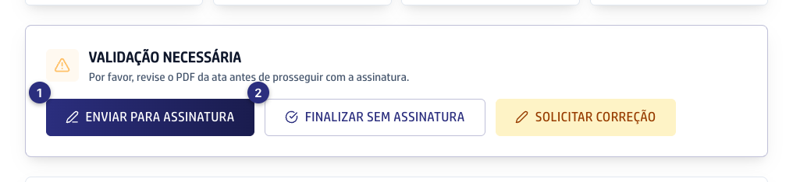

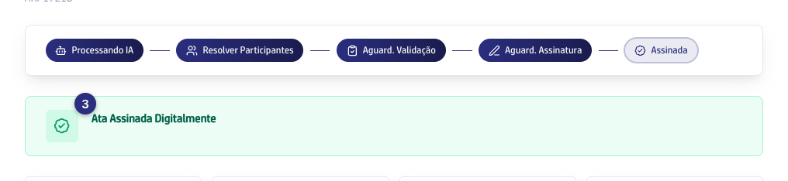

## Contestar um item da Ata

Se o item que está no seu nome saiu errado (o prazo, o responsável ou o que foi combinado), você avisa o Facilitador por aqui. Só o responsável pelo item contesta, e só enquanto a Ata está em assinatura.

1. Abra **Pendências**, **Lista**, e clique na lupa da Pendência que está errada.
2. Clique em **Contestar** (1).
3. Escreva na **Anotação** (2) o que está errado e como deveria ser.
4. Clique em **Confirmar** (3). O Facilitador vê a Contestação no Início dele na hora.
5. Assine a Ata mesmo assim: a assinatura registra que você leu o resto.

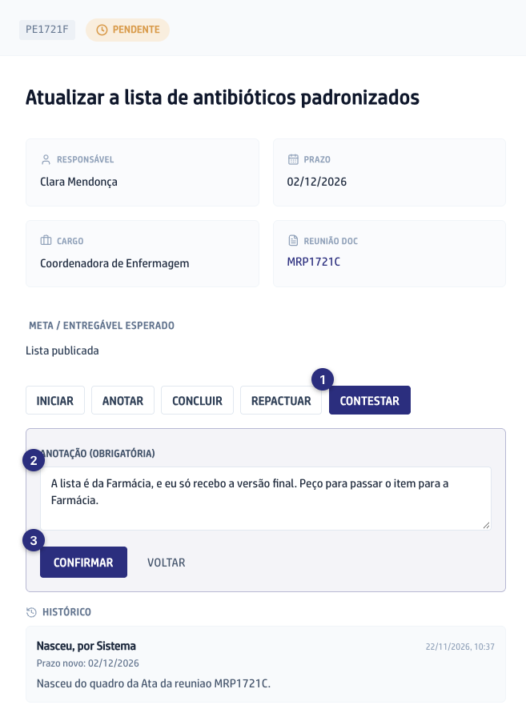

> Contestar não adia nada. O item segue cobrado, com o mesmo prazo, até o Facilitador responder.

## Responder a uma Contestação

1. A Contestação aparece no seu Início, em **Vence em até 48 horas**, com o motivo que o responsável escreveu. Clique em **Ajustar ou recusar**: a Pendência abre já destacada.
2. Para aceitar, clique em **Ajustar** (1) e escreva na **Anotação** o que foi corrigido. Se o erro era o prazo, informe o **Prazo novo** (2). Se era o responsável, digite o nome da pessoa certa em **Responsável novo** (3) e clique nela na lista.
3. Para manter o item como está, clique em **Recusar contestação** (4) e explique na **Anotação** por quê.
4. Clique em **Confirmar**. A resposta fica no **Histórico** da Pendência, e a Ata não volta para assinatura.

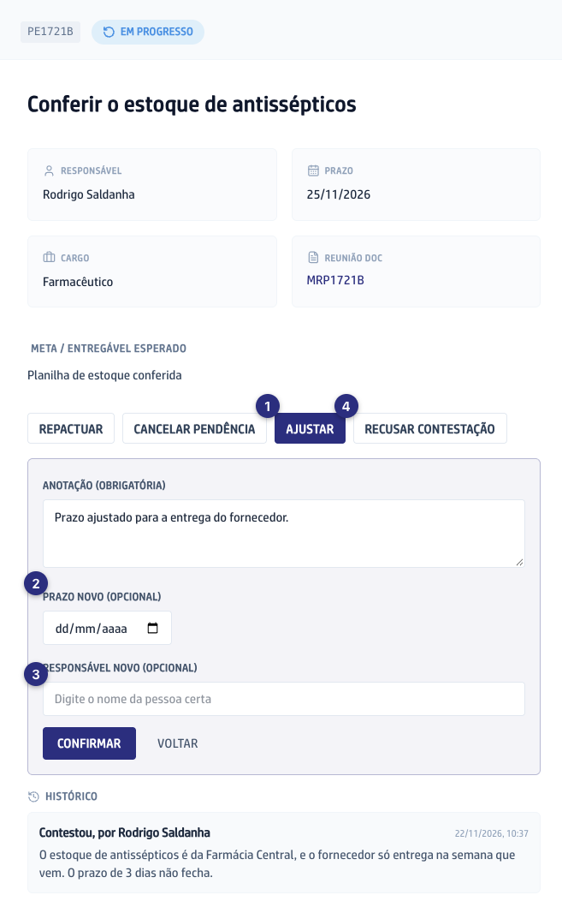

## A vida de uma Pendência

A Pendência tem quatro estados: **Pendente**, **Em progresso**, **Concluída** e **Cancelada**. **Atrasada** e **Repactuada** não são estados que alguém marca: o app mostra sozinho a Pendência aberta com prazo vencido e a que já teve o prazo trocado. Toda mudança pede uma **Anotação** e fica no **Histórico**, que ninguém edita nem apaga. Nenhuma Pendência é apagada.

```fluxograma
inicio nasce 1,2: Nasce no envio da Ata | Todas as Ações da Ata viram Pendência quando o Facilitador envia para assinatura ou finaliza sem assinatura.
passo repactuacao 2,1: Repactuação | Prazo novo, com Anotação. Feita depois do vencimento, conta como atraso.
passo pendente 2,2: Pendente | Já conta no painel e no prazo. Se o prazo vence aberta, aparece como atrasada.
passo andamento 2,3: Em progresso | O responsável começou a fazer. Iniciar é opcional.
decisao fecha 3,2: Como termina? | Pendente ou Em progresso, a Pendência aberta se conclui ou se cancela. Não precisa Iniciar antes.
fim concluida 4,2: Concluída | Com Anotação e, se quiser, uma foto ou PDF como prova. Fecha na hora, sem validação.
fim cancelada 4,3: Cancelada | Só o Facilitador ou quem administra o app cancela, com Anotação.
passo reabertura 5,2: Reabertura | O Facilitador devolve a entrega, com Anotação e prazo novo.
nasce -> pendente
pendente -> andamento: Iniciar
pendente -> repactuacao: Repactuar
repactuacao -> pendente
pendente -> fecha
andamento -> fecha
fecha -> concluida: Concluir
fecha -> cancelada: Cancelar
concluida -> reabertura: Reabrir
reabertura -> pendente
```

## Acompanhar as Pendências

Você vê as Pendências em que é responsável e todas as das reuniões que você conduz.

1. No menu da esquerda, abra **Pendências** e clique em **Lista** (1).
2. Use os filtros (2) para ver só as Pendências de um Facilitador ou de um período, e o campo **Status** para ver só as atrasadas, por exemplo.
3. Cada linha mostra a ação, o responsável, o setor, o prazo e o status. Prazo em vermelho já venceu.
4. Para mudar o status, clique no selo da coluna **Status** (3). A Pendência abre com os botões que você pode usar, e cada um pede uma Anotação.
5. Para ver os detalhes, o histórico, comentar ou marcar alguém com @, clique na lupa no fim da linha (4).
6. Prefere ver em colunas? Clique em **Kanban**, no alto à direita, e arraste o cartão de uma coluna para outra. O app abre a ação certa e pede a Anotação antes de mudar.

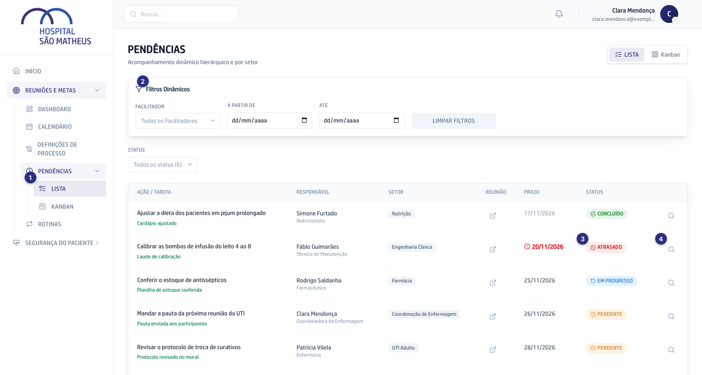

## Concluir uma Pendência e anexar a prova

Quem conclui é o responsável, ou quem administra o aplicativo. A Pendência fecha na hora, sem ninguém validar.

1. Abra a Pendência pela lupa, na **Lista**, ou pelo botão da linha no seu Início.
2. Clique em **Concluir** (1).
3. Escreva na **Anotação** (2) o que foi entregue. Ela é obrigatória.
4. Se quiser, anexe uma prova da entrega (3): uma foto (JPG, PNG ou WEBP) ou um PDF de até 10 MB. Não anexe foto com paciente nem documento interno sensível.
5. Clique em **Confirmar** (4). A conclusão entra no **Histórico** com o anexo, que só o responsável, o Facilitador e quem administra o app abrem.

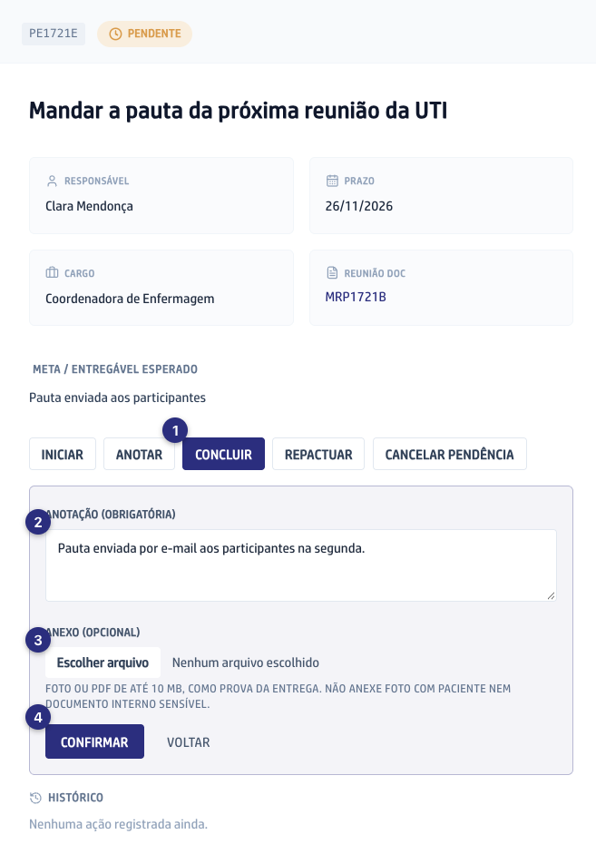

## Repactuar o prazo de uma Pendência

Repactuar é marcar um prazo novo. Fazem isso o responsável, o Facilitador e quem administra o aplicativo, sem pedir aprovação e quantas vezes for preciso. O prazo antigo fica no Histórico.

1. Abra a Pendência pela lupa.
2. Clique em **Repactuar** (1).
3. Escolha o **Prazo novo** (2). Ele não pode estar no passado.
4. Escreva na **Anotação** por que o prazo mudou e clique em **Confirmar** (3).

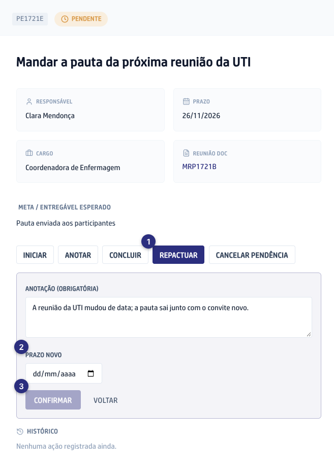

> Repactuar antes de o prazo vencer não pesa. Depois de vencer, conta como atraso de quem é responsável.

## Cancelar ou reabrir uma Pendência

Só o Facilitador da reunião e quem administra o aplicativo cancelam ou reabrem. Pendência não se exclui: a cancelada continua na lista e no Histórico.

1. Para cancelar uma Pendência aberta, abra-a pela lupa e clique em **Cancelar pendência** (1).
2. Escreva na **Anotação** por que ela deixou de valer e clique em **Confirmar**.

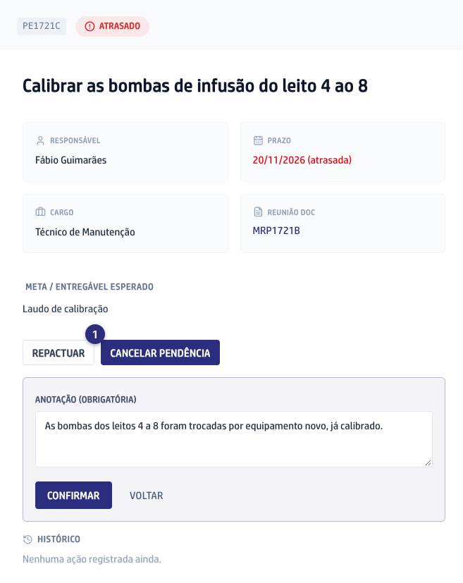

3. Para devolver uma entrega concluída, abra a Pendência concluída e clique em **Reabrir** (1).
4. Escolha o **Prazo novo** (2), escreva na **Anotação** o que falta e clique em **Confirmar**. A Pendência volta para **Pendente**, e a Reabertura pesa na avaliação do responsável.

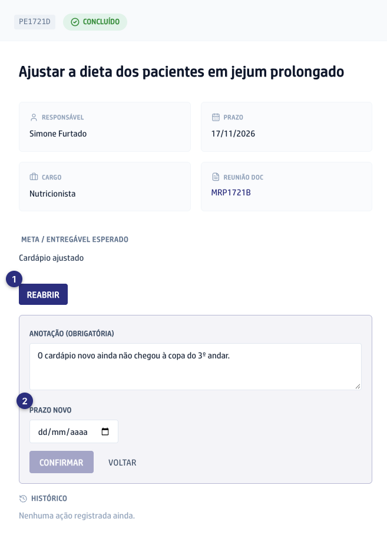

## Marcar a Verificação de uma Rotina

Cada ciclo da Rotina segue o calendário: a semana vai de segunda a domingo, a quinzena do dia 1 ao 15 e do 16 ao fim do mês, e o mês do dia 1 ao último dia. O ciclo vale até o último dia.

1. No menu da esquerda, abra **Reuniões e metas** e clique em **Rotinas**. A tela mostra as Rotinas no seu nome e as das reuniões que você conduz.
2. Em cada ciclo em aberto, clique em **Realizada** (1) se a Rotina foi feita. É um clique só.
3. Se não foi feita, clique em **Não realizada** (2), escreva na **Anotação** o que aconteceu e clique em **Confirmar**.
4. O ciclo que terminou sem marcação aparece como **Atrasado** (3). Ainda dá para marcar, e a marcação fica registrada como atrasada.
5. As marcações feitas ficam embaixo de cada Rotina (4), com quem marcou.
6. Se você é o Facilitador, marque pelo responsável que não entra no app. Para parar de cobrar a Rotina, clique em **Encerrar a Rotina** (5) e escreva a Anotação.

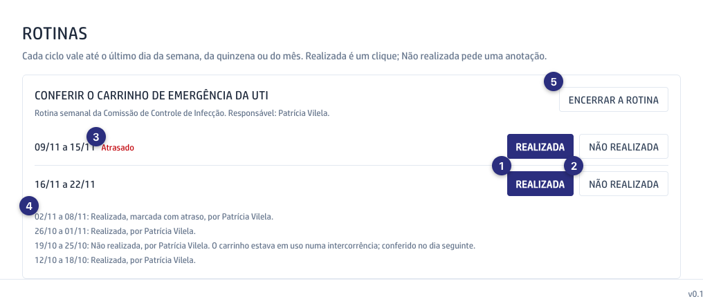

> A Verificação do ciclo também aparece no Início do responsável: **Realizada** marca ali mesmo, e **Não realizada** leva a esta tela.

## Consultar as Definições de processo

Cada linha do tipo Processo de uma Ata enviada entra nesta lista, no setor da reunião, com o trecho da Ata copiado. Ela não tem responsável nem prazo: é para consultar quando precisar.

1. No menu da esquerda, abra **Reuniões e metas** e clique em **Definições de processo** (1).
2. As definições aparecem agrupadas pelo setor da reunião (2). Cada uma diz de qual Ata veio e em que data.
3. Uma definição deixou de valer? Se você conduziu a reunião de onde ela veio, clique em **Tirar da lista** (3), escreva a Anotação e clique em **Confirmar**.

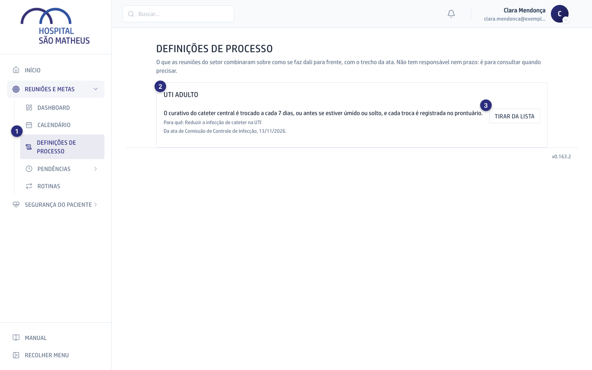

## Atualizar as Pendências pelo link do e-mail

Toda segunda, a partir das 8h, cada pessoa recebe um e-mail com o resumo da semana: o Facilitador, o que aconteceu nas reuniões dele e as Rotinas verificadas; o responsável, as Pendências e as Rotinas dele em aberto. Quem nunca entrou no app recebe nesse e-mail um link pessoal, que abre as próprias Pendências sem senha.

1. Abra o e-mail de segunda e clique no link (1).

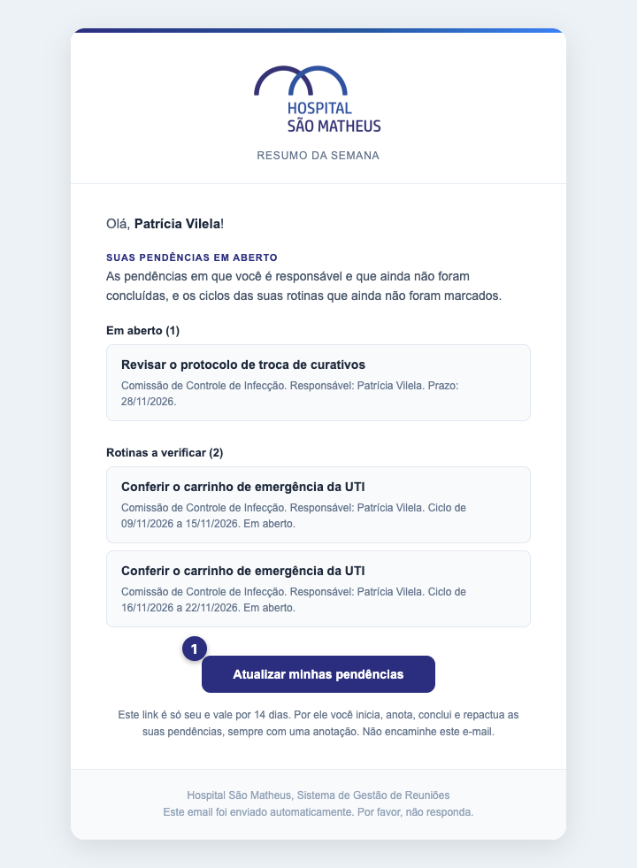

2. A página mostra as suas Pendências em aberto, com o prazo e a situação de cada uma (1).
3. Clique no que quer fazer (2): **Iniciar**, **Anotar**, **Concluir** ou **Repactuar**.
4. Escreva a **Anotação** e, se repactuou, o **Prazo novo**. Clique em **Confirmar**. A ação entra no Histórico em seu nome, igual a quem faz pelo app.

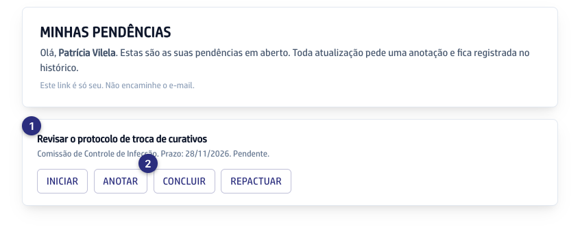

> O link é só seu e vale por 14 dias; cada e-mail de segunda traz um novo. Não encaminhe o e-mail.
