O módulo Segurança do Paciente é onde o Núcleo de Segurança do Paciente funciona dentro do aplicativo: quem faz parte dele, os documentos, as capacitações, a agenda regulatória, as reuniões e as notificações de incidente, da chegada à triagem.

Ele fica no menu da esquerda, em **NSP**, a sigla do Núcleo de Segurança do Paciente, com os itens **Visão geral**, **Reuniões** e **Núcleo**. Dentro de **Núcleo** ficam **Membros**, **Documentos**, **Capacitações** e **Agenda regulatória**.

A Presidência do Núcleo e quem tem Acesso pleno fazem tudo o que esta página descreve. O membro com o Termo de Adesão assinado abre as telas e as atas; cadastrar, publicar e validar ficam com a Presidência e com quem tem Acesso pleno. Quem ainda não assinou o Termo vê o calendário e a agenda; nas outras telas aparece a faixa **Assine o Termo de Adesão para liberar este acesso**, com o botão **Abrir o Termo de Adesão**.

Notificar um incidente é para qualquer profissional, com ou sem login, e todo usuário logado vê o botão **Notificar incidente** no alto do grupo **NSP** do menu. Quem abre os casos (a Presidência, quem tem Acesso pleno e o membro com o Termo assinado) vê também o item **Notificações**. A triagem, o encaminhamento e a **Configuração** ficam com a Presidência e com quem tem Acesso pleno.

## Cadastrar um membro e acompanhar o Termo

1. No menu da esquerda, clique em **NSP**, depois em **Núcleo** e em **Membros**.
2. Clique em **Cadastrar membro**.
3. Em **Pessoa**, escolha a pessoa no cadastro. Escolha o **Papel**: Presidência, Suplente da Presidência ou Membro. Preencha a **Área**, o **Conselho**, o **Número do registro**, a **UF do registro** e as datas de **Início da vigência** e **Fim da vigência**.

   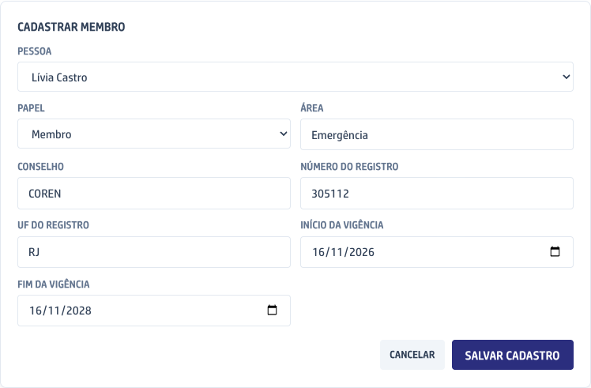

4. Clique em **Salvar cadastro**. O aplicativo gera um documento só, com o Termo de Adesão e o Regimento vigente, e manda por e-mail para a pessoa assinar. Se o envio falhar, um aviso amarelo no alto da tela diz o motivo.
5. Acompanhe na lista. A coluna **Estado** mostra onde cada membro está: Cadastrado, Documento gerado, Aguardando assinatura, Ativo, A vencer, Em carência, Vencido ou Encerrado. A coluna **Termo** mostra a data da assinatura, ou **Sem Termo**.

   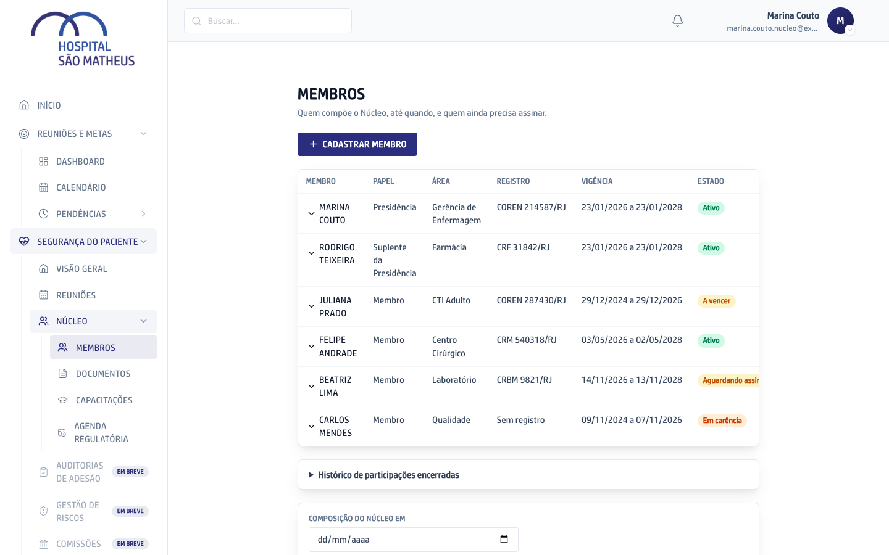

6. Quando a pessoa assina, ela passa a **Ativo** sozinha, sem ninguém precisar liberar.
7. Se a assinatura demorar, clique no nome do membro para abrir a ficha dele. Na caixa **Termo de Adesão** há três botões. **Reconsultar status da assinatura** serve para quando a pessoa já assinou e a lista ainda não mudou. **Reenviar o Termo** manda o documento de novo, por exemplo depois de corrigir o e-mail, e o envio anterior deixa de valer. **Liberar sem assinatura** é para quando a assinatura eletrônica falha: pede uma justificativa, que fica no histórico com quem liberou e quando.

   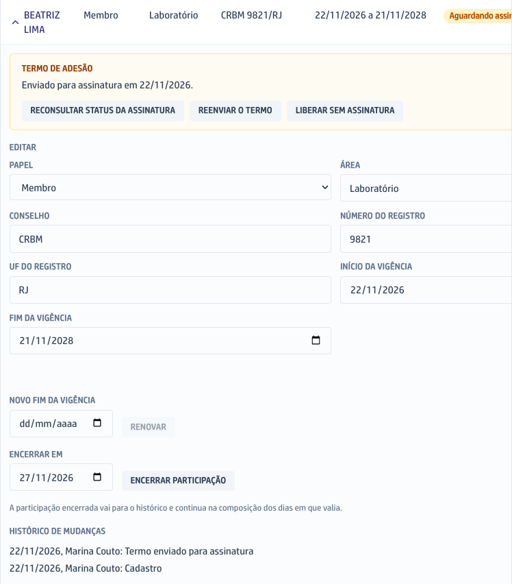

O aplicativo avisa sozinho, por e-mail. O membro recebe o aviso aos 3 e aos 7 dias sem assinar o Termo. Aos 14 dias, o aviso vai para ele e para a Presidência, e os dois são avisados também 60 e 30 dias antes do fim da vigência. Quando a carência de 30 dias acaba sem renovação, o aviso vai para a Presidência e para a Diretoria Executiva.

## Renovar ou encerrar uma participação

1. Em **Núcleo**, **Membros**, clique no nome do membro. A ficha abre embaixo da linha dele.
2. Para renovar, escolha a data em **Novo fim da vigência** e clique em **Renovar**. A renovação manda um Termo novo para a pessoa assinar. Mudar o **Papel** em **Editar** e clicar em **Salvar alterações** também manda um Termo novo.

   

3. Para encerrar, escolha a data em **Encerrar em**, clique em **Encerrar participação** e depois em **Confirmar encerramento**.
4. A participação encerrada sai da lista e vai para **Histórico de participações encerradas**, no fim da tela. O **Histórico de mudanças**, na ficha, guarda cada alteração, com quem fez e quando.
5. Para saber quem compunha o Núcleo num dia passado, escolha a data em **Composição do Núcleo em**, no fim da tela. A lista mostra quem tinha participação vigente naquele dia, mesmo quem já saiu.

   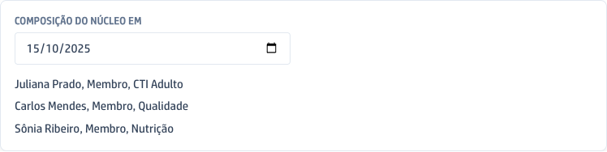

Enquanto a pessoa não assina o Termo novo, ela continua no estado em que estava. Até 30 dias depois do fim da vigência, o membro fica **Em carência** e ainda conta para o quórum; depois disso, sem renovação, passa a **Vencido**.

## Publicar uma revisão do Regimento

1. Em **Núcleo**, clique em **Documentos**. Cada tipo de documento aparece com a versão **Vigente** em cima e as **Versões anteriores** embaixo.

   

2. Clique em **Publicar versão nova**.
3. Em **Tipo**, escolha **Regimento**. Preencha o **Título** e cole o **Texto**.
4. Em **Natureza da revisão**, marque **Material** quando a mudança mexe nas regras, ou **De redação** quando só corrige o texto. A revisão material manda um Termo novo para todos os membros que contam para o quórum assinarem; a de redação não pede assinatura de ninguém.

   

5. Clique em **Enviar para assinatura**. O Regimento vai por e-mail para a Diretoria Executiva e para a Presidência do Núcleo, e só vira o vigente quando os dois assinam. Até lá a versão atual continua valendo, e a nova aparece no alto como **Aguardando assinatura**, com quem já assinou.
6. Se a assinatura travar, use **Reconsultar status da assinatura** ou **Reenviar para assinatura**, na caixa da versão que espera.

Nenhuma versão se apaga nem se edita: a correção é sempre uma versão nova. O ato de designação e o Plano de Segurança do Paciente seguem o mesmo caminho; o ato é assinado só pela Diretoria Executiva.

## Registrar uma capacitação e confirmar presença

1. Em **Núcleo**, clique em **Capacitações**.
2. Clique em **Registrar capacitação**. Preencha o **Título**, a **Data**, a **Carga horária (horas)**, o **Instrutor**, a **Formação do instrutor** (por exemplo, enfermeira do trabalho) e o **Público**: Membros do Núcleo ou Profissionais. Marque os **Temas tratados** e, em **Participantes**, quem estava na lista. Sem a formação do instrutor, a capacitação não é salva.

   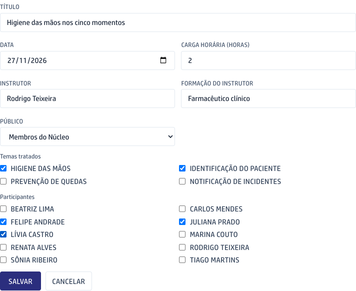

3. Clique em **Salvar**. A capacitação aparece na lista com a formação logo abaixo do nome do instrutor e cada participante marcado como **Não confirmou**. As capacitações registradas antes desse campo mostram "Formação não informada".
4. Cada participante abre a mesma tela e clica em **Confirmar minha presença**, no cartão da capacitação. O botão aparece a partir do dia da capacitação. Depois do toque, a linha da pessoa mostra **Confirmou em**, com a data e a hora.

   

5. Em **Temas mínimos por membro**, veja quantos temas cada membro já cobriu. A conta usa só as capacitações em que ele confirmou presença.
6. A lista **Temas mínimos**, no fim da tela, muda com **Incluir tema**, **Renomear** e **Desativar**.

## Acompanhar a agenda regulatória

1. Em **Núcleo**, clique em **Agenda regulatória**. Cada obrigação aparece num cartão com a periodicidade, a **Próxima data**, o **Último resultado** e o link, quando houver.
2. Para incluir uma obrigação, clique em **Incluir evento** e preencha **Evento**, **Periodicidade**, **Detalhe da periodicidade**, **Próxima data**, **Lembrar quantos dias antes** e **Link**. Clique em **Salvar**.
3. Quando a próxima data fica a menos dias do que a antecedência escolhida, o aplicativo abre uma Pendência de lembrete para a Presidência. O cartão mostra **Lembrete aberto**, com o número da pendência e o prazo; passado o prazo, **Lembrete atrasado**. Esse lembrete fica só no aplicativo, sem e-mail.

   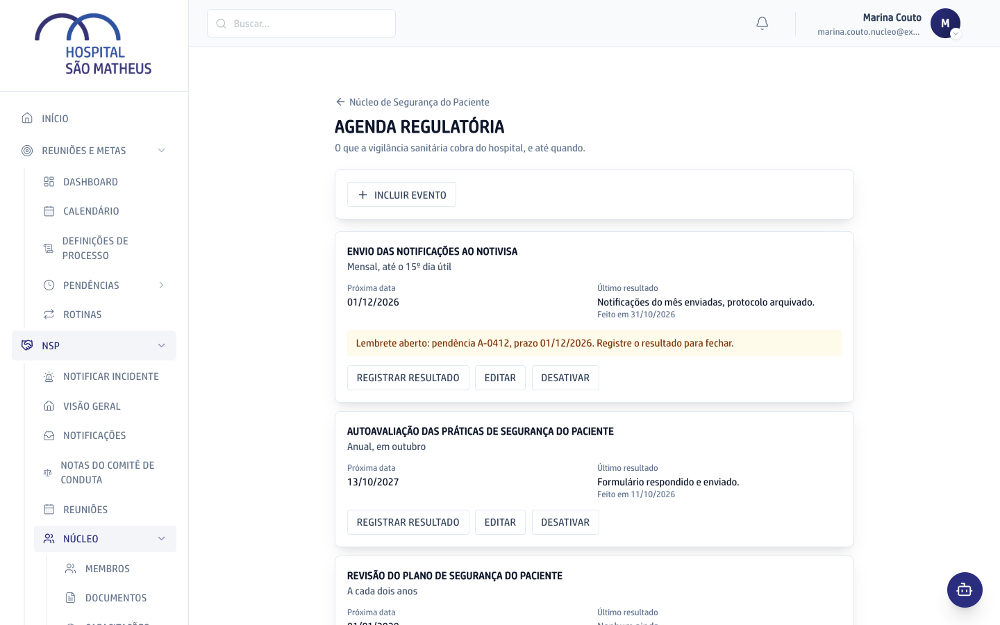

4. Depois de cumprir a obrigação, clique em **Registrar resultado**, escreva o **Resultado**, confira a data em **Feito em** e clique em **Registrar**. O lembrete fecha, o resultado vira o último do cartão e a próxima data anda pela periodicidade. A obrigação avulsa não se repete.
5. Para mudar a data ou o link, clique em **Editar**. A obrigação que deixou de valer se desliga em **Desativar**.

## Fazer a reunião do Núcleo, da pauta à ata assinada

1. No menu da esquerda, em **NSP**, clique em **Reuniões**. As reuniões do Núcleo aparecem mês a mês.
2. No começo do ano, clique em **Gerar o calendário do ano**, escolha o **Ano**, o **Dia do mês** e a **Hora** e clique em **Gerar**. O aplicativo cria as doze reuniões ordinárias, uma por mês; o dia que cai em fim de semana ou feriado vai para o próximo dia útil. Para uma reunião fora do calendário, clique em **Nova reunião**, escolha o **Tipo** e preencha o título, a data e a hora.

   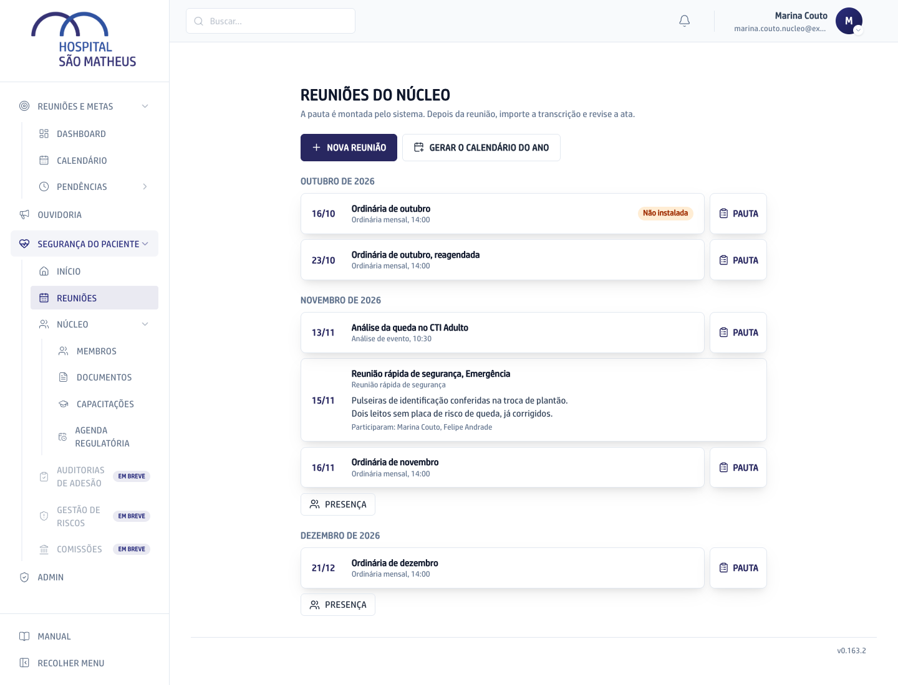

3. Cinco dias úteis antes da reunião, a pauta fica pronta. Clique em **Pauta**, ao lado da reunião, para ver os blocos que o aplicativo montou, com a situação de hoje de cada pendência.
4. Para mudar algum item, clique em **Editar a pauta**, faça o ajuste e clique em **Salvar a pauta**.
5. Clique em **Convocar os membros**. A convocação vai por e-mail, e a pauta passa a mostrar quem foi convocado.

   

6. No dia, clique em **Presença**, embaixo da reunião. Marque cada pessoa como Presente, Ausente, Ausente justificado ou Convidado. Para alguém de fora do Núcleo, escolha a pessoa e clique em **Acrescentar**. Clique em **Salvar presença**.
7. Veja o quórum, embaixo da lista. Com o mínimo de presentes e a Presidência ou o suplente na sala, aparece **Reunião instalada**. Sem quórum, escolha a **Nova data** e clique em **Registrar como não instalada e reagendar**: a reunião fica registrada como não instalada e nasce outra, na data nova.

   

8. Depois da reunião, clique nela para abrir e, em **Transcrição**, clique em **Anexar Transcrição e Processar com IA**. A IA monta a minuta da ata em dez blocos. A identificação, as presenças, as pendências da reunião anterior e os indicadores vêm do aplicativo; o resto vem da transcrição.
9. Leia a ata. Clique em **Revisar** para reescrever o plano de ação, os alertas sanitários e a próxima reunião, um item por linha, e para ajustar as deliberações, cada uma com o responsável e o prazo. Clique em **Salvar a revisão**. Os **Trechos para conferir na gravação**, no fim, apontam o que vale ouvir de novo antes de validar.

   

10. Clique em **Validar a ata**. Só a Presidência, o suplente em exercício ou quem tem Acesso pleno valida. Cada deliberação vira uma Pendência, e a ata vai por e-mail para a assinatura eletrônica de todos os presentes.
11. A ata encerra sozinha 5 dias úteis depois do envio, com as assinaturas que tiver, e registra quem não assinou. A ata encerrada entra em **Documentos**, numerada, e se baixa pelo botão **Baixar a ata assinada**.

    

12. Se alguém recusar a assinatura ou o envio for cancelado, a ata mostra o aviso e não encerra sozinha. Clique em **Reenviar para assinatura**: a ata vai de novo para todos os presentes, inclusive quem já tinha assinado, e os 5 dias úteis recomeçam do reenvio.

A transcrição anexada é apagada 30 dias depois de a ata ser assinada. Para uma conversa curta de segurança num setor, escolha o tipo **Reunião rápida de segurança** em **Nova reunião**: ela não tem ata nem assinatura, só o setor, quem participou e até três linhas do que foi conversado.

## Notificar um incidente pelo QR, pelo endereço ou pelo botão do módulo

1. Abra o formulário por uma das três portas: o QR do Núcleo, no cartaz ou no celular; o endereço da página, pelo ícone nos computadores do hospital; ou, com login, o botão **Notificar incidente**, no alto do grupo **NSP** do menu. Pelo QR e pelo endereço não precisa de login. Pelo botão, a identificação já vem com o seu nome e o seu e-mail.
2. Na tela **O que aconteceu**, conte com as suas palavras, sem classificar nada. Não escreva o nome do paciente: se precisar, informe o **Leito ou atendimento**. Em **Fotos ou PDF**, anexe até 3 arquivos, somando menos de 9 MB. Clique em **Continuar**.

   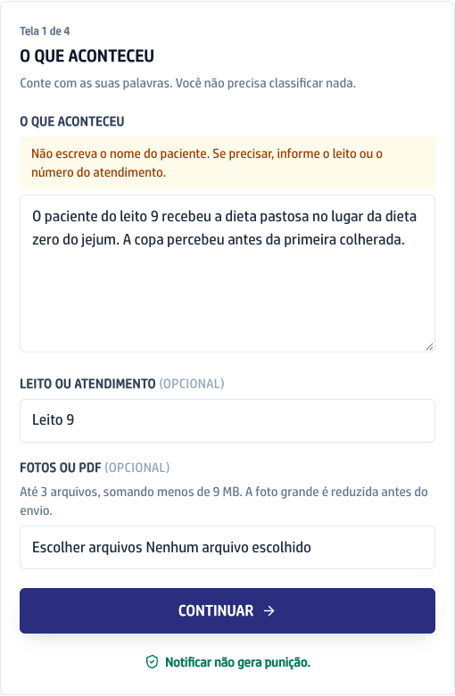

3. Em **Onde e quando**, escolha o **Setor**, confira a **Data**, que já vem com o dia de hoje, e marque o **Turno**. A **Hora aproximada** é opcional.
4. Em **O paciente foi atingido**, diga se o incidente chegou ao paciente. Se chegou com dano, ou se você não sabe, a tela pergunta também se foi grave ou se houve morte.
5. Em **Identificação**, escolha **Com o meu nome** ou **Sem me identificar**. O nome aparece só para a Presidência do Núcleo e para o Diretor Executivo. Quem não se identifica não deixa nome nem contato.
6. Clique em **Enviar notificação**. O protocolo aparece na hora, no formato NSP-2026-0042. Quem notificou sem se identificar recebe também um código de acompanhamento: anote ou copie, porque ele aparece só nessa tela e ninguém consegue recuperá-lo depois.

   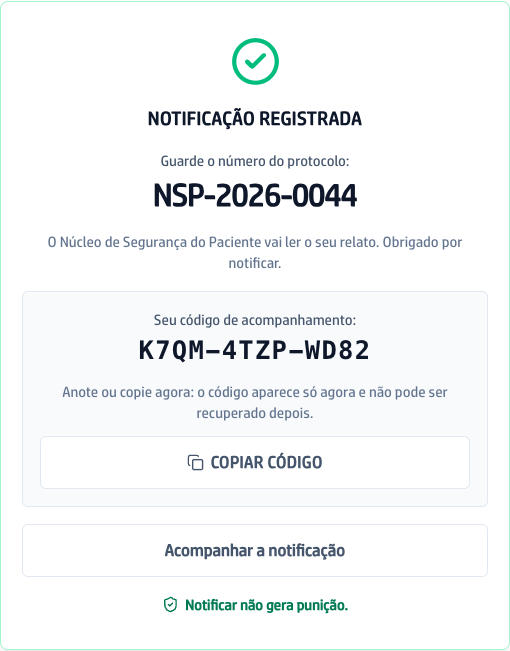

O rodapé de toda tela do formulário lembra que notificar não gera punição. Quando quem notifica marca que foi grave ou houve morte, a Presidência, o suplente, quem tem Acesso pleno e a Diretoria Executiva recebem um e-mail na hora, a qualquer dia e horário, com o protocolo e o setor, sem o relato. Quem se identificou e deixou um e-mail recebe a confirmação de recebimento com o protocolo. O QR e o endereço ficam em **Configuração**, na seção **QR e endereço da notificação**: o botão **Baixar o QR** baixa a imagem para o cartaz, e o botão **Copiar** copia o endereço para a TI criar o ícone nos computadores.

## Acompanhar uma notificação

1. Na tela do protocolo, clique em **Acompanhar a notificação**. A página de acompanhamento também abre pelo endereço da notificação com /acompanhar no fim, sem login.
2. Em **Como você notificou?**, escolha **Notifiquei sem me identificar** ou **Notifiquei com o meu nome**.
3. Digite o **Protocolo** e, conforme a escolha, o **Código de acompanhamento** ou o **E-mail ou telefone** que você deixou.
4. Clique em **Consultar**. A página mostra o estado da notificação: Recebida, Em análise ou Concluída. Se o Núcleo marcou o caso como fora de escopo, aparece também a orientação que ele deixou para você.

   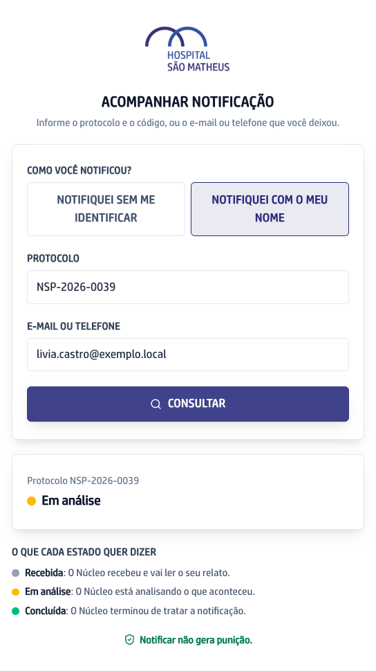

Se algum dado estiver errado, a resposta é sempre a mesma, sem dizer qual parte errou. A página não mostra o relato nem quem notificou.

## Fazer um registro rápido

1. No menu da esquerda, em **NSP**, clique em **Notificações**.
2. No alto da tela, em **Registro rápido**, escreva **O que foi encontrado** e escolha o **Setor** e a **Data**.
3. Em **Origem**, escolha de onde veio: **Busca ativa**, **Ronda**, **Reunião rápida**, **Auditoria** ou **Outra**.

   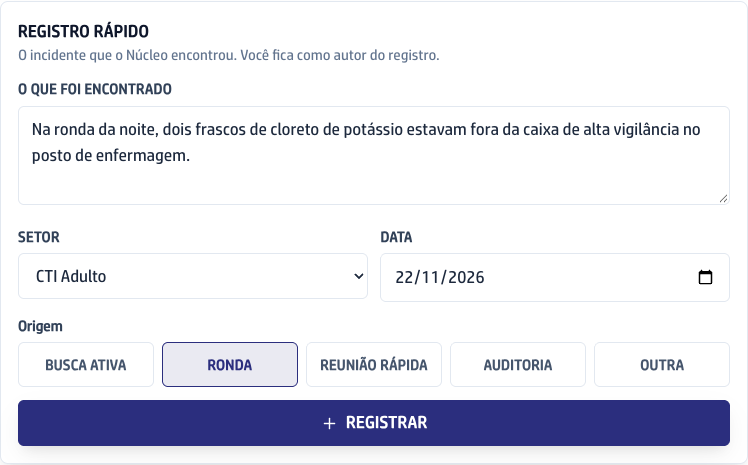

4. Clique em **Registrar**. A tela mostra o protocolo, e a notificação entra na lista e na fila de triagem como qualquer outra. Você fica como autor, com o nome e o e-mail da sua conta.

O registro rápido é da Presidência e do membro com o Termo assinado, para o incidente que o próprio Núcleo encontra. Quem ainda não assinou o Termo, e quem é de fora do Núcleo, notifica pelo botão **Notificar incidente**.

## Fazer a triagem de uma notificação

1. No menu da esquerda, em **NSP**, clique em **Visão geral**. Os casos graves que esperam a triagem aparecem em destaque no alto. Logo abaixo, a faixa **O que exige ação hoje** mostra os casos das faixas A e B abertos, as triagens pendentes por idade, os prazos legais a vencer e os Termos pendentes. Cada grupo leva à tela onde se resolve, e o que está mais perto de vencer aparece em destaque.

   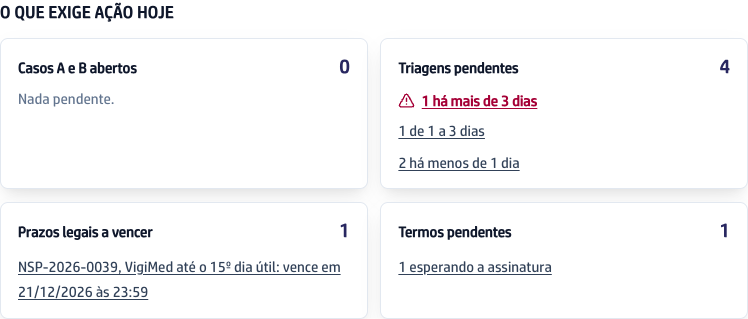

2. Clique em **Notificações** e depois em **Fila de triagem**. A fila traz as notificações que esperam a triagem, da mais antiga para a mais nova, com o protocolo, o setor, a data e há quantos dias cada uma chegou. Ela não mostra o relato nem quem notificou.

   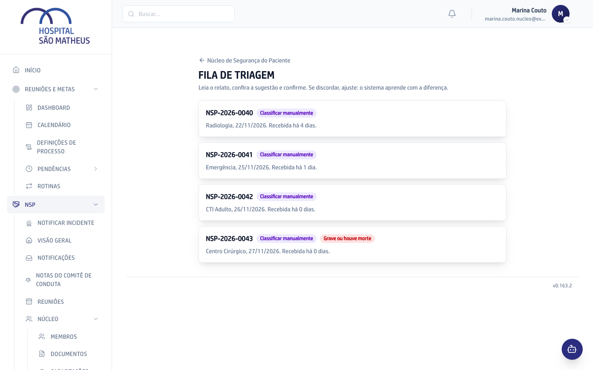

3. Clique no protocolo. A tela da triagem abre com o relato, as respostas de quem notificou e os anexos à esquerda.
4. Enquanto o agente de triagem estiver desligado, toda notificação chega em **Classificar manualmente**, com os campos em branco. Preencha o **Assunto**, a **Natureza**, o **Grau de dano**, a **Categoria**, o **Incidente**, o **Evento que nunca deveria ocorrer**, o **Protocolo básico** e o **Canal**, e marque **IRAS** ou **Risco de imagem** quando for o caso. A **Faixa calculada** sai sozinha da natureza e do grau de dano. Em **Calculado pelo sistema**, a tela mostra quantas vezes a mesma categoria aconteceu no setor em 60 dias, a frequência, a prioridade e os casos parecidos.

   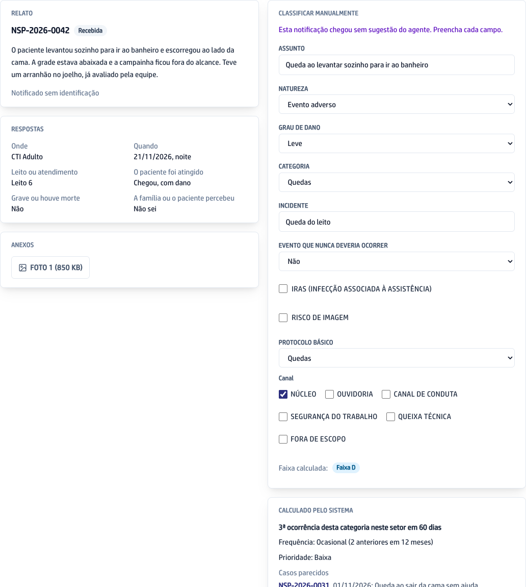

5. Quando o caso pede conferência (faixa A ou B, relato que fala em morte, ou quem notificou marcou grave), o alto da tela mostra **Caso grave: confirme cada campo. O prazo legal já está correndo.** Marque a caixa **Conferi** de cada campo: a confirmação só libera com todas marcadas.
6. Clique em **Confirmar a classificação**. O caso passa a Classificada, ou a Em análise agregada quando é quase erro, circunstância de risco ou incidente sem dano.
7. Clique em **Ver os prazos do caso**. Cada prazo do Regimento aparece com a data e a hora, e o alto mostra até quando notificar à vigilância sanitária: no VigiMed, quando é erro de medicação, e no NOTIVISA nos outros casos.

   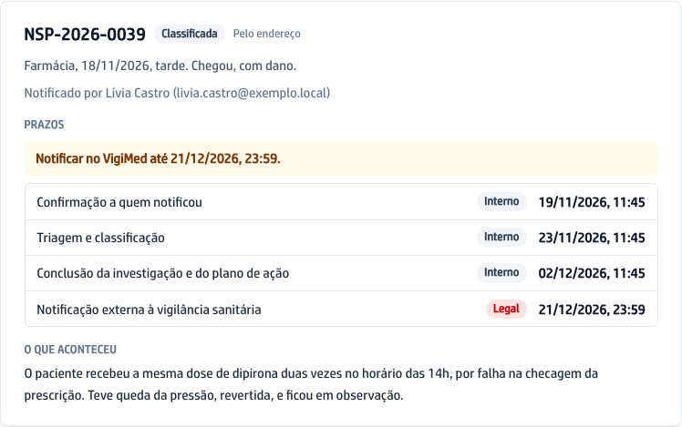

Nas faixas A e B, a confirmação já programa a reunião de análise de evento na data-limite (7 dias úteis na faixa A, 15 na faixa B) e manda na hora o e-mail à Direção, sem o relato. Quem notificou com o nome e deixou um e-mail recebe o aviso de que a notificação está em análise. Faltando 24 horas para o fim do prazo de 72 horas de um caso da faixa A que ainda não foi notificado, a Presidência, o suplente e quem tem Acesso pleno recebem um e-mail urgente. Quando o agente for ligado, a tela mostra à direita a **Sugestão** dele: **Confirmar** aceita como veio, e **Ajustar** abre os campos para mudar o que discordar. Se a aprovação em lote estiver ligada, a fila ganha uma caixa de marcar nos casos sugeridos nas faixas D e E, e o botão **Confirmar em lote** confirma todos os marcados de uma vez.

## Encaminhar uma notificação a outro canal

1. Na tela da triagem, clique em **Encaminhar**.
2. Marque um ou mais destinos. **Núcleo** mantém o caso na triagem, junto do outro destino. **Ouvidoria** manda ao ouvidor um e-mail com o protocolo, o motivo e o relato. **Canal de Conduta** não envia nada: a tela mostra como orientar quem notificou. **Segurança do Trabalho** e **Queixa técnica** mandam ao titular do setor um e-mail com o resumo do caso e o botão **Recebido**. **Fora de escopo** vai sozinho e encerra o caso.
3. Para a Segurança do Trabalho e a queixa técnica, escolha o setor em **Setor que recebe**.
4. Escreva o **Motivo, em uma frase**. No fora de escopo, escreva também a **Orientação para quem notificou**, que a pessoa vê na página de acompanhamento.

   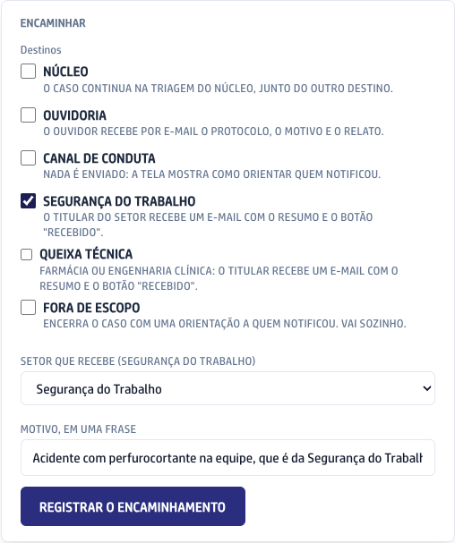

5. Clique em **Registrar o encaminhamento**. O protocolo continua o mesmo. Com o Núcleo marcado, o caso segue na fila de triagem; sem ele, sai da fila como Encaminhada ou Fora de escopo.
6. Acompanhe em **Encaminhamentos**, na mesma tela, para quem o caso foi e quando o setor clicou em **Recebido**, com a data e a hora.

   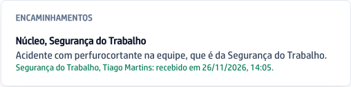

O e-mail ao setor não traz o relato nem quem notificou, e o link dele vale uma vez só, por 30 dias. Sem o clique em 2 dias úteis, o e-mail é reenviado uma única vez. Se o setor está sem titular, o e-mail vai ao gestor e a Presidência é avisada; sem titular e sem gestor, o encaminhamento é recusado.

## Registrar a ausência da Presidência

1. Em **Núcleo**, clique em **Membros** e no nome do suplente. A ficha abre embaixo da linha dele.
2. Em **Ausência da Presidência**, escolha o **Primeiro dia da ausência** e o **Último dia da ausência**.

   

3. Clique em **Registrar ausência**. O registro entra no **Histórico de mudanças** do suplente, com quem registrou e o período, e depois não se edita nem se apaga.
4. Nesses dias, contando os dois, o suplente responde pela Presidência no módulo: confirma a triagem e vê quem notificou. Fora do período, ele volta a ser membro.

Só a Presidência e quem tem Acesso pleno registram a ausência. O suplente em exercício não registra nenhuma, nem a dele. Na reunião, continua valendo a regra da ata: quando a Presidência falta, o suplente presente conduz.

## Ajustar a tabela de prazos

1. No menu da esquerda, em **NSP**, clique em **Configuração**.
2. Em **Tabela de prazos**, os **Prazos internos** aparecem por etapa, com um prazo para cada faixa: a confirmação a quem notificou, a comunicação à Direção, a triagem e classificação, o início e a conclusão da investigação e a reunião de análise.

   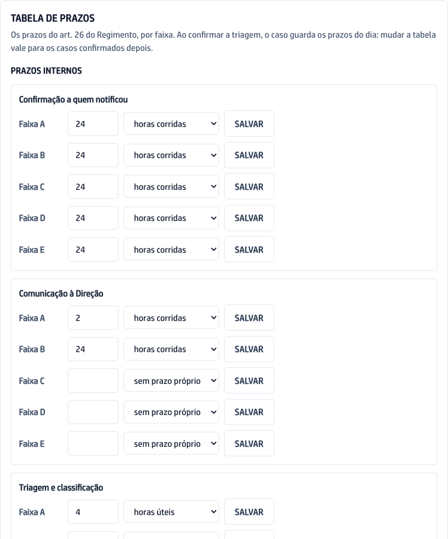

3. Para mudar um prazo, digite o número, escolha a unidade (horas corridas, horas úteis, dias corridos ou dias úteis) e clique em **Salvar**, na linha da faixa. Para deixar a faixa sem prazo, escolha **sem prazo próprio**.
4. A tela mostra **Prazo salvo. Vale para os casos confirmados daqui para a frente.**, e a mudança entra no **Histórico**, no fim da tabela, com quem mudou, quando, o valor antigo e o novo.

O caso já classificado guarda os prazos do dia em que foi confirmado. Os **Prazos legais** vêm da norma e aparecem só para leitura: 72 horas corridas do incidente na faixa A, até o 15º dia útil do mês seguinte nos outros casos, e 60 dias corridos para completar a notificação da faixa A. Só a Presidência e quem tem Acesso pleno mudam a tabela.

## Recalibrar o agente

1. Aos 30 e aos 60 dias da primeira notificação registrada, quem tem Acesso pleno recebe no Início do aplicativo a pendência **Recalibrar o agente do NSP**, com prazo de uma semana. Clique em **Abrir a recalibração**. A mesma tela abre pela **Configuração**, no link **Abrir a recalibração do agente**.
2. Leia os itens da **Auditoria de 30 dias** e da **Auditoria de 60 dias**. O que já tem dado sai calculado pelo aplicativo, e o item com número fora do esperado mostra **Sinal de alerta aceso**. O resto aparece como **Sem dados nesta fase**.
3. Em **Recalibrações**, escolha a decisão: **Manter o agente como está**, **Ajustar o prompt e a base** ou **Ligar a aprovação em lote**.

   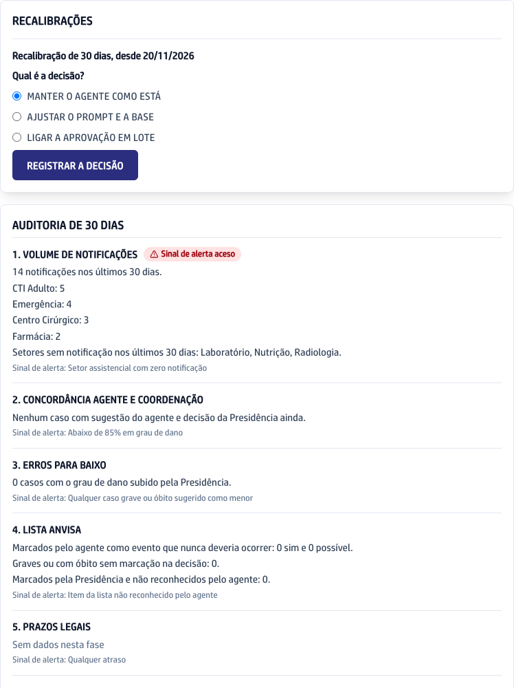

4. Clique em **Registrar a decisão**. A decisão fica gravada com o nome de quem decidiu e o dia, e não muda depois.

A Presidência lê a tela, mas quem decide é quem tem Acesso pleno. Ligar a aprovação em lote só é aceito com concordância de 90% ou mais nas últimas 4 semanas, nos casos das faixas D e E confirmados. Enquanto o agente estiver desligado, não há sugestão para comparar: a **Concordância do agente**, na Configuração, fica sem casos, e o aplicativo recusa ligar o lote.

## O ciclo do membro

```fluxograma
inicio cadastro 1,1: Cadastrar membro | A Presidência escolhe a pessoa, o papel e a vigência.
passo termo 2,1: Termo enviado | Um documento só, com o Termo de Adesão e o Regimento vigente, vai por e-mail para a pessoa.
decisao assinou 3,1: Assinou?
passo espera 3,2: Aguardando assinatura | Avisos aos 3, 7 e 14 dias. A Presidência pode reconsultar, reenviar ou liberar.
passo ativo 4,1: Ativo | Abre as atas, os documentos e as capacitações, e conta para o quórum.
fim encerrado 4,2: Encerrado | A participação vai para o histórico e continua na composição dos dias em que valia.
passo avencer 5,1: A vencer | Avisos 60 e 30 dias antes do fim da vigência.
passo termonovo 5,2: Termo novo | Vai por e-mail para a pessoa assinar. Quem já tinha assinado continua no estado em que estava, sem os avisos de 3, 7 e 14 dias.
decisao renovou 6,1: Renovou?
passo carencia 6,2: Em carência | Até 30 dias depois do fim, ainda conta para o quórum e ainda dá para renovar.
fim vencido 7,2: Vencido | A carência acabou sem renovação. A Presidência e a Diretoria Executiva são avisadas.
cadastro -> termo
termo -> assinou
assinou -> ativo: sim
assinou -> espera: não
espera -> termo: reenviado
espera -> ativo: liberado com justificativa
ativo -> termonovo: mudou o papel ou revisão material do Regimento
termonovo -> ativo: segue valendo, sem esperar a assinatura
ativo -> encerrado: encerrar participação
ativo -> avencer
avencer -> renovou
renovou -> termonovo: renovou
renovou -> carencia: não
carencia -> termonovo: renovou na carência
carencia -> vencido: a carência acabou
```

## O ciclo da reunião

```fluxograma
inicio calendario 1,1: Calendário do ano | Doze reuniões ordinárias, uma por mês, ou uma reunião criada à mão.
passo pauta 2,1: Pauta pronta | Cinco dias úteis antes, montada pelo aplicativo com a situação de hoje de cada pendência.
passo convocacao 3,1: Convocar os membros | A Presidência ajusta a pauta, se quiser, e convoca em um clique.
passo presenca 4,1: Presença | No dia, a Presidência marca quem veio.
decisao quorum 5,1: Tem quórum?
passo naoinstalada 5,2: Não instalada | A reunião fica registrada e nasce outra, na nova data.
passo transcricao 6,1: Transcrição anexada | A IA monta a minuta da ata em dez blocos.
passo validar 7,1: Revisar e Validar a ata | A Presidência revisa e valida. Cada deliberação vira Pendência.
passo assinatura 8,1: Assinatura dos presentes | A ata vai por e-mail para todos os presentes.
decisao cancelado 9,1: Envio cancelado?
passo reenvio 9,2: Reenviar para assinatura | Vai de novo para todos os presentes, e o prazo de 5 dias úteis recomeça.
fim encerrada 10,1: Ata encerrada | 5 dias úteis depois do envio, com as assinaturas que tiver. Entra em Documentos.
calendario -> pauta
pauta -> convocacao
convocacao -> presenca
presenca -> quorum
quorum -> transcricao: sim
quorum -> naoinstalada: não
naoinstalada -> pauta: nova data
transcricao -> validar
validar -> assinatura
assinatura -> cancelado
cancelado -> encerrada: não
cancelado -> reenvio: sim
reenvio -> assinatura
```

## O ciclo da notificação

```fluxograma
inicio notificacao 1,1: Notificação | Pelo QR, pelo endereço, pelo botão do módulo, pelo registro rápido ou vinda da Ouvidoria.
passo protocolo 2,1: Protocolo na hora | Sai antes de qualquer triagem. Quem não se identificou recebe também o código de acompanhamento.
decisao grave 3,1: Grave ou houve morte?
passo alerta 3,2: Alerta por e-mail | Na hora, a qualquer dia e horário, para a Presidência, o suplente, o Acesso pleno e a Diretoria Executiva.
passo fila 4,1: Fila de triagem | Enquanto o agente estiver desligado, a notificação chega para classificar manualmente.
decisao encaminhar 5,1: Encaminhar?
passo outro 5,2: Outro canal | Ouvidoria, Canal de Conduta, Segurança do Trabalho ou queixa técnica, com o mesmo protocolo.
fim fora 6,2: Fora de escopo | O caso se encerra com uma orientação, que quem notificou vê no acompanhamento.
passo triagem 6,1: Triagem da Presidência | Classifica, confere campo a campo no caso grave e confirma.
fim agregada 7,2: Em análise agregada | Quase erro, circunstância de risco ou incidente sem dano.
passo classificada 7,1: Classificada | O caso ganha os prazos do Regimento e o prazo da notificação à vigilância sanitária.
fim reuniao 8,1: Reunião de análise | Programada na data-limite, com o e-mail à Direção na hora.
notificacao -> protocolo
protocolo -> grave
grave -> alerta: sim
grave -> fila: não
alerta -> fila
fila -> encaminhar
encaminhar -> triagem: não
encaminhar -> outro: sim
encaminhar -> fora: fora de escopo
outro -> fila: com o Núcleo marcado
triagem -> agregada: quase erro, risco ou sem dano
triagem -> classificada: os demais
classificada -> reuniao: faixa A ou B
```
