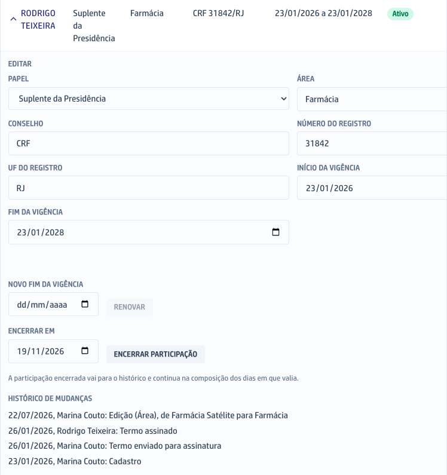
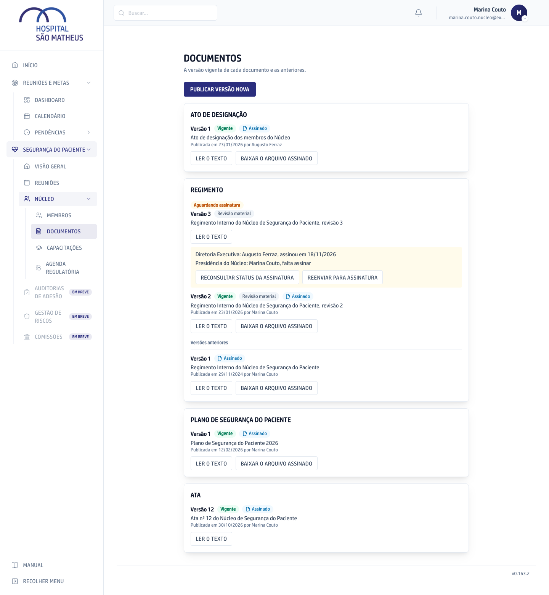
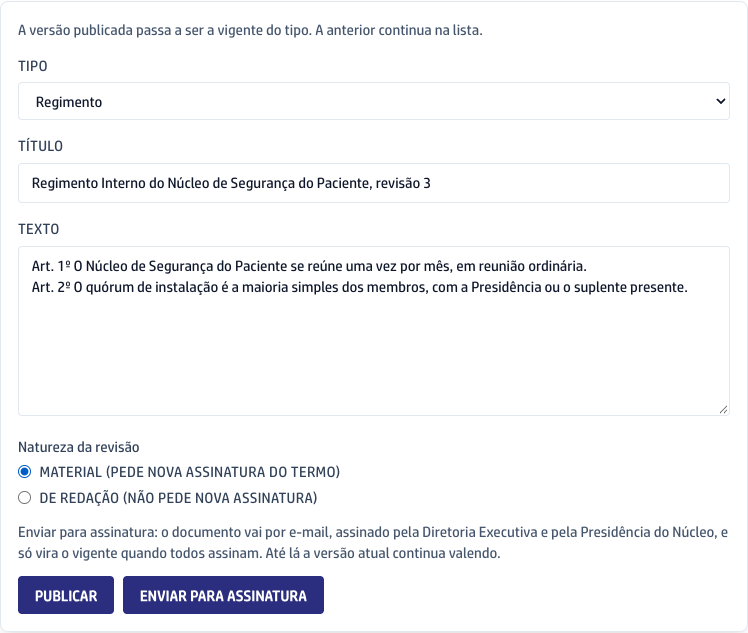
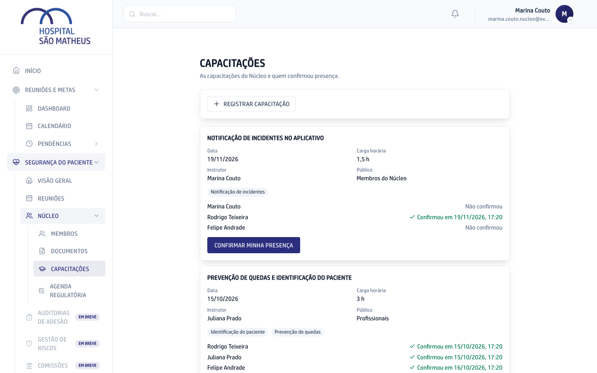
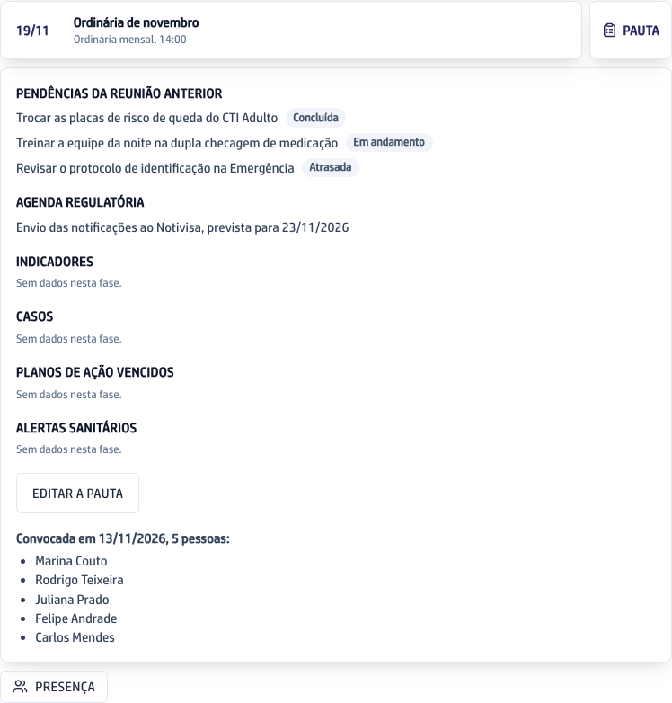
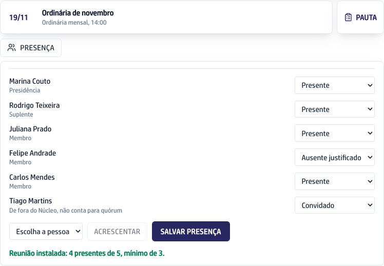
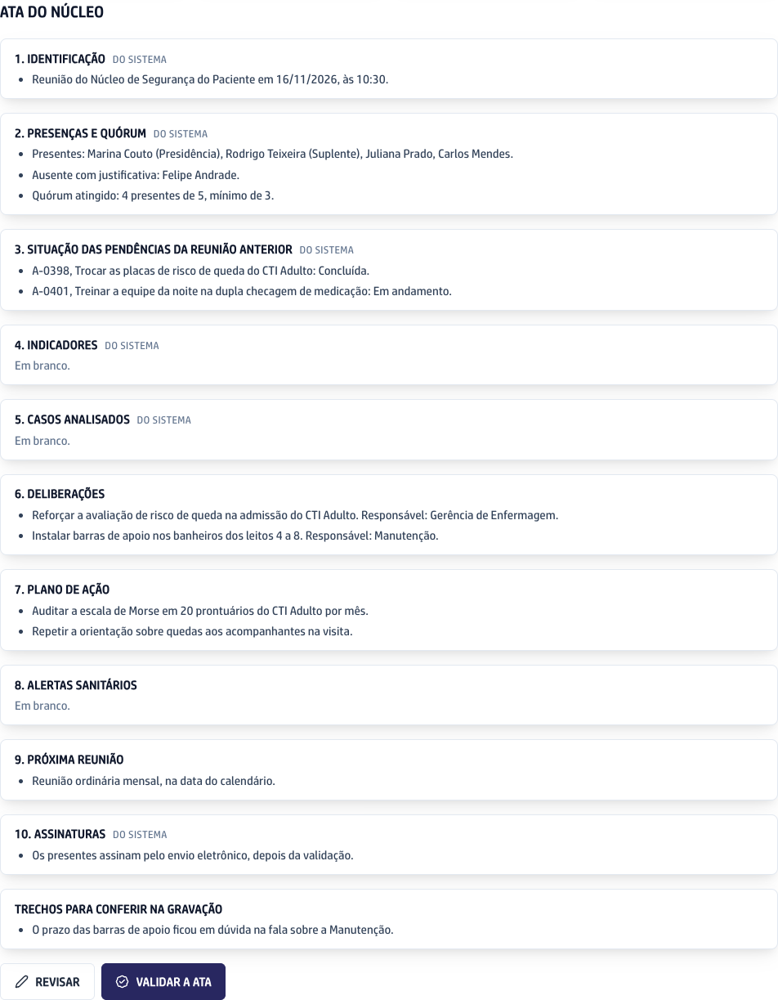
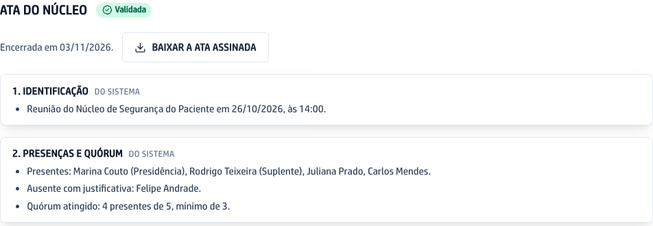

O módulo Segurança do Paciente é onde o Núcleo de Segurança do Paciente funciona dentro do aplicativo: quem faz parte dele, os documentos, as capacitações, a agenda regulatória e as reuniões.

Ele fica no menu da esquerda, em **Segurança do Paciente**, com os itens **Visão geral**, **Reuniões** e **Núcleo**. Dentro de **Núcleo** ficam **Membros**, **Documentos**, **Capacitações** e **Agenda regulatória**.

A Presidência do Núcleo e quem tem Acesso pleno fazem tudo o que esta página descreve. O membro com o Termo de Adesão assinado abre as telas e as atas; cadastrar, publicar e validar ficam com a Presidência e com quem tem Acesso pleno. Quem ainda não assinou o Termo vê o calendário e a agenda; nas outras telas aparece a faixa **Assine o Termo de Adesão para liberar este acesso**, com o botão **Abrir o Termo de Adesão**.

## Cadastrar um membro e acompanhar o Termo

1. No menu da esquerda, clique em **Segurança do Paciente**, depois em **Núcleo** e em **Membros**.
2. Clique em **Cadastrar membro**.
3. Em **Pessoa**, escolha a pessoa no cadastro. Escolha o **Papel**: Presidência, Suplente da Presidência ou Membro. Preencha a **Área**, o **Conselho**, o **Número do registro**, a **UF do registro** e as datas de **Início da vigência** e **Fim da vigência**.

   

4. Clique em **Salvar cadastro**. O aplicativo gera um documento só, com o Termo de Adesão e o Regimento vigente, e manda por e-mail para a pessoa assinar. Se o envio falhar, um aviso amarelo no alto da tela diz o motivo.
5. Acompanhe na lista. A coluna **Estado** mostra onde cada membro está: Cadastrado, Documento gerado, Aguardando assinatura, Ativo, A vencer, Em carência, Vencido ou Encerrado. A coluna **Termo** mostra a data da assinatura, ou **Sem Termo**.

   

6. Quando a pessoa assina, ela passa a **Ativo** sozinha, sem ninguém precisar liberar.
7. Se a assinatura demorar, clique no nome do membro para abrir a ficha dele. Na caixa **Termo de Adesão** há três botões. **Reconsultar status da assinatura** serve para quando a pessoa já assinou e a lista ainda não mudou. **Reenviar o Termo** manda o documento de novo, por exemplo depois de corrigir o e-mail, e o envio anterior deixa de valer. **Liberar sem assinatura** é para quando a assinatura eletrônica falha: pede uma justificativa, que fica no histórico com quem liberou e quando.

   

O aplicativo avisa sozinho, por e-mail. O membro recebe o aviso aos 3 e aos 7 dias sem assinar o Termo. Aos 14 dias, o aviso vai para ele e para a Presidência, e os dois são avisados também 60 e 30 dias antes do fim da vigência. Quando a carência de 30 dias acaba sem renovação, o aviso vai para a Presidência e para a Diretoria Executiva.

## Renovar ou encerrar uma participação

1. Em **Núcleo**, **Membros**, clique no nome do membro. A ficha abre embaixo da linha dele.
2. Para renovar, escolha a data em **Novo fim da vigência** e clique em **Renovar**. A renovação manda um Termo novo para a pessoa assinar. Mudar o **Papel** em **Editar** e clicar em **Salvar alterações** também manda um Termo novo.

   

3. Para encerrar, escolha a data em **Encerrar em**, clique em **Encerrar participação** e depois em **Confirmar encerramento**.
4. A participação encerrada sai da lista e vai para **Histórico de participações encerradas**, no fim da tela. O **Histórico de mudanças**, na ficha, guarda cada alteração, com quem fez e quando.
5. Para saber quem compunha o Núcleo num dia passado, escolha a data em **Composição do Núcleo em**, no fim da tela. A lista mostra quem tinha participação vigente naquele dia, mesmo quem já saiu.

   

Enquanto a pessoa não assina o Termo novo, ela continua no estado em que estava. Até 30 dias depois do fim da vigência, o membro fica **Em carência** e ainda conta para o quórum; depois disso, sem renovação, passa a **Vencido**.

## Publicar uma revisão do Regimento

1. Em **Núcleo**, clique em **Documentos**. Cada tipo de documento aparece com a versão **Vigente** em cima e as **Versões anteriores** embaixo.

   

2. Clique em **Publicar versão nova**.
3. Em **Tipo**, escolha **Regimento**. Preencha o **Título** e cole o **Texto**.
4. Em **Natureza da revisão**, marque **Material** quando a mudança mexe nas regras, ou **De redação** quando só corrige o texto. A revisão material manda um Termo novo para todos os membros que contam para o quórum assinarem; a de redação não pede assinatura de ninguém.

   

5. Clique em **Enviar para assinatura**. O Regimento vai por e-mail para a Diretoria Executiva e para a Presidência do Núcleo, e só vira o vigente quando os dois assinam. Até lá a versão atual continua valendo, e a nova aparece no alto como **Aguardando assinatura**, com quem já assinou.
6. Se a assinatura travar, use **Reconsultar status da assinatura** ou **Reenviar para assinatura**, na caixa da versão que espera.

Nenhuma versão se apaga nem se edita: a correção é sempre uma versão nova. O ato de designação e o Plano de Segurança do Paciente seguem o mesmo caminho; o ato é assinado só pela Diretoria Executiva.

## Registrar uma capacitação e confirmar presença

1. Em **Núcleo**, clique em **Capacitações**.
2. Clique em **Registrar capacitação**. Preencha o **Título**, a **Data**, a **Carga horária (horas)**, o **Instrutor** e o **Público**: Membros do Núcleo ou Profissionais. Marque os **Temas tratados** e, em **Participantes**, quem estava na lista.

   

3. Clique em **Salvar**. A capacitação aparece na lista com cada participante marcado como **Não confirmou**.
4. Cada participante abre a mesma tela e clica em **Confirmar minha presença**, no cartão da capacitação. O botão aparece a partir do dia da capacitação. Depois do toque, a linha da pessoa mostra **Confirmou em**, com a data e a hora.

   

5. Em **Temas mínimos por membro**, veja quantos temas cada membro já cobriu. A conta usa só as capacitações em que ele confirmou presença.
6. A lista **Temas mínimos**, no fim da tela, muda com **Incluir tema**, **Renomear** e **Desativar**.

## Acompanhar a agenda regulatória

1. Em **Núcleo**, clique em **Agenda regulatória**. Cada obrigação aparece num cartão com a periodicidade, a **Próxima data**, o **Último resultado** e o link, quando houver.
2. Para incluir uma obrigação, clique em **Incluir evento** e preencha **Evento**, **Periodicidade**, **Detalhe da periodicidade**, **Próxima data**, **Lembrar quantos dias antes** e **Link**. Clique em **Salvar**.
3. Quando a próxima data fica a menos dias do que a antecedência escolhida, o aplicativo abre uma Pendência de lembrete para a Presidência. O cartão mostra **Lembrete aberto**, com o número da pendência e o prazo; passado o prazo, **Lembrete atrasado**. Esse lembrete fica só no aplicativo, sem e-mail.

   

4. Depois de cumprir a obrigação, clique em **Registrar resultado**, escreva o **Resultado**, confira a data em **Feito em** e clique em **Registrar**. O lembrete fecha, o resultado vira o último do cartão e a próxima data anda pela periodicidade. A obrigação avulsa não se repete.
5. Para mudar a data ou o link, clique em **Editar**. A obrigação que deixou de valer se desliga em **Desativar**.

## Fazer a reunião do Núcleo, da pauta à ata assinada

1. No menu da esquerda, em **Segurança do Paciente**, clique em **Reuniões**. As reuniões do Núcleo aparecem mês a mês.
2. No começo do ano, clique em **Gerar o calendário do ano**, escolha o **Ano**, o **Dia do mês** e a **Hora** e clique em **Gerar**. O aplicativo cria as doze reuniões ordinárias, uma por mês; o dia que cai em fim de semana ou feriado vai para o próximo dia útil. Para uma reunião fora do calendário, clique em **Nova reunião**, escolha o **Tipo** e preencha o título, a data e a hora.

   

3. Cinco dias úteis antes da reunião, a pauta fica pronta. Clique em **Pauta**, ao lado da reunião, para ver os blocos que o aplicativo montou, com a situação de hoje de cada pendência.
4. Para mudar algum item, clique em **Editar a pauta**, faça o ajuste e clique em **Salvar a pauta**.
5. Clique em **Convocar os membros**. A convocação vai por e-mail, e a pauta passa a mostrar quem foi convocado.

   

6. No dia, clique em **Presença**, embaixo da reunião. Marque cada pessoa como Presente, Ausente, Ausente justificado ou Convidado. Para alguém de fora do Núcleo, escolha a pessoa e clique em **Acrescentar**. Clique em **Salvar presença**.
7. Veja o quórum, embaixo da lista. Com o mínimo de presentes e a Presidência ou o suplente na sala, aparece **Reunião instalada**. Sem quórum, escolha a **Nova data** e clique em **Registrar como não instalada e reagendar**: a reunião fica registrada como não instalada e nasce outra, na data nova.

   

8. Depois da reunião, clique nela para abrir e, em **Transcrição**, clique em **Anexar Transcrição e Processar com IA**. A IA monta a minuta da ata em dez blocos. A identificação, as presenças, as pendências da reunião anterior e os indicadores vêm do aplicativo; o resto vem da transcrição.
9. Leia a ata. Clique em **Revisar** para reescrever o plano de ação, os alertas sanitários e a próxima reunião, um item por linha, e para ajustar as deliberações, cada uma com o responsável e o prazo. Clique em **Salvar a revisão**. Os **Trechos para conferir na gravação**, no fim, apontam o que vale ouvir de novo antes de validar.

   

10. Clique em **Validar a ata**. Só a Presidência, o suplente em exercício ou quem tem Acesso pleno valida. Cada deliberação vira uma Pendência, e a ata vai por e-mail para a assinatura eletrônica de todos os presentes.
11. A ata encerra sozinha 5 dias úteis depois do envio, com as assinaturas que tiver, e registra quem não assinou. A ata encerrada entra em **Documentos**, numerada, e se baixa pelo botão **Baixar a ata assinada**.

    

12. Se alguém recusar a assinatura ou o envio for cancelado, a ata mostra o aviso e não encerra sozinha. Clique em **Reenviar para assinatura**: a ata vai de novo para todos os presentes, inclusive quem já tinha assinado, e os 5 dias úteis recomeçam do reenvio.

A transcrição anexada é apagada 30 dias depois de a ata ser assinada. Para uma conversa curta de segurança num setor, escolha o tipo **Reunião rápida de segurança** em **Nova reunião**: ela não tem ata nem assinatura, só o setor, quem participou e até três linhas do que foi conversado.

## O ciclo do membro

```fluxograma
inicio cadastro 1,1: Cadastrar membro | A Presidência escolhe a pessoa, o papel e a vigência.
passo termo 2,1: Termo enviado | Um documento só, com o Termo de Adesão e o Regimento vigente, vai por e-mail para a pessoa.
decisao assinou 3,1: Assinou?
passo espera 3,2: Aguardando assinatura | Avisos aos 3, 7 e 14 dias. A Presidência pode reconsultar, reenviar ou liberar.
passo ativo 4,1: Ativo | Abre as atas, os documentos e as capacitações, e conta para o quórum.
fim encerrado 4,2: Encerrado | A participação vai para o histórico e continua na composição dos dias em que valia.
passo avencer 5,1: A vencer | Avisos 60 e 30 dias antes do fim da vigência.
passo termonovo 5,2: Termo novo | Vai por e-mail para a pessoa assinar. Quem já tinha assinado continua no estado em que estava, sem os avisos de 3, 7 e 14 dias.
decisao renovou 6,1: Renovou?
passo carencia 6,2: Em carência | Até 30 dias depois do fim, ainda conta para o quórum e ainda dá para renovar.
fim vencido 7,2: Vencido | A carência acabou sem renovação. A Presidência e a Diretoria Executiva são avisadas.
cadastro -> termo
termo -> assinou
assinou -> ativo: sim
assinou -> espera: não
espera -> termo: reenviado
espera -> ativo: liberado com justificativa
ativo -> termonovo: mudou o papel ou revisão material do Regimento
termonovo -> ativo: segue valendo, sem esperar a assinatura
ativo -> encerrado: encerrar participação
ativo -> avencer
avencer -> renovou
renovou -> termonovo: renovou
renovou -> carencia: não
carencia -> termonovo: renovou na carência
carencia -> vencido: a carência acabou
```

## O ciclo da reunião

```fluxograma
inicio calendario 1,1: Calendário do ano | Doze reuniões ordinárias, uma por mês, ou uma reunião criada à mão.
passo pauta 2,1: Pauta pronta | Cinco dias úteis antes, montada pelo aplicativo com a situação de hoje de cada pendência.
passo convocacao 3,1: Convocar os membros | A Presidência ajusta a pauta, se quiser, e convoca em um clique.
passo presenca 4,1: Presença | No dia, a Presidência marca quem veio.
decisao quorum 5,1: Tem quórum?
passo naoinstalada 5,2: Não instalada | A reunião fica registrada e nasce outra, na nova data.
passo transcricao 6,1: Transcrição anexada | A IA monta a minuta da ata em dez blocos.
passo validar 7,1: Revisar e Validar a ata | A Presidência revisa e valida. Cada deliberação vira Pendência.
passo assinatura 8,1: Assinatura dos presentes | A ata vai por e-mail para todos os presentes.
decisao cancelado 9,1: Envio cancelado?
passo reenvio 9,2: Reenviar para assinatura | Vai de novo para todos os presentes, e o prazo de 5 dias úteis recomeça.
fim encerrada 10,1: Ata encerrada | 5 dias úteis depois do envio, com as assinaturas que tiver. Entra em Documentos.
calendario -> pauta
pauta -> convocacao
convocacao -> presenca
presenca -> quorum
quorum -> transcricao: sim
quorum -> naoinstalada: não
naoinstalada -> pauta: nova data
transcricao -> validar
validar -> assinatura
assinatura -> cancelado
cancelado -> encerrada: não
cancelado -> reenvio: sim
reenvio -> assinatura
```
