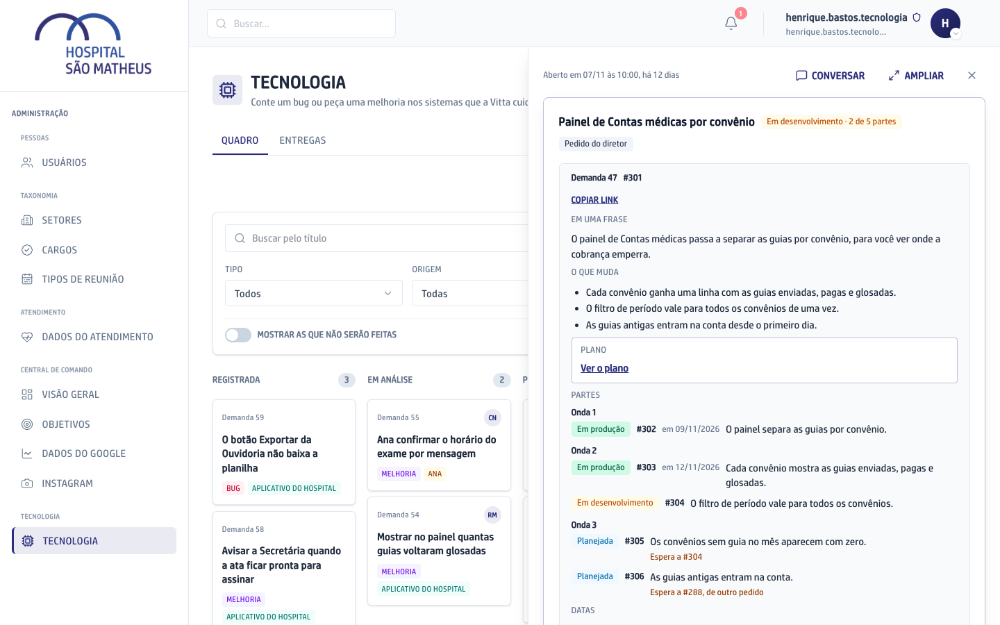
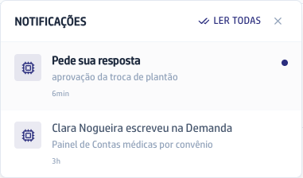
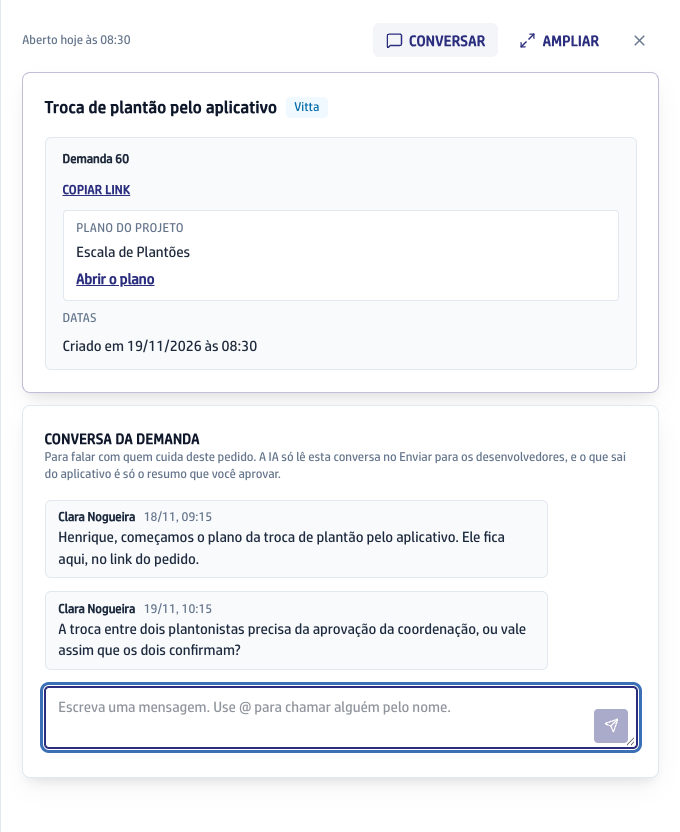
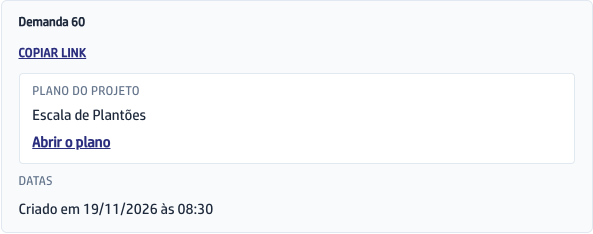

A Tecnologia é onde você conta à Vitta, a empresa que cuida dos sistemas do hospital, um bug ou uma melhoria que quer no aplicativo ou na Ana. Cada pedido vira uma Demanda, que guarda a conversa que a originou, e você acompanha cada uma até a entrega.

Ela fica na área de Administração, e só o Super admin vê. A aba tem duas partes no alto: **Quadro**, com os seus pedidos, e **Entregas**, com o que já foi entregue. No celular, o Quadro se chama **Conversas** e mostra os pedidos numa lista.

## Pedir um bug ou uma melhoria ao Assistente

O Assistente é a IA que entende o seu pedido e o escreve para a Vitta. Nada vai para a Vitta antes do seu clique em **Criar o card**.

1. No menu da esquerda, clique em **Admin**.
2. Na seção **Tecnologia**, clique em **Tecnologia**.
3. No alto da aba, clique em **Novo pedido**. No celular, o botão se chama **Nova conversa**.
4. O Assistente pergunta se é um bug, algo que não funciona como deveria, ou uma melhoria. Clique em **Bug** ou **Melhoria**, ou escreva do seu jeito no campo de baixo. Dá para falar no microfone e anexar um print ou um documento a qualquer momento.

   

5. Responda as perguntas, uma de cada vez. No bug, são no máximo cinco: onde aconteceu, o que aconteceu, o que você esperava, como repetir e o print. Na melhoria, cada pergunta chega num cartão com duas opções; a recomendada vem em destaque, com o porquê embaixo, e a linha **Na prática** diz o que muda com cada uma. Ao lado, o **Documento do pedido** se monta conforme você responde.

   

6. Na melhoria, se quiser encerrar antes, clique em **Fechar e resumir**, no alto da conversa.
7. Leia o resumo. Em **Quem cuida disto?**, escolha quem da Vitta vai cuidar do pedido, se quiser. Sem escolha, o card vai para quem a tela indica.
8. Se o resumo estiver certo, clique em **Criar o card**. Se algo estiver errado, clique em **Não bateu**, diga o quê, e a conversa continua até o resumo ficar certo.

   

Se a conversa parar no meio, ela fica guardada como Registrada. Clique no pedido no Quadro e você continua de onde parou.

## Acompanhar o pedido no Quadro

1. Abra a aba **Tecnologia**. Ela abre no **Quadro**.
2. Veja os seus pedidos em colunas, uma para cada Etapa: Registrada, Em análise, Planejada, Em desenvolvimento e Entregue. A Etapa muda sozinha conforme a Vitta trabalha; não dá para arrastar o card de uma coluna para outra. No alto de cada coluna aparece quantos pedidos ela tem.

   

3. Em cada card, veja o número da Demanda, o título, o selo **Bug** ou **Melhoria**, o Projeto, as iniciais de quem cuida, a versão quando ele já está Em produção e, quando o pedido tem partes, quantas já foram entregues.
4. Quando o pedido já tem um plano publicado, o card mostra no canto o botão quadrado **Ver o plano**, com o ícone de apresentação. Clique nele para abrir a página do plano em outra aba. Um check verde no botão quer dizer que você já validou aquele plano. Ao abrir o card, o cartão **Plano** também leva à página. Para validar, continue usando o link do e-mail.

   

5. Clique num card. Ele abre num painel à direita, com o documento do pedido: o que ele muda para você, as partes e as datas.
6. Em **Partes**, veja em que ordem o pedido entra. As partes vêm agrupadas por Onda: a **Onda 1** tem as que não dependem de outra parte do pedido, e cada Onda seguinte entra depois das que ela espera. Cada parte traz o seu número, como **#304**, para você citar aquela parte quando falar com a Vitta. Se a parte ainda espera outra terminar, aparece embaixo dela a linha **Espera a #304**. Quando a outra é de um pedido diferente, a linha diz **Espera a #288, de outro pedido**. A linha some sozinha quando a outra parte termina.

   

7. Para falar com a Vitta sobre aquele pedido, clique em **Conversar**, no alto do painel, e escreva na Conversa da Demanda. Para chamar alguém, escreva @ e escolha o nome. Para o que você escreveu virar uma tarefa no plano, veja **Mandar o que você escreveu aos desenvolvedores**, mais abaixo.

   

8. Quando a Vitta precisa de uma decisão sua sobre o pedido, a pergunta chega nessa mesma Conversa da Demanda. O passo a passo está em **Responder uma pergunta da Vitta**, logo abaixo.
9. Para fechar o painel, clique no X ou aperte Esc. O botão **Ampliar** abre o pedido na tela toda, e o **Voltar ao quadro** traz as colunas de volta.

A coluna Entregue mostra o que foi entregue nos últimos 30 dias. Os pedidos que não serão feitos ficam fora das colunas: para vê-los, ligue **Mostrar as que não serão feitas**, na barra de filtros.

## Responder uma pergunta da Vitta

Às vezes o trabalho da Vitta para numa decisão que é sua. A pergunta chega pelo pedido, no aplicativo, e você responde ali mesmo.

1. Quando a Vitta precisa de uma decisão sua sobre um pedido, a pergunta chega na Conversa da Demanda daquele pedido, como as outras mensagens da Vitta, e você recebe o aviso no sino e por e-mail. Se a pergunta espera uma resposta sua, o aviso do sino diz **Pede sua resposta** e traz o assunto embaixo. Esse aviso vai só para você, mesmo num pedido que você não abriu.

   

2. No e-mail, o assunto diz quem pergunta e sobre o quê, por exemplo "Clara Nogueira pede sua resposta: aprovação da troca de plantão". Dentro dele vêm o assunto, o nome do pedido e o link.
3. Clique no aviso do sino ou no link do e-mail. O pedido abre na aba Tecnologia, no painel à direita.
4. Clique em **Conversar**, no alto do painel, leia a pergunta e responda ali mesmo, na Conversa da Demanda.

   

5. Escreva a resposta na caixa e clique no botão de enviar, ao lado dela. A resposta fica na conversa, e a Vitta lê ali.

Quando a Vitta só dá um recado, sem pergunta, o sino mostra o aviso de sempre, como **Clara Nogueira escreveu na Demanda**, e o e-mail segue o mesmo texto.

Às vezes a pergunta vem de um projeto da Vitta que ainda não aparecia no aplicativo. Nesse caso, ela abre um pedido novo na aba. No Quadro, o card traz o nome do projeto no selo. No painel, o pedido vem marcado como **Vitta**, e a parte **Plano do projeto** mostra o nome do projeto e o link **Abrir o plano**, que abre o plano em outra aba. O pedido fica em Registrada, porque o aplicativo não acompanha o trabalho desse projeto, e não se apaga pelo aplicativo. A pergunta seguinte do mesmo plano cai no mesmo pedido, nunca num segundo. Depois do primeiro pedido, o campo **Projeto** da barra de filtros passa a listar esse projeto.



## Mandar o que você escreveu aos desenvolvedores

Quando o pedido já virou card, a Conversa da Demanda guarda o que você escreve. Quem cuida do pedido lê a conversa no aplicativo e recebe o aviso de cada mensagem sua no sino e por e-mail. O plano do pedido só muda quando você manda: escreve quantas mensagens quiser e, no fim, aperta um botão. Do aplicativo sai só o resumo que você aprovou, e ele vira uma tarefa no plano do pedido.

1. No Quadro, clique no card do pedido e, no alto do painel, clique em **Conversar**.
2. Escreva o que quer mudar ou responder na caixa embaixo da conversa e clique no botão de enviar, ao lado dela. Mande quantas mensagens quiser: cada uma fica guardada na conversa.
3. Quando terminar, clique em **Enviar para os desenvolvedores**, embaixo da caixa. O botão fica desligado enquanto não há mensagem sua nova desde o último envio, e só aparece para quem é do hospital.
4. Leia o **Entendi assim:**, que aparece na conversa. Ele traz, em tópicos, o que a IA entendeu das suas mensagens e o que muda em cada parte do pedido, com o número da parte.

   

5. Se o resumo estiver certo, clique em **Enviar**. Se faltou algo ou alguma coisa está errada, clique em **Corrigir**: o Entendi assim fecha e o cursor vai para a caixa de mensagem. Escreva o que faltou, clique no botão de enviar, ao lado da caixa, e clique de novo em Enviar para os desenvolvedores. O resumo seguinte já leva em conta o que você escreveu.
6. Depois do Enviar, a conversa ganha a linha **Enviado aos desenvolvedores**, com a data, a hora e os tópicos que você aprovou. O que você escrever depois dessa linha entra no próximo envio.

   

Se o envio falhar, a tela diz o motivo e mostra **Tente de novo**, sem perder nada do que você escreveu.

## Filtrar por Projeto

A aba junta os pedidos do Aplicativo do Hospital, da Ana, a agente de atendimento, e dos projetos novos da Vitta que já têm pedido na aba. Cada card traz um selo com o nome do Projeto.

1. No Quadro, na barra de filtros, clique no campo **Projeto**.
2. Escolha **Aplicativo do Hospital**, **Ana** ou o nome de um projeto novo da Vitta. O Quadro passa a mostrar só os pedidos daquele Projeto.

   

3. Para voltar a ver tudo, escolha **Todos** no mesmo campo ou clique em **Limpar filtros**.

O Projeto combina com os outros filtros da barra, o Tipo e a Origem, e com a busca pelo título. Os pedidos da Ana são só para acompanhar: o Assistente cria card apenas no Aplicativo do Hospital. Nas Entregas, o filtro Projeto é a fileira de botões **Todos**, **Aplicativo do Hospital**, **Ana** e um botão para cada projeto novo, no alto.

## Ver as Entregas

1. No alto da aba Tecnologia, clique em **Entregas**.
2. Leia os números do alto: quantos pedidos chegaram e quantas entregas saíram nas últimas 4 semanas, comparados com as 4 anteriores.
3. Veja o gráfico das últimas 12 semanas. Cada barra mostra as entregas da semana pelo tamanho, **P**, **M** ou **G**, conforme o número de partes. Passe o mouse numa barra para ver o que saiu naquela semana. Clique nela para a lista de baixo mostrar só aquela semana.

   

4. Em **O que foi entregue**, veja as entregas agrupadas por semana, a mais nova em cima. Cada linha diz o tamanho, o título, se é bug ou melhoria, a versão e a data.
5. Passe o mouse numa linha, ou clique nela, para ver o que a entrega muda. Ali ficam os botões **Abrir o card** e **Copiar link** e, quando houver vídeo, **Demonstração**.

   

6. No fim da lista, clique em **Ver semanas anteriores** para buscar as entregas mais antigas.

Os filtros do alto, **Bug** ou **Melhoria**, a Origem e o Projeto, valem para os números, para o gráfico e para a lista.

## O caminho de um pedido

```fluxograma
inicio conversa 1,1: Conversa com o Assistente | Você clica em Novo pedido e conta o que precisa, por texto, voz, print ou documento.
decisao tipo 2,1: Bug ou melhoria?
passo bug 3,1: Perguntas do bug | No máximo cinco: onde, o que aconteceu, o que esperava, como repetir e o print.
passo melhoria 3,2: Perguntas da melhoria | Uma por vez, num cartão com duas opções e a recomendada em destaque.
passo resumo 4,1: Resumo | O Assistente junta o que você disse. Em Quem cuida disto?, você escolhe quem da Vitta vai cuidar.
decisao bateu 5,1: O resumo bateu?
passo naobateu 5,2: Não bateu | Você diz o que está errado, e a conversa continua até o resumo ficar certo.
passo card 6,1: Criar o card | O pedido vai para a Vitta e aparece no Quadro.
passo analise 7,1: Em análise | A Vitta lê a melhoria e decide como fazer. O bug pula esta Etapa e entra direto na fila.
passo planejada 7,2: Planejada | O trabalho está dividido em partes e na fila. Quando o plano está publicado, o card mostra o botão Ver o plano.
passo desenvolvimento 7,3: Em desenvolvimento | A Vitta está fazendo. Num pedido com partes, o card mostra quantas já foram entregues.
fim entregue 7,4: Entregue | O trabalho terminou. Quando a entrega chega ao aplicativo, o card passa a Em produção, com a versão.
passo envio 8,2: Enviar para os desenvolvedores | Com o card criado, você escreve na Conversa da Demanda quantas mensagens quiser e aperta o botão.
decisao entendi 9,2: O Entendi assim bateu?
passo corrigir 9,1: Corrigir | Você manda na Conversa uma mensagem com o que faltou e aperta o botão de novo.
passo enviado 10,2: Enviado aos desenvolvedores | A Conversa ganha a linha com a data e os tópicos. Do aplicativo sai só o resumo que você aprovou, e os desenvolvedores ajustam o plano.
conversa -> tipo
tipo -> bug: bug
tipo -> melhoria: melhoria
bug -> resumo
melhoria -> resumo
resumo -> bateu
bateu -> card: sim
bateu -> naobateu: não
naobateu -> resumo
card -> analise: melhoria
card -> planejada: bug
analise -> planejada
planejada -> desenvolvimento
desenvolvimento -> entregue
planejada -> envio: quer mudar algo
envio -> entendi
entendi -> enviado: Enviar
entendi -> corrigir: Corrigir
corrigir -> envio
```
