A Tecnologia é onde você conta à Vitta, a empresa que cuida dos sistemas do hospital, um bug ou uma melhoria que quer no aplicativo ou na Ana. Cada pedido vira uma Demanda, que guarda a conversa que a originou, e você acompanha cada uma até a entrega.

Ela fica na área de Administração, e só o Super admin vê. A aba tem duas partes no alto: **Quadro**, com os seus pedidos, e **Entregas**, com o que já foi entregue. No celular, o Quadro se chama **Conversas** e mostra os pedidos numa lista.

## Pedir um bug ou uma melhoria ao Assistente

O Assistente é a IA que entende o seu pedido e o escreve para a Vitta. Nada vai para a Vitta antes do seu clique em **Criar o card**.

1. No menu da esquerda, clique em **Admin**.
2. Na seção **Tecnologia**, clique em **Tecnologia**.
3. No alto da aba, clique em **Novo pedido**. No celular, o botão se chama **Nova conversa**.
4. O Assistente pergunta se é um bug, algo que não funciona como deveria, ou uma melhoria. Clique em **Bug** ou **Melhoria**, ou escreva do seu jeito no campo de baixo. Dá para falar no microfone e anexar um print ou um documento a qualquer momento.

   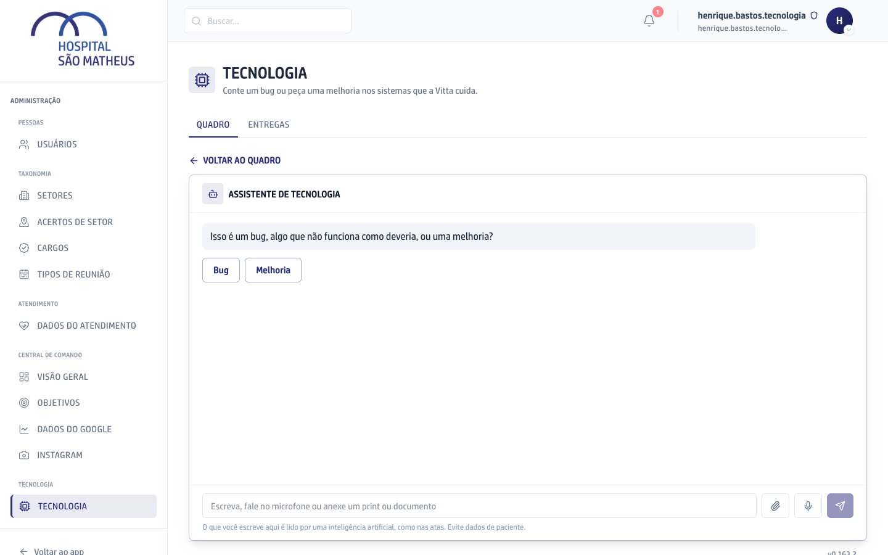

5. Responda as perguntas, uma de cada vez. No bug, são no máximo cinco: onde aconteceu, o que aconteceu, o que você esperava, como repetir e o print. Na melhoria, cada pergunta chega num cartão com duas opções; a recomendada vem em destaque, com o porquê embaixo, e a linha **Na prática** diz o que muda com cada uma. Ao lado, o **Documento do pedido** se monta conforme você responde.

   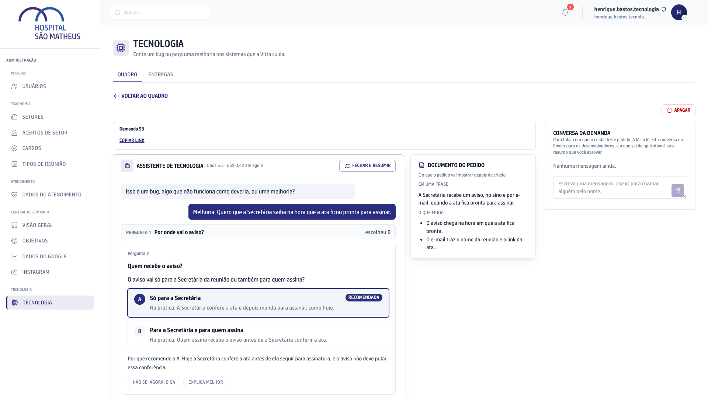

6. Na melhoria, se quiser encerrar antes, clique em **Fechar e resumir**, no alto da conversa.
7. Leia o resumo. Em **Quem cuida disto?**, escolha quem da Vitta vai cuidar do pedido, se quiser. Sem escolha, o card vai para quem a tela indica.
8. Se o resumo estiver certo, clique em **Criar o card**. Se algo estiver errado, clique em **Não bateu**, diga o quê, e a conversa continua até o resumo ficar certo.

   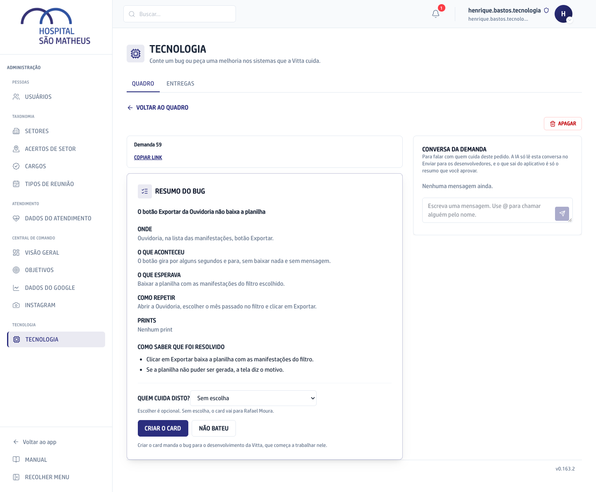

Se a conversa parar no meio, ela fica guardada como Registrada. Clique no pedido no Quadro e você continua de onde parou.

## Acompanhar o pedido no Quadro

1. Abra a aba **Tecnologia**. Ela abre no **Quadro**.
2. Veja os seus pedidos em colunas, uma para cada Etapa: Registrada, Em análise, Planejada, Em desenvolvimento e Entregue. A Etapa muda sozinha conforme a Vitta trabalha; não dá para arrastar o card de uma coluna para outra. No alto de cada coluna aparece quantos pedidos ela tem.

   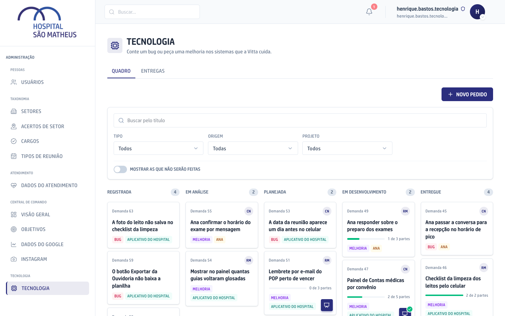

3. Em cada card, veja o número da Demanda, o título, o selo **Bug** ou **Melhoria**, o Projeto, as iniciais de quem cuida, a versão quando ele já está Em produção e, quando o pedido tem partes, quantas já foram entregues. Enquanto falta o hospital fazer alguma coisa para começar a usar a entrega, o card mostra o selo **Implantação 1 de 3**, com quantos Pedidos de implantação já foram feitos.

   

4. Quando o pedido já tem um plano publicado, o card mostra no canto o botão quadrado **Ver o plano**, com o ícone de apresentação. Clique nele para abrir a página do plano em outra aba. Um check verde no botão quer dizer que você já validou aquele plano. Ao abrir o card, o cartão **Plano** também leva à página. Para validar, continue usando o link do e-mail.

   

5. Clique num card. Ele abre num painel à direita, com o documento do pedido: o que ele muda para você, as partes e as datas.
6. Em **Partes**, veja em que ordem o pedido entra. As partes vêm agrupadas por Onda: a **Onda 1** tem as que não dependem de outra parte do pedido, e cada Onda seguinte entra depois das que ela espera. Cada parte traz o seu número, como **#304**, para você citar aquela parte quando falar com a Vitta. Se a parte ainda espera outra terminar, aparece embaixo dela a linha **Espera a #304**. Quando a outra é de um pedido diferente, a linha diz **Espera a #288, de outro pedido**. A linha some sozinha quando a outra parte termina.

   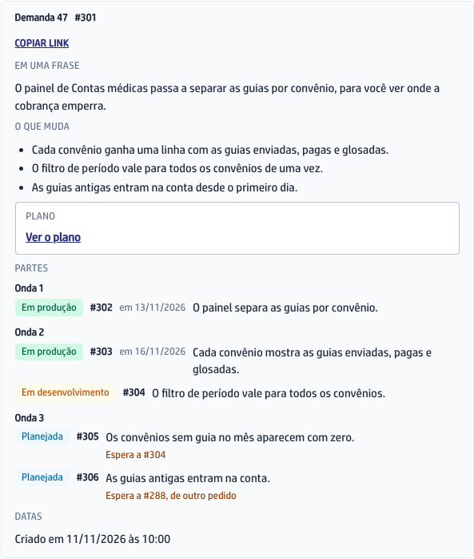

7. Quando a entrega já está Em produção e ainda falta o hospital fazer alguma coisa para começar a usá-la, como um teste, uma configuração ou um treinamento, o card ganha a seção **Implantação**. Ao lado do título aparece quantos já foram feitos, como **1 de 3 feitos**. Cada linha é um Pedido de implantação, com a situação, **Feito** ou **Aberto**, e com quem ele está. Cada Pedido aberto chega na lista **Esperando você** de quem o recebe. A Implantação aberta não segura a entrega: o pedido fica Em produção, e a seção mostra o que falta para usar. Veja **Concluir um passo a passo** e **Avisar um problema na implantação**, mais abaixo.

   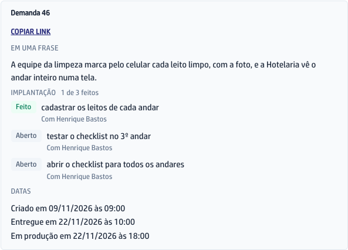

8. Para falar com a Vitta sobre aquele pedido, clique em **Conversar**, no alto do painel, e escreva na Conversa da Demanda. Para chamar alguém, escreva @ e escolha o nome. Para o que você escreveu virar uma tarefa no plano, veja **Mandar o que você escreveu aos desenvolvedores**, mais abaixo.

   

9. Quando a Vitta precisa de uma decisão sua sobre o pedido, ou precisa que você faça alguma coisa no aplicativo, o pedido chega num cartão nessa mesma Conversa da Demanda e na lista **Esperando você**, no alto da aba. Veja **Responder uma pergunta da Vitta** e **Concluir um passo a passo**, logo abaixo.
10. Para fechar o painel, clique no X ou aperte Esc. O botão **Ampliar** abre o pedido na tela toda, e o **Voltar ao quadro** traz as colunas de volta.

A coluna Entregue mostra o que foi entregue nos últimos 30 dias. Os pedidos que não serão feitos ficam fora das colunas: para vê-los, ligue **Mostrar as que não serão feitas**, na barra de filtros.

## Ver o que espera você

O que a Vitta pede a alguém fica guardado num cartão até a pessoa agir. Há dois tipos: a pergunta, que se responde, e o passo a passo, que se faz e se conclui. A lista **Esperando você** junta num lugar só os dois tipos, de todos os projetos. Até 22/11/2026 ela se chamava Esperando sua resposta.

1. No menu da esquerda, clique em **Admin** e, na seção **Tecnologia**, clique em **Tecnologia**.
2. Veja a lista **Esperando você** no alto da aba, acima do Quadro. Ao lado do nome aparece quantos pedidos estão abertos. Quando nenhum pedido espera alguém, a lista some.

   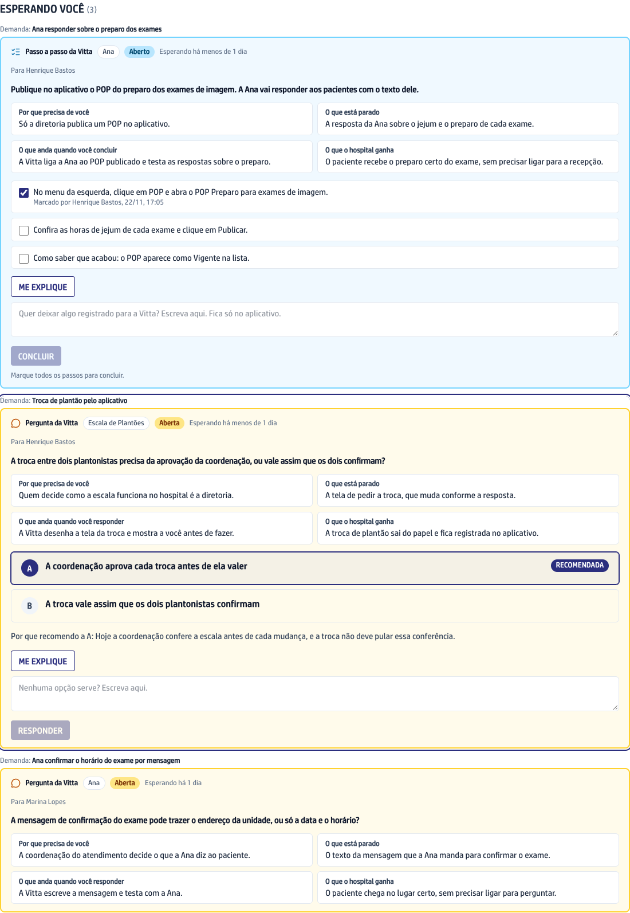

3. Veja a ordem: as suas vêm primeiro, depois as que esperam outra pessoa. Por último, no grupo **Com a Vitta**, vem o que a própria Vitta precisa fazer, para você acompanhar o que anda do lado de lá. Em cada grupo, a mais antiga fica em cima. A linha **Para**, no cartão, diz quem o pedido espera.
4. Leia o cartão. O ícone no canto diz o tipo: o balão de conversa é uma pergunta, e a lista com check é um passo a passo. Em cima do cartão vem o nome do pedido, em **Demanda**. No cartão da pergunta aparecem o projeto, o estado **Aberta**, há quantos dias a pergunta espera, a pergunta e quatro quadros: **Por que precisa de você**, **O que está parado**, **O que anda quando você responder** e **O que o hospital ganha**. Quando a Vitta já preparou opções, elas vêm embaixo, com a recomendada em destaque e o porquê. No cartão do passo a passo, no lugar das opções vêm os passos, cada um com um check.
5. Clique no aviso do sino ou no link do e-mail de uma pergunta: a aba abre com o cartão dela em destaque, com uma borda em volta.

Se a pergunta espera você, responda ali mesmo, no cartão da lista: as opções, o campo da resposta e o **Me explique** aparecem nele, como em **Responder uma pergunta da Vitta**, logo abaixo. O passo a passo também se conclui no cartão da lista, como em **Concluir um passo a passo**. Quando o pedido espera outra pessoa da diretoria, o cartão é só para ler. A pergunta respondida sai da lista na hora, e o passo a passo concluído também.

## Responder uma pergunta da Vitta

Às vezes o trabalho da Vitta para numa decisão que é sua. A pergunta chega num cartão, no aplicativo, e você responde no próprio cartão.

1. Quando a Vitta precisa de uma decisão sua sobre um pedido, a pergunta chega num cartão, na lista **Esperando você** e na Conversa da Demanda daquele pedido, e você recebe o aviso no sino e por e-mail. Se a pergunta espera uma resposta sua, o aviso do sino diz **Pede sua resposta** e traz o assunto embaixo. Esse aviso vai só para você, mesmo num pedido que você não abriu.

   

2. No e-mail, o assunto diz quem pergunta e sobre o quê, por exemplo "Clara Nogueira pede sua resposta: aprovação da troca de plantão". Dentro dele vêm o assunto, o nome do pedido e o link.
3. Clique no aviso do sino ou no link do e-mail. A aba Tecnologia abre com o cartão da pergunta em destaque, na lista **Esperando você**. Em cima do cartão está o nome do pedido. Leia e responda ali mesmo, no cartão da lista, sem abrir o pedido.
4. O mesmo cartão aparece na Conversa da Demanda do pedido. Para responder por lá, clique no card do pedido, no Quadro, e depois em **Conversar**, no alto do painel: responda ali mesmo, no cartão.

   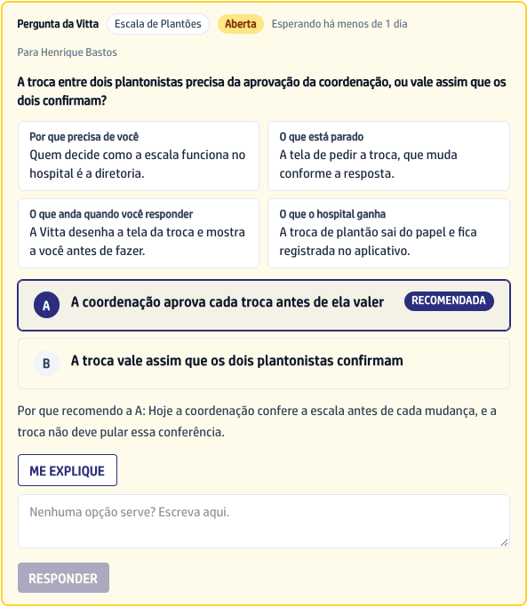

5. Se a pergunta traz opções, clique na opção que você escolhe: o clique já envia a resposta. A opção **Recomendada** vem em destaque, com o porquê embaixo. Se nenhuma opção serve, escreva no campo embaixo delas e clique em **Responder**. Se tiver dúvida antes de responder, veja **Pedir explicação ao assistente (Me explique)**, logo abaixo.
6. Depois de responder, a pergunta sai da lista **Esperando você** na hora. Na Conversa da Demanda, o cartão passa a **Respondida** e mostra a sua resposta e o seu nome, e a resposta entra também como mensagem.
7. A Vitta lê a sua resposta e dá o ok. Só então o trabalho anda: o cartão passa a **Resolvida**, com **O que foi decidido** e **O que destravou**, e a conversa ganha uma linha com a decisão. Quando a pergunta deixa de ser necessária, o cartão passa a **Cancelada**, com o motivo.

Só a pessoa que a pergunta espera responde. Outro Super admin vê o cartão, na lista e na Conversa, sem as opções clicáveis, sem o campo da resposta e sem o **Me explique**. Um desenvolvedor da Vitta pode registrar a resposta no seu lugar, e o cartão mostra os dois nomes, como "Registrada por Rafael Moura em nome de Henrique Bastos".

Se a pergunta fica sem resposta, o aplicativo lembra você uma vez só, depois de 3 dias, no sino e por e-mail, com quantos dias ela espera, como **Sua resposta espera há 3 dias**.

Quando a Vitta só dá um recado, sem pergunta, o sino mostra o aviso de sempre, como **Clara Nogueira escreveu na Demanda**, e o e-mail segue o mesmo texto.

Às vezes a pergunta vem de um projeto da Vitta que ainda não aparecia no aplicativo. Nesse caso, ela abre um pedido novo na aba. No Quadro, o card traz o nome do projeto no selo. No painel, o pedido vem marcado como **Vitta**, e a parte **Plano do projeto** mostra o nome do projeto e o link **Abrir o plano**, que abre o plano em outra aba. O pedido fica em Registrada, porque o aplicativo não acompanha o trabalho desse projeto, e não se apaga pelo aplicativo. A pergunta seguinte do mesmo plano cai no mesmo pedido, nunca num segundo. Depois do primeiro pedido, o campo **Projeto** da barra de filtros passa a listar esse projeto.


## Concluir um passo a passo

Às vezes a Vitta precisa que você faça alguma coisa no aplicativo, como publicar um documento ou cadastrar uma pessoa. O pedido chega num cartão com o passo a passo, e cada passo tem um check para você marcar.

O **Pedido de implantação** usa o mesmo cartão. Ele chega quando uma entrega já está no ar e falta o hospital fazer alguma coisa para começar a usá-la, como um teste, uma configuração, a abertura ou um treinamento. Quem recebe escolhe quem do hospital faz e marca os checks quando a pessoa devolve.

1. Quando a Vitta precisa que você faça alguma coisa, o cartão **Passo a passo da Vitta**, ou **Pedido de implantação**, chega na lista **Esperando você** e na Conversa da Demanda do pedido, e você recebe o aviso no sino e por e-mail. O aviso do sino diz **Pede sua ação** e traz o assunto embaixo.
2. Clique no aviso do sino ou no link do e-mail. A aba Tecnologia abre com o cartão em destaque. Leia os passos: cada um diz onde clicar e traz o link quando precisa.
3. Faça o primeiro passo e marque o check ao lado dele. O cartão mostra o seu nome e a hora embaixo do passo. Marcou errado? Clique de novo para desmarcar.

   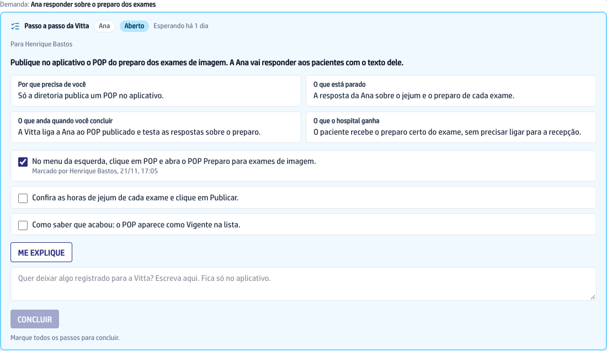

4. Faça os outros passos e marque um por um. O último é o **Como saber que acabou**: confira o que ele diz antes de marcar.
5. Se quiser deixar algo registrado para a Vitta, escreva no campo **Sua anotação (opcional)**. A anotação fica só no aplicativo.
6. Clique em **Concluir**. O botão só libera com todos os checks marcados.
7. Num **Pedido de implantação**, o Concluir pode ficar preso mesmo com todos os checks marcados. Um Pedido de implantação pode esperar outro da mesma entrega, como a abertura de um canal, que espera o teste dele. Nesse caso, o cartão mostra **Espera:** com o nome do outro, o Concluir fica bloqueado, e a linha embaixo dele diz o motivo, por exemplo: Este Pedido espera "testar o checklist no 3º andar" ser concluído. Quando o outro é concluído, o Concluir libera sozinho, sem ninguém precisar fazer nada.

   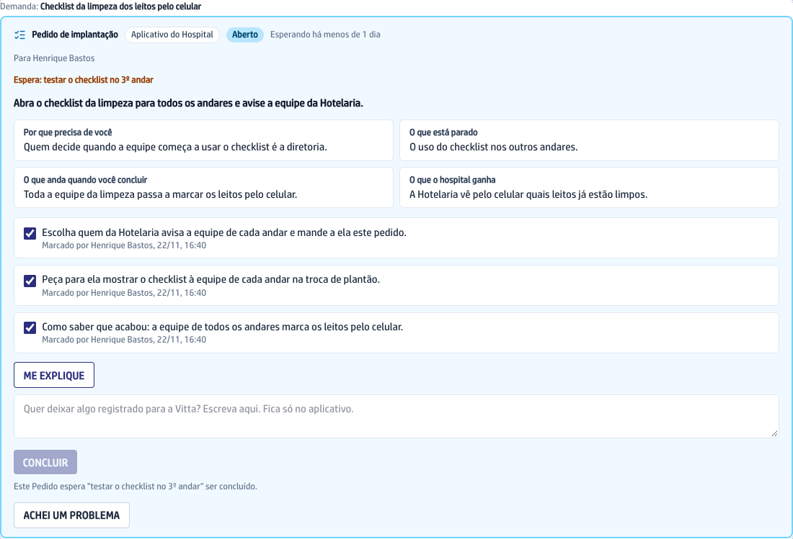

8. O pedido sai da lista **Esperando você** na hora, e o cartão passa a **Concluído**, com o seu nome. A Vitta fica sabendo na hora, e o trabalho que dependia disso segue sozinho, sem ninguém precisar conferir. No Pedido de implantação, o card da entrega já fechou quando o pedido chegou: o Concluir só registra a conclusão nele, sem reabrir nada.
9. Se o cartão mostrar **Não chegou ao GitHub**, o pedido ficou concluído no aplicativo, mas o aviso não chegou à Vitta. O motivo aparece embaixo. Clique em **Reenviar** para tentar de novo. O aplicativo nunca tenta sozinho. No Pedido de implantação, esse aviso pode aparecer já no cartão aberto, quando o card da entrega não fechou no GitHub.

Só a pessoa que o passo a passo espera marca os checks e conclui. Outro Super admin vê o cartão sem poder marcar. Um desenvolvedor da Vitta pode marcar e concluir no seu lugar, e o cartão mostra os dois nomes, como "Concluído por Rafael Moura em nome de Henrique Bastos".

Se o passo a passo fica parado, o aplicativo lembra você uma vez só, depois de 3 dias, no sino e por e-mail, como **Seu passo a passo espera há 3 dias**.

## Avisar um problema na implantação

Quando você acha um problema no meio de um Pedido de implantação, como uma tela que não funciona no teste, o próprio cartão abre o bug para a Vitta. O Pedido continua aberto, e a entrega não é reaberta.

1. No cartão do **Pedido de implantação**, na lista **Esperando você**, clique em **Achei um problema**, embaixo do Concluir. O botão só aparece no Pedido de implantação aberto.
2. A conversa com o Assistente abre já como bug: a pergunta se é um bug ou uma melhoria já vem respondida com **Bug**, e logo depois vem uma mensagem sua que diz qual é o Pedido e de qual entrega ele é. Conte o que aconteceu no campo de baixo, como em qualquer bug.

   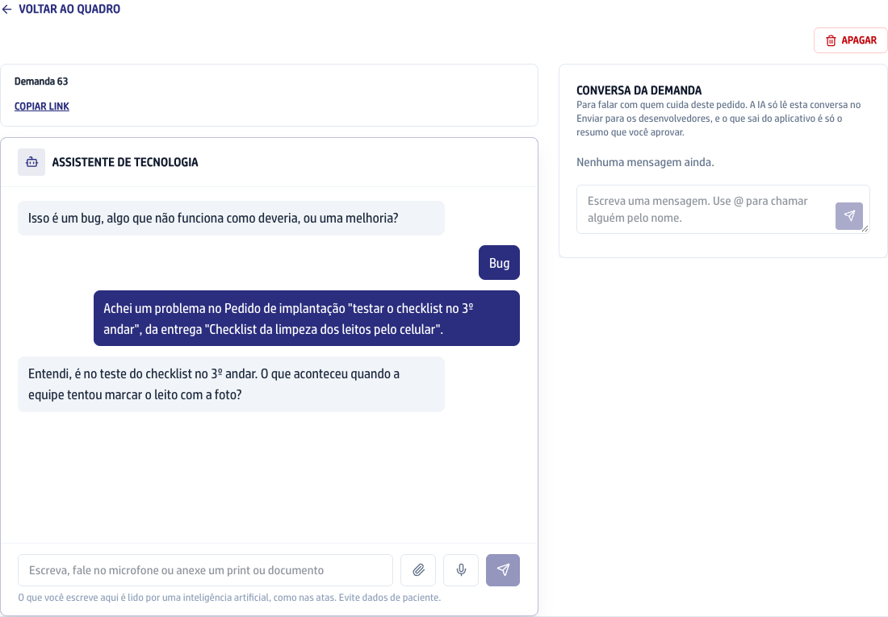

3. Responda as perguntas do bug, como em **Pedir um bug ou uma melhoria ao Assistente**. Nada vai para a Vitta antes do seu clique no fim.
4. Leia o resumo e clique em **Criar o card**. O bug vira uma Demanda nova, que diz de qual entrega veio, e aparece no Quadro.
5. Volte ao cartão do mesmo Pedido de implantação. Ele continua aberto e mostra **Espera a Demanda 63**, com o número do bug. O Concluir fica bloqueado até ela ser entregue, e a linha embaixo dele diz o motivo.

   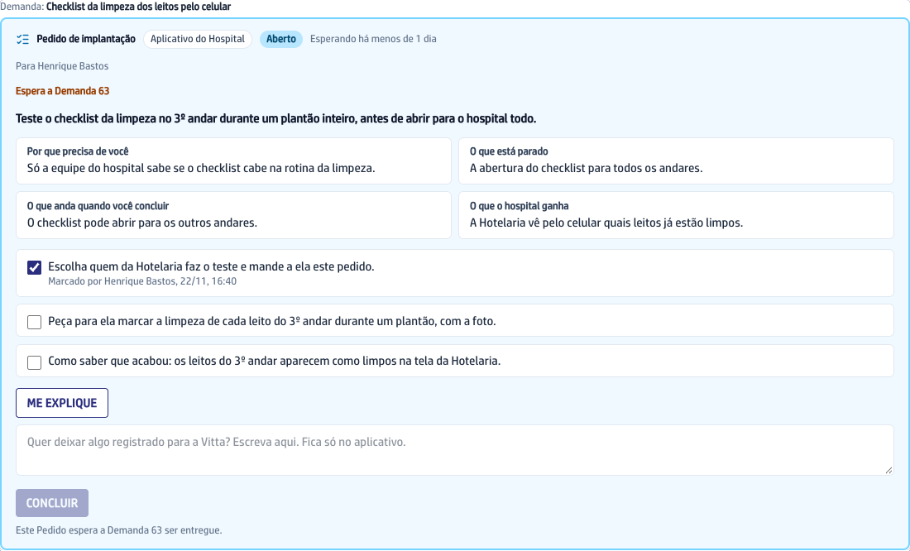

6. Quando a Demanda do bug é entregue, a linha **Espera a Demanda** some e o Concluir libera. Refaça só o passo que falhou, marque o check dele, se ainda não estiver marcado, e clique em **Concluir**.

É um problema por vez: enquanto o Pedido espera uma Demanda de bug, o botão **Achei um problema** some do cartão. O próximo problema entra depois que ela for entregue.

## Pedir explicação ao assistente (Me explique)

Quando a pergunta não está clara, o **Me explique** abre, dentro do cartão, uma conversa só sua com o Assistente de Tecnologia. Ele já conhece o pedido e a pergunta. Ninguém mais vê essa conversa, e nada do Me explique vai para a Conversa da Demanda.

1. Abra o cartão da pergunta, na lista **Esperando você** ou na Conversa da Demanda, como nos passos 3 e 4 de **Responder uma pergunta da Vitta**. O **Me explique** também aparece no cartão do passo a passo, e o rascunho dele vai para o campo da anotação.
2. No cartão, clique em **Me explique**. O botão só aparece para a pessoa que a pergunta espera.
3. Leia a explicação. O Assistente começa explicando a pergunta e o que cada opção muda. Se você fechar e abrir de novo, a conversa continua de onde parou.

   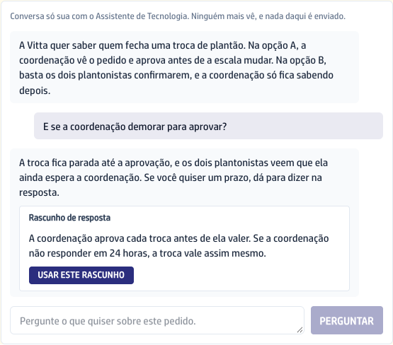

4. Para tirar uma dúvida, escreva no campo embaixo da conversa e clique em **Perguntar**.
5. Quando o Assistente propõe um **Rascunho de resposta**, clique em **Usar este rascunho**. O texto vai para o campo da resposta, no cartão.
6. Confira o texto, mude o que quiser e clique em **Responder**, no cartão. A resposta só sai nesse clique.
7. Para fechar a conversa, clique de novo em **Me explique**.

## Mandar o que você escreveu aos desenvolvedores

Quando o pedido já virou card, a Conversa da Demanda guarda o que você escreve. Quem cuida do pedido lê a conversa no aplicativo e recebe o aviso de cada mensagem sua no sino e por e-mail. O plano do pedido só muda quando você manda: escreve quantas mensagens quiser e, no fim, aperta um botão. Do aplicativo sai só o resumo que você aprovou, e ele vira uma tarefa no plano do pedido.

1. No Quadro, clique no card do pedido e, no alto do painel, clique em **Conversar**.
2. Escreva o que quer mudar ou responder na caixa embaixo da conversa e clique no botão de enviar, ao lado dela. Mande quantas mensagens quiser: cada uma fica guardada na conversa.
3. Quando terminar, clique em **Enviar para os desenvolvedores**, embaixo da caixa. O botão fica desligado enquanto não há mensagem sua nova desde o último envio, e só aparece para quem é do hospital.
4. Leia o **Entendi assim:**, que aparece na conversa. Ele traz, em tópicos, o que a IA entendeu das suas mensagens e o que muda em cada parte do pedido, com o número da parte.

   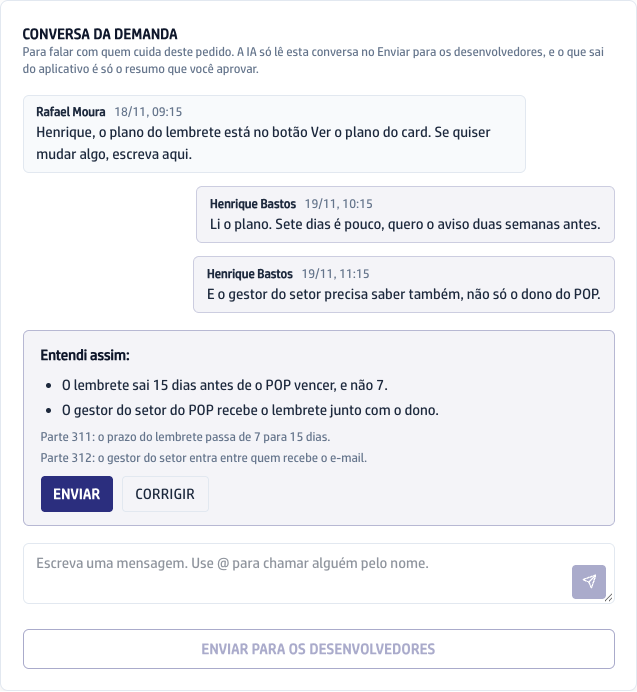

5. Se o resumo estiver certo, clique em **Enviar**. Se faltou algo ou alguma coisa está errada, clique em **Corrigir**: o Entendi assim fecha e o cursor vai para a caixa de mensagem. Escreva o que faltou, clique no botão de enviar, ao lado da caixa, e clique de novo em Enviar para os desenvolvedores. O resumo seguinte já leva em conta o que você escreveu.
6. Depois do Enviar, a conversa ganha a linha **Enviado aos desenvolvedores**, com a data, a hora e os tópicos que você aprovou. O que você escrever depois dessa linha entra no próximo envio.

   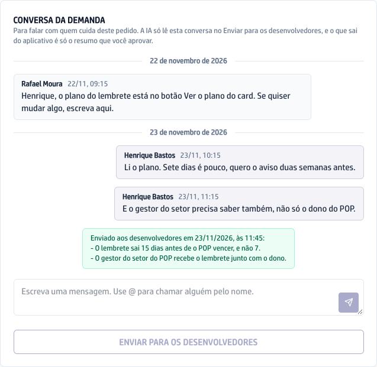

Se o envio falhar, a tela diz o motivo e mostra **Tente de novo**, sem perder nada do que você escreveu.

## Filtrar por Projeto

A aba junta os pedidos do Aplicativo do Hospital, da Ana, a agente de atendimento, e dos projetos novos da Vitta que já têm pedido na aba. Cada card traz um selo com o nome do Projeto.

1. No Quadro, na barra de filtros, clique no campo **Projeto**.
2. Escolha **Aplicativo do Hospital**, **Ana** ou o nome de um projeto novo da Vitta. O Quadro passa a mostrar só os pedidos daquele Projeto.

   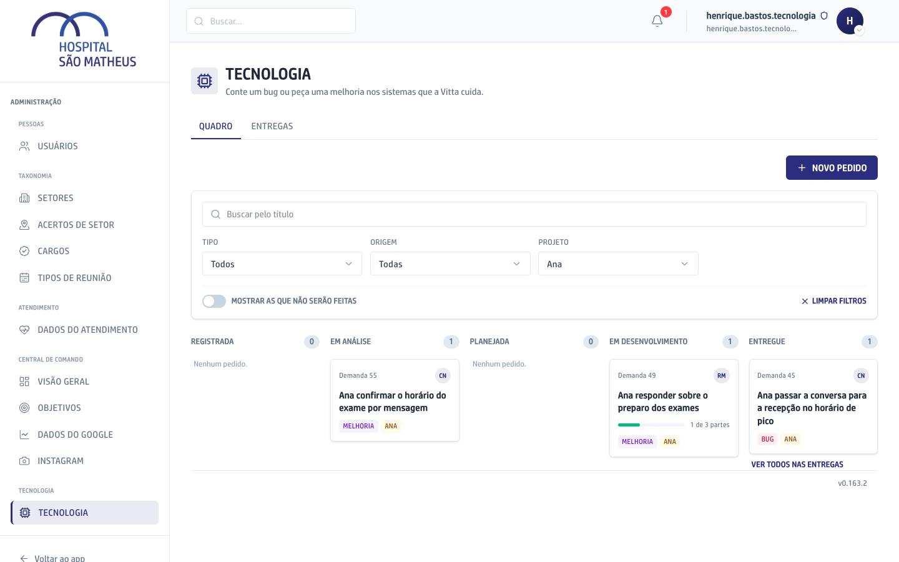

3. Para voltar a ver tudo, escolha **Todos** no mesmo campo ou clique em **Limpar filtros**.

O Projeto combina com os outros filtros da barra, o Tipo e a Origem, e com a busca pelo título. Os pedidos da Ana são só para acompanhar: o Assistente cria card apenas no Aplicativo do Hospital. Nas Entregas, o filtro Projeto é a fileira de botões **Todos**, **Aplicativo do Hospital**, **Ana** e um botão para cada projeto novo, no alto.

## Ver as Entregas

1. No alto da aba Tecnologia, clique em **Entregas**.
2. Leia os números do alto: quantos pedidos chegaram e quantas entregas saíram nas últimas 4 semanas, comparados com as 4 anteriores.
3. Veja o gráfico das últimas 12 semanas. Cada barra mostra as entregas da semana pelo tamanho, **P**, **M** ou **G**, conforme o número de partes. Passe o mouse numa barra para ver o que saiu naquela semana. Clique nela para a lista de baixo mostrar só aquela semana.

   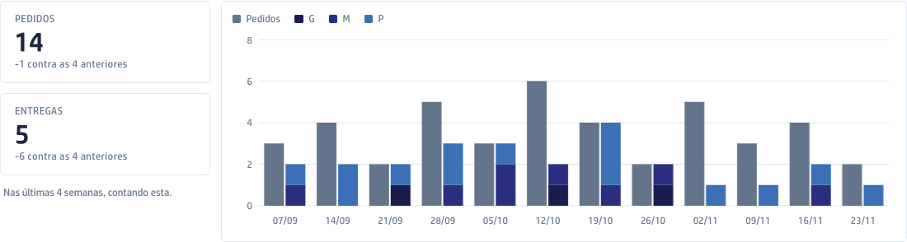

4. Em **O que foi entregue**, veja as entregas agrupadas por semana, a mais nova em cima. Cada linha diz o tamanho, o título, se é bug ou melhoria, a versão e a data.
5. Passe o mouse numa linha, ou clique nela, para ver o que a entrega muda. Ali ficam os botões **Abrir o card** e **Copiar link** e, quando houver vídeo, **Demonstração**.

   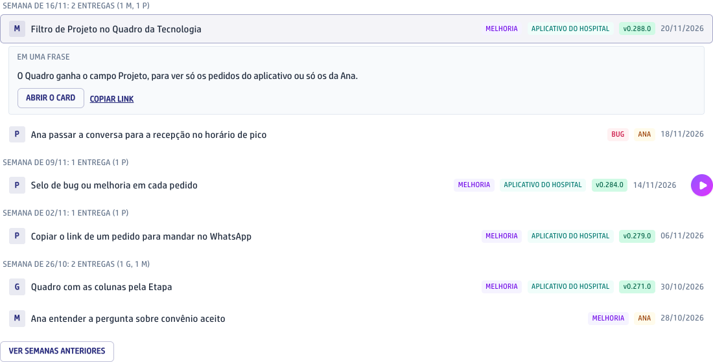

6. No fim da lista, clique em **Ver semanas anteriores** para buscar as entregas mais antigas.

Os filtros do alto, **Bug** ou **Melhoria**, a Origem e o Projeto, valem para os números, para o gráfico e para a lista.

## O caminho de um pedido

```fluxograma
inicio conversa 1,1: Conversa com o Assistente | Você clica em Novo pedido e conta o que precisa, por texto, voz, print ou documento.
decisao tipo 2,1: Bug ou melhoria?
passo bug 3,1: Perguntas do bug | No máximo cinco: onde, o que aconteceu, o que esperava, como repetir e o print.
passo melhoria 3,2: Perguntas da melhoria | Uma por vez, num cartão com duas opções e a recomendada em destaque.
passo resumo 4,1: Resumo | O Assistente junta o que você disse. Em Quem cuida disto?, você escolhe quem da Vitta vai cuidar.
decisao bateu 5,1: O resumo bateu?
passo naobateu 5,2: Não bateu | Você diz o que está errado, e a conversa continua até o resumo ficar certo.
passo card 6,1: Criar o card | O pedido vai para a Vitta e aparece no Quadro.
passo analise 7,1: Em análise | A Vitta lê a melhoria e decide como fazer. O bug pula esta Etapa e entra direto na fila.
passo planejada 7,2: Planejada | O trabalho está dividido em partes e na fila. Quando o plano está publicado, o card mostra o botão Ver o plano.
passo desenvolvimento 7,3: Em desenvolvimento | A Vitta está fazendo. Num pedido com partes, o card mostra quantas já foram entregues.
passo entregue 7,4: Entregue | O trabalho terminou.
passo producao 8,4: Em produção | A entrega chegou ao aplicativo, e o card mostra a versão.
passo implantacao 9,4: Implantação | Se falta o hospital fazer algo para usar a entrega, como um teste ou um treinamento, o card ganha a seção Implantação e o selo Implantação 1 de 3. Cada Pedido de implantação tem passos com check.
decisao problema 10,4: Achei um problema?
passo bugdaimplantacao 10,5: Demanda de bug | O Assistente abre o bug com o nome do Pedido. O Pedido mostra Espera a Demanda, e a entrega não reabre.
fim emuso 11,4: Em uso | Os Pedidos de implantação estão concluídos, e a entrega está em uso.
passo envio 8,2: Enviar para os desenvolvedores | Com o card criado, você escreve na Conversa da Demanda quantas mensagens quiser e aperta o botão.
decisao entendi 9,2: O Entendi assim bateu?
passo corrigir 9,1: Corrigir | Você manda na Conversa uma mensagem com o que faltou e aperta o botão de novo.
passo enviado 10,2: Enviado aos desenvolvedores | A Conversa ganha a linha com a data e os tópicos. Do aplicativo sai só o resumo que você aprovou, e os desenvolvedores ajustam o plano.
passo pergunta 8,3: Pergunta da Vitta | Em qualquer Etapa, quando o trabalho para numa decisão sua, chega o aviso Pede sua resposta, no sino e por e-mail.
passo lista 9,3: Esperando você | O aviso abre a lista no alto da aba, com o cartão da pergunta em destaque.
passo responder 10,3: Responder no cartão | No pedido, em Conversar, você clica numa opção ou escreve. Com dúvida, o Me explique ajuda.
passo resolvida 11,3: Resolvida | A Vitta lê a sua resposta e dá o ok. Só então o trabalho anda.
conversa -> tipo
tipo -> bug: bug
tipo -> melhoria: melhoria
bug -> resumo
melhoria -> resumo
resumo -> bateu
bateu -> card: sim
bateu -> naobateu: não
naobateu -> resumo
card -> analise: melhoria
card -> planejada: bug
analise -> planejada
planejada -> desenvolvimento
desenvolvimento -> entregue
entregue -> producao
producao -> implantacao
implantacao -> problema
problema -> bugdaimplantacao: sim
problema -> emuso: não
bugdaimplantacao -> implantacao: corrigido
planejada -> envio: quer mudar algo
envio -> entendi
entendi -> enviado: Enviar
entendi -> corrigir: Corrigir
corrigir -> envio
desenvolvimento -> pergunta: decisão sua
pergunta -> lista
lista -> responder
responder -> resolvida
resolvida -> desenvolvimento
```
