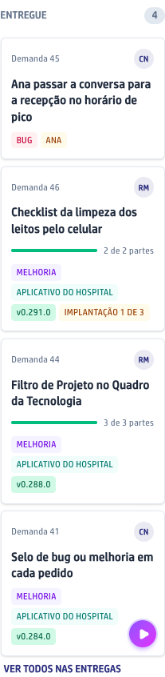

A Tecnologia é onde você acompanha o que a Vitta, a empresa que cuida dos sistemas do hospital, está fazendo no aplicativo e na Ana. Cada pedido vira uma Demanda, e a aba mostra em que fase ela está e o que já foi entregue. A aba só acompanha: nada se pede nem se responde por ela.

O pedido nasce em dois lugares. A melhoria você pede pelo seu Claude, no seu computador: ele faz as perguntas, monta o protótipo e abre o card no GitHub, e o card aparece sozinho no Quadro. O bug você relata pelo robô do canto inferior direito, o Assistente do app, e ele aparece no Quadro, em Registrada, assim que você responde às perguntas. Ao abrir o pedido, o painel mostra de onde ele veio: **Pedido do diretor** ou **Relato no app**. Veja **Tirar uma dúvida ou relatar um bug no Assistente**, na página Início. O que pede uma ação sua, como uma decisão ou uma tarefa, chega como card no seu nome no GitHub, com o aviso do próprio GitHub.

A aba fica na área de Administração, e só o Super admin vê. Ela tem duas partes no alto: **Quadro**, com a fase de cada pedido, e **Entregas**, com o que já foi entregue. No celular, o Quadro vira uma lista dos pedidos.

## Acompanhar o pedido no Quadro

1. No menu da esquerda, clique em **Admin** e, na seção **Tecnologia**, clique em **Tecnologia**. A aba abre no **Quadro**.
2. Veja os seus pedidos em colunas, uma para cada Etapa: Registrada, Em análise, Planejada, Em desenvolvimento e Entregue. A Etapa muda sozinha conforme a Vitta trabalha; não dá para arrastar o card de uma coluna para outra. No alto de cada coluna aparece quantos pedidos ela tem. O bug do Assistente fica em Registrada até você clicar em **Enviar à Vitta**.

   

3. Em cada card, veja o número da Demanda, o título, o selo **Bug** ou **Melhoria**, o Projeto, as iniciais de quem cuida, a versão quando ele já está Em produção e, quando o pedido tem partes, quantas já foram entregues. Quando falta o hospital fazer alguma coisa para começar a usar a entrega, o card mostra o selo da Implantação: veja **Ver o que falta para começar a usar**, logo abaixo.
4. Quando o pedido já tem um plano publicado, o card mostra no canto o botão quadrado **Ver o plano**, com o ícone de apresentação. Clique nele para abrir a página do plano em outra aba. Um check verde no botão quer dizer que você já validou aquele plano. Ao abrir o card, o cartão **Plano** também leva à página. Para validar, continue usando o link do e-mail.

   

5. Clique num card. Ele abre num painel à direita, só para ler: a Etapa, de onde veio o pedido (**Pedido do diretor**, **Relato no app** ou **Vitta**) e o documento do pedido, com o que ele muda para você, as partes e as datas.

   

6. Em **Partes**, veja em que ordem o pedido entra. As partes vêm agrupadas por Onda: a **Onda 1** tem as que não dependem de outra parte do pedido, e cada Onda seguinte entra depois das que ela espera. Cada parte traz o seu número, como **#304**, para você citar aquela parte quando falar com a Vitta. Se a parte ainda espera outra terminar, aparece embaixo dela a linha **Espera a #304**. Quando a outra é de um pedido diferente, a linha diz **Espera a #288, de outro pedido**. A linha some sozinha quando a outra parte termina.

   

7. Para fechar o painel, clique no X ou aperte Esc. O botão **Ampliar** abre o pedido na tela toda, e o **Voltar ao quadro** traz as colunas de volta.

A coluna Entregue mostra o que foi entregue nos últimos 30 dias; o **Ver todos nas Entregas**, no pé dela, abre o histórico inteiro. Os pedidos que não serão feitos ficam fora das colunas: para vê-los, ligue **Mostrar as que não serão feitas**, na barra de filtros. O link de um aviso do sino ou do e-mail sobre um pedido abre o pedido no painel. O aviso antigo que pedia a sua resposta ou a sua ação, e o lembrete dele, abrem só a aba, no Quadro, sem pedido aberto.

## Ver o que falta para começar a usar

Às vezes a entrega já está no ar, mas falta o hospital fazer alguma coisa para começar a usá-la, como um teste, uma configuração ou um treinamento. Cada uma dessas coisas é um card de implantação no seu nome no GitHub, ligado ao card da entrega. Você passa o card a quem vai fazer e fecha o card no GitHub quando o hospital terminou. A aba mostra quantos faltam.

1. No Quadro, procure o card com o selo **Implantação 1 de 3**. O primeiro número diz quantos cards de implantação já foram fechados, e o segundo, quantos são ao todo.

   

2. Clique no card. No painel, a seção **Implantação** vem logo depois de O que muda. Ao lado do título aparece quantos já foram feitos, como **1 de 3 feitos**. Cada linha é um card de implantação, com o que é, a situação, **Feito** ou **Aberto**, e com quem ele está.

   

3. Para andar com o que está **Aberto**, abra o card de implantação no GitHub, pela notificação ou pela lista dos cards no seu nome, e passe a quem vai fazer.
4. Quando o hospital terminar, feche o card no GitHub. A conta anda sozinha: a linha passa a **Feito**, e o número do selo sobe.

Quando todos os cards de implantação estão fechados, o selo some do Quadro. A entrega fica Em produção mesmo com a implantação por fazer: o que falta para usar não segura a entrega. A entrega sem card de implantação não tem a seção nem o selo.

## Filtrar por Projeto

A aba junta os pedidos do Aplicativo do Hospital, da Ana, a agente de atendimento, e dos projetos novos da Vitta que já têm pedido na aba. Cada card traz um selo com o nome do Projeto.

1. No Quadro, na barra de filtros, clique no campo **Projeto**.
2. Escolha **Aplicativo do Hospital**, **Ana** ou o nome de um projeto novo da Vitta. O Quadro passa a mostrar só os pedidos daquele Projeto.

   

3. Para voltar a ver tudo, escolha **Todos** no mesmo campo ou clique em **Limpar filtros**.

O Projeto combina com os outros filtros da barra, o Tipo e a Origem, e com a busca pelo título. O pedido de um projeto novo da Vitta mostra, no painel, o nome do projeto e o link **Abrir o plano**, e fica em Registrada, porque o aplicativo não acompanha o trabalho desse projeto. Nas Entregas, o filtro Projeto é a fileira de botões **Todos**, **Aplicativo do Hospital**, **Ana** e um botão para cada projeto novo, no alto.

## Ver as Entregas

1. No alto da aba Tecnologia, clique em **Entregas**.
2. Leia os números do alto: quantos pedidos chegaram e quantas entregas saíram nas últimas 4 semanas, comparados com as 4 anteriores.
3. Veja o gráfico das últimas 12 semanas. Cada barra mostra as entregas da semana pelo tamanho, **P**, **M** ou **G**, conforme o número de partes. Passe o mouse numa barra para ver o que saiu naquela semana. Clique nela para a lista de baixo mostrar só aquela semana.

   

4. Em **O que foi entregue**, veja as entregas agrupadas por semana, a mais nova em cima. Cada linha diz o tamanho, o título, se é bug ou melhoria, a versão e a data.
5. Passe o mouse numa linha, ou clique nela, para ver o que a entrega muda. Ali ficam os botões **Abrir o card** e **Copiar link** e, quando houver vídeo, **Demonstração**.

   

6. No fim da lista, clique em **Ver semanas anteriores** para buscar as entregas mais antigas.

Os filtros do alto, **Bug** ou **Melhoria**, a Origem e o Projeto, valem para os números, para o gráfico e para a lista.

## O caminho de um pedido

```fluxograma
inicio claude 1,1: No seu Claude | Melhoria: o seu Claude faz as perguntas, monta o protótipo e abre o card no GitHub.
inicio assistente 1,2: No Assistente do app | Bug: o robô do canto inferior direito faz as perguntas do bug e mostra o resumo.
passo quadro 2,1: No Quadro | O pedido aparece sozinho na aba. O bug aparece em Registrada assim que você responde às perguntas do robô.
passo enviar 3,2: Enviar à Vitta | O bug só vai para a Vitta com o seu clique, no resumo do Assistente. Até lá, fica em Registrada.
passo analise 4,1: Em análise | A Vitta lê a melhoria e decide como fazer. O bug pula esta Etapa e entra direto na fila.
passo planejada 4,2: Planejada | O trabalho está dividido em partes e na fila. Quando o plano está publicado, o card mostra o botão Ver o plano.
passo desenvolvimento 4,3: Em desenvolvimento | A Vitta está fazendo. Num pedido com partes, o card mostra quantas já foram entregues. Se ela precisa de você, chega um card no seu nome no GitHub.
passo entregue 4,4: Entregue | O trabalho terminou.
passo producao 5,4: Em produção | A entrega chegou ao aplicativo, e o card mostra a versão.
decisao falta 6,4: Falta algo para usar?
passo implantacao 6,3: Implantação | Cada coisa que o hospital faz vira um card de implantação no seu nome no GitHub, e o card da entrega mostra o selo Implantação 1 de 3.
fim emuso 7,4: Em uso | A entrega está em uso no hospital.
claude -> quadro: melhoria
assistente -> quadro: bug
quadro -> analise: melhoria
quadro -> enviar: bug
enviar -> planejada
analise -> planejada
planejada -> desenvolvimento
desenvolvimento -> entregue
entregue -> producao
producao -> falta
falta -> implantacao: sim
falta -> emuso: não
implantacao -> emuso: cards fechados
```
